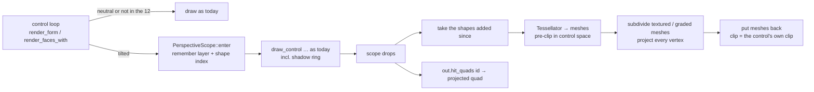

# Plan — 3D perspective for display controls

- **Status:** implemented in 1.91.39
- **Spec:** ./spec.md   **Date:** 2026-10-13

## 1. Approach

**One projection, applied to what a control has just painted.** A control's face is already
drawn by one painter per surface (`render_faces_with` for the designer canvas and static
faces, `render_form` for Preview, Run Form and the compiled binary — spec 017). The change
does not touch those painters. A new module, `cobolt-forms::perspective`, **captures the
shapes a control just added to its layer**, turns them into meshes, **projects every vertex**
with a pin-hole camera, and puts the meshes back in place of the shapes. A control at the
defaults never enters it (R6).

**Why this seam (R7, R8).** Every `draw_control` call, every shadow, every chart mark and
every glyph is a shape on the painter's layer list. egui exposes exactly what is needed, all
read in `egui-0.36.1` / `epaint-0.36.1` on 2026-10-13: `PaintList::next_idx`,
`all_entries`, `mutate_shape` and `reset_shape` (`egui/src/layers.rs`), reached through
`ctx.graphics_mut`; and `epaint::Tessellator::new(pixels_per_point, options, font_tex_size,
prepared_discs)` with `tessellate_shape(shape, &mut Mesh)` — public — whose `font_tex_size`
egui itself takes from `ctx.fonts(|f| f.font_image_size())`. A projective map sends straight
lines to straight lines and triangles to triangles, so a flat-coloured mesh projects exactly
by moving its vertices; only a mesh with an **attribute** that varies across it (an image's
UVs, a gradient's colours) needs its triangles cut small enough for the affine interpolation
inside a triangle to be right (R7's "not smeared").

**The projection (R2–R5), with the sign of R3.** For a control whose designed rectangle
(after the animation transform) has centre `c`, size `w × h` and `M = max(w, h)`; a point `p`
of its plane, relative to `c`, is lifted to `(x, y, 0)`:

1. `RotateX` = θx: `y₁ = y·cos θx`, `z₁ = −y·sin θx` (the top, `y < 0`, moves away for θx > 0).
2. `RotateY` = θy: `x₂ = x·cos θy − z₁·sin θy`, `z₂ = z₁·cos θy + x·sin θy`
   (the right, `x > 0`, moves away for θy > 0), `y₂ = y₁`.
3. Camera: `D(d) = D_ref · 2^((50 − d)/50)` with `D_ref = K·M`, `K = 2.0` to start;
   focal length `F = D_ref`. Screen point `= c + (x₂, y₂) · F / (D + z₂)`.

Consequences, each an acceptance criterion: a flat control (θ = 0) is scaled about `c` by
`F/D = 2^((d−50)/50)` — 0.5 at `d` = 0, exactly 1 at 50, 2 at 100 (AC4); the centre maps to
`c` (R4); nearer edges (`z₂ < 0`) are longer and farther ones shorter (AC3); a smaller `D`
(larger `d`) gives a larger ratio between the two (R5). **`D + z₂ > 0` for every input**: the
smallest `D` is `K·M/2 = M` and `|z₂|` never exceeds the half-diagonal, `≤ 0.71·M`, so the
divisor is at least `0.29·M` and the projected outline is always a convex quad — which is
what lets a hit test be "inside the quad" (R10). `K` is a constant to be **calibrated by eye
against the reference picture** (AC12): at `K = 2`, `RotateY` = −30 gives edge lengths in the
ratio about 0.78, close to the picture's.

**Clipping (R9).** A shape on the list carries its own clip rectangle. Two cases, decided
by comparing it with the painter's clip when the scope was entered (`outer`):
- *tighter than `outer`* (a control clipping its own content — a chart's plot area, a caption
  held to its box): it is a clip in **control space**, so the triangles are cut to it
  (Sutherland–Hodgman against a rectangle) **before** projecting, and the meshes carry `outer`;
- *`outer` or wider* (the container's content rectangle, the form rectangle for a layer; a
  shadow's wider room): it is a clip in **screen space**, so nothing is cut early and the
  meshes keep it.

**Hit testing (R10).** `out.hit_quads: HashMap<String, [Pos2; 4]>` holds the projected
outline of each tilted control. The places that today ask `rect.contains(p)` of a control's
rectangle — `control_pointer_events` (its `over`), `owns_pointer_at`,
`controls_under_the_owner`, `paints_at` — ask one new function, `hit(out, id, rect, p)`,
which is the quad when there is one and the rectangle when there is not. The designer is
left on the designed rectangle on purpose (R11): `render_faces_with` returns `control_rects`
unchanged, which is what selection, handles and drag read.

**Scope of types (R1, R16).** One predicate, `ControlType::has_perspective()`, lists the
12; `Control::new` seeds the three properties for those and for no other; the render path
reads them through `Perspective::of(&Control) -> Option<Perspective>`, which answers `None`
for any other type (so a hand-edited property on a Button is ignored — the loader keeps it,
`xml.rs`, but nothing reads it), for the neutral triple, and for non-finite text.

**Write path (R12).** Both COBOL write paths — `obj_set` and `set_member` — pass the value
through `canonical_prop_value` → `cobolt_forms::model::property_runtime_text(class, key,
stored)`, today only a boolean canonicaliser. The clamp to `[−60, 60]` and `[0, 100]` goes
there, so a write of 200 is stored, mirrored to the host and read back as 60, in all three
hosts at once (`rcrun run-form`, embedded child forms, the compiled binary) with no
per-host code.

**Label (R14).** In `render_form` the Label arm calls `draw_control_capturing_label` and hosts
the caption in egui's selectable label. While a Label is tilted the arm calls
`draw_control` instead (caption painted, so it is inside the scope and projected) and does not
host the label; its tab stop and `onGotFocus` come from the tab-target collection
(`collect_tab_targets`), which does not depend on the hosted label's drawing — **T9 reads
and proves that before the arm is changed**.

## 2. Affected crates / files
- `crates/cobolt-forms/src/perspective.rs` — **new**: `Perspective` (+ `of`, clamp), the
  projection and its quad, `PerspectiveScope` (enter / drop → capture, tessellate, pre-clip,
  subdivide, project, put back), the quad hit test, mesh helpers. Pure functions first, the
  egui part thin.
- `crates/cobolt-forms/src/lib.rs` — `pub mod perspective;`.
- `crates/cobolt-forms/src/model.rs` — `ControlType::has_perspective()`; the three property
  names and ranges as consts; seeding in `Control::new`; the clamp in `property_runtime_text`.
- `crates/cobolt-forms/src/render.rs` — a `PerspectiveScope` around each control's painting in
  `render_form` (the loop that holds ~30 `draw_control` arms) and in `render_faces_with` (one
  `draw_control`); `RenderOutput.hit_quads`; the four hit tests above; the Label arm; the
  `ui.interact` rectangles of the arms of the 12 types become the quad's bounding box while
  tilted (cursor and tooltip follow what is seen).
- `crates/cobolt-ide/src/panels/properties.rs` — a "3D perspective" section with three
  `int_prop_row`s for the 12 types.
- `crates/cobolt-ide/src/prop_help_data.rs` — three `PropHelp { ty: "", … }` entries (the
  `ty: ""` form applies to every control, so one entry per property, not 36), six languages.
- `crates/cobolt-ide/src/ui_text_data.rs` — the section title and any row label, six languages.
- `crates/cobolt-compiler/src/lib.rs` — the System KB's property table (it is keyed by property
  name, so three arms) and `assets/knowledge/chunked.data` regenerated with
  `cargo run -p cobolt-ide --example build_chunked_kb`.
- `docs/developers-guide-en.md` — a subsection on 3D perspective, with the reference picture
  (English only; the translations the edit invalidates are deleted, per GOLDEN RULE #8).
- `examples/PowerDemo3/forms/General/perspective-form.cfrm` (+ its project entry and the two
  render goldens, the corpus counts 75 → 76 in the tests that hold them) — **optional**, the
  demo the Layers feature also had (T16); drop it for a smaller change.
- `crates/cobolt-ide/src/version.rs`, `CHANGELOG.md` — **1.91.39**: 1.91.36–38 went to `fixes`
  and were merged into `main` first.
- Tests: `crates/cobolt-forms/tests/` (new files named for what they hold), the parity guard
  in `render.rs`, the Properties-pane drawing test in `cobolt-ide`, the form-host run test.

## 3. Data / model changes
- **`.cfrm`:** three more `<Property>` rows on each of the 12 types, written like any other;
  no schema change. A form saved before this feature loads with the properties absent; every
  reader goes through `Perspective::of`, which treats an absent property as the default, so it
  looks as it did (R13). A form saved after it carries the three defaults on those types —
  what every seeded property does (the same happened to `AutoCommit` in spec 095).
- **`RenderOutput`:** one new map, `hit_quads`. Empty for a form with no tilted control.
- **No change** to `Form`, `Layer`, the layout engine, the event model or codegen (§6 of the spec).

## 4. Key decisions & alternatives
- **Project the captured shapes** — *why:* it reuses every painter unchanged and stays vector
  (crisp text and lines); one seam serves four surfaces; neutral controls never enter it.
  *Rejected:* **(a)** hooking each `draw_control` call (about 30 in `render_form`) — one missed
  arm is a control that ignores its tilt on one surface; **(b)** rendering the control to an
  off-screen texture and drawing that on a projected quad — needs a texture lifecycle, resamples
  text into blur, and re-rasterises on the CPU every frame a chart changes (the CPU rasteriser
  exists, `raster.rs`, and is **the fallback if T1 fails**); **(c)** an affine `TSTransform` — it
  cannot make an edge shorter, which is the whole of perspective.
- **A `Drop` scope, not a closure** — the render loop has `continue`s and early arms; a guard
  finishes the capture however the iteration ends. It records `(layer, start index)` and works
  on that layer's list only.
- **Subdivide only meshes with a varying attribute** — a mesh whose vertices share one colour
  and one UV (every flat fill and every stroke) is projected as it is; an image or a gradient
  has its edges cut to at most 24 points before projection (a bounded, tested count).
- **`PerspectiveDistance` is a camera distance on a 2^x scale** (`D = D_ref·2^((50−d)/50)`):
  equal steps feel equal, 50 is exactly the identity, and the extremes (×0.5 and ×2) are a
  stated range, not an accident. *Rejected:* a linear distance (steps feel uneven; no clean 1.0).
- **Whole degrees and whole 0–100** (spec Q4) — the pane's `int_prop_row`, the `.cfrm`'s `Int`,
  and COBOL's `MOVE 30 TO …` all stay integers; a Timer steps a degree at a time.
- **Clamp at write, not at read only** (R12) — the render side clamps too (`Perspective::of`),
  but a COBOL read must answer what the control now is; one normaliser, `property_runtime_text`.
- **The designer keeps the designed rectangle** (R11) — selection and handles never depend on
  a projection, so a control can always be grabbed; the cost is that a strongly tilted control's
  handles sit on the flat rectangle, which the spec accepts.
- **No notch mask on a tilted control** — the 12 types are not containers, so `notch_mask_rounding`
  already answers `None`; the arc is projected with the rest and never repaired (skill
  `rounded-corners`).

## 5. Risks & mitigations
- **Text through `Tessellator`.** `Shape::Text` must tessellate to glyph quads outside egui's own
  frame loop, with the right atlas size, and the atlas can grow in the same frame. → **T1 is a
  spike with a go/no-go**: tessellate a chart's captured shapes and compare the glyph quads with
  what egui's own pass produces for the same shapes; if it fails, take fallback (b) of §4.
- **Clip semantics** are the subtle part (a shadow painted with a wider clip, a plot area with a
  tighter one). → The two-case rule of §1 is a pure function with its own table test (T5), and AC7
  checks the painted bounds for a control inside a Panel and on a layer.
- **Cost.** Tessellating twice (ours, then egui's) for the shapes of a tilted control only. → AC14
  measures 1 and 8 tilted charts against untilted, in `bench_render_frame.rs`; if a chart is too
  dear, the capture can be cached by the control's property digest (the bench decides, not a guess).
- **egui `Shape::Callback`** cannot be projected. → None of the 12 types paints one; the scope
  leaves a callback shape in place and a test asserts the 12 types paint none.
- **Hover and cursor** use `ui.interact(screen)`, a rectangle, so a control enlarged past its
  designed box has no pointing-hand cursor out there. → The arms of the 12 types interact with the
  quad's bounding box while tilted; the **events** are exact either way (the quad), the cursor is
  within the box.
- **Extreme combinations** (60°, distance 100) enlarge the near edge ×3.5. → That is "closer"; the
  clip of R9 bounds the damage, and the guide says so.
- **Animation transform** (`RenderTransform`: shift, scale, alpha) already moves a control. →
  The projection is applied to the rectangle **after** it (`screen`), and a test runs both.
- **Goldens.** → Neutral controls take the old path untouched (AC2), so no golden moves; the
  demo form (T16) adds two.

## 6. Test strategy
Each test prints the numbers it checked, as the other files of `cobolt-forms/tests/` do.
- `cobolt-forms/tests/perspective_projection.rs` — **pure geometry**: the four edge lengths for
  `RotateX`/`RotateY` ±30 (AC3); size and edge ratio over distance 0/25/50/75/100 (AC4); the
  centre fixed; `D + z₂ > 0` swept over the whole range of the three properties (a 61×61×101
  grid, the minimum divisor printed); the quad is convex everywhere.
- `…/perspective_shapes.rs` — **a painted control**: a tilted BarChart, PictureBox and Label
  through the real painter: collinearity of the straight edges (≤ 0.5 px), no degenerate glyph,
  the four image corners on the four outline corners and a mid-edge point landing in perspective
  not in screen halves (AC5); no `Shape::Callback` among the 12 types.
- `…/perspective_clip.rs` — the clip table; a tilted chart in a Panel and on a layer stays inside
  (AC7); a later control in z-order is over it.
- `…/perspective_hit.rs` — the pointer table of AC8, printed; the owner logic of spec 091 with a
  tilted control over a button.
- `…/perspective_neutral_is_free.rs` — shapes of each of the 12 types at the defaults equal the
  shapes of the previous path; the **75-form corpus goldens** run unregenerated (AC2).
- The parity guard `engine_reference_form_parity_static_vs_faces` gains a tilted chart, picture and
  shape (AC6); the designer test for selection on the designed rectangle (AC9).
- `cobolt-form-host`: a form whose handler writes `RotateY` 0 → 30 and `RotateX` 200; the next
  frame's outline, and the read-back 60 (AC10) — then the same in the compiled-binary host
  (skill `interpreter-binary-parity`, read in T11).
- `cobolt-ide`: the Properties pane drawn for each of the 12 types in six languages, none of its
  words left in English (the probe used for the other panes); the KB freshness guard; the
  property-help audit.
- `tests/controls/`: the existing generic `assert_control` per type already round-trips every
  seeded property, so the 12 files cover the new three with no edit; one new test asserts the
  other types do not seed them (AC1).
- **Visual, by a person (AC12):** render the reference scene with `render_form`, look at it, and
  compare with the operator's picture: the left edge shorter than the right at `RotateY` ≈ −30,
  the border and text turning with the chart, no stair-steps on the arc of the rounded corners,
  text legible; then the same scene in the Designer and Run Form windows. Tune `K` here.

## 7. Steering compliance
- [x] i18n: the section title, the three help lines (`prop_help_data.rs`, 6 languages) and any
  row label (`ui_text_data.rs`, 6 languages); the Properties-pane drawing test holds it.
- [x] Generated-code banner + regenerate-on-action contract: untouched (codegen reads no property).
- [x] English Developer's Guide updated; translations the edit invalidates are deleted (GOLDEN RULE #8).
- [x] System KB: property arms in `cobolt-compiler` + `chunked.data` regenerated, same change.
- [x] Fix vs feature: **feature** → branch `features-perspective-3d`, version `z` bump (1.91.39), CHANGELOG
  entry, own commit(s); no merge into `main` and no push until the operator asks.
- [x] No "cobolt" in user-facing text; property names and COBOL identifiers are English.
- [x] Corner rules (`rounded-corners`): no mask, no repair; the arc is projected.
- [x] Three-hosts rule: the write path is `cobolt-forms`' normaliser, shared by all three.
