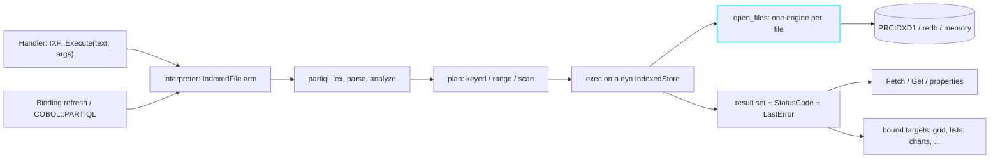

<!--
SPDX-License-Identifier: Apache-2.0
Copyright (c) 2026 Emerson Lopes and PowerRustCOBOL contributors
-->

# Plan — PartiQL for indexed files

- **Status:** approved (operator, 2026-10-29)
- **Spec:** ./spec.md   **Date:** 2026-10-29
- **Branch:** `features-108-partiql` (cut from `main` at 1.91.227; `features` is not held by another worktree, but the
  name the coordinator gave this worktree is kept). Feature, so `features`-class work: never mixed with a fix (rule #5).
- **Operator decisions folded in (2026-10-29):** Q6 yes — `COBOL::"PARTIQL"` and `COBOL::"PARTIQL-FETCH"` built-ins;
  Q8 yes — `SelectedValue` on lists; Q12 — names exactly as the spec writes them; Q13 — numbers keep their decimal
  point in the new binding as written, and the old quick-bind decimals path is a **separate fix on `fixes`**, outside this
  feature's commits; Q5 — no batch; Q7 — the Grid Browser filter and the agents' search tool are separate specs.

Every code anchor below was read on `main` at 1.91.227 (`git -C <worktree>`), not taken from the spec's 1.91.223 line
numbers. Line numbers are the tree's of this date and drift; the function names are the anchors.

## 0. What the check against the tree changed

Seven findings. The first five alter the design; the last two change what the spec says about the tree.

1. **There is no `cobolt-decimal` crate on `main`.** The exact decimal kernel is `CobolNumeric` in
   `crates/cobolt-runtime/src/value.rs` (`mantissa: i128`, `decimals: u8`). `cobolt-decimal` exists only on `2.x.x`, where
   `value.rs` re-exports it (`pub use cobolt_decimal::CobolNumeric`). The executor therefore names `crate::value::CobolNumeric`,
   which is the same type on both lines, and the forward-port needs no edit there.
2. **`SelectedValue` does not exist on a DataGrid, or anywhere.** A DataGrid publishes `ClickedRow` (1-based data row) and
   `ClickedColumn` (`crates/cobolt-forms/src/render.rs`, near the `onRowSelect` push) and answers `GetCellValue(row, col)` and
   `GetSelectedText()`; no control answers `SelectedValue`. The spec's master-detail example (§1, AC9, R30) passes
   `DG-CUSTOMERS::SelectedValue`, but R35 defines the property for lists only. **Decided (O1, 2026-10-29).** The plan builds the
   recommendation (§4, D9).
3. **Control properties reach `exec_method` as numbers when they look like numbers.** `prop_to_value` (`interpreter.rs`, next
   to `is_known_method`) turns a property's text into `CobolValue::Numeric` when it parses. `TXT-SEARCH::Text` holding `2026` is
   then a Number, and R3/R6 (a Number against a String field is an error, Q10) would refuse
   `begins_with(ORDER-DATE, ?)`. **Decided (O2)**; the rule is D6 and the first task is a spike that proves what an
   argument actually is.
4. **The generated facade cannot stay for a form without an FD.** `<id>-OPEN` emits `OPEN INPUT <file>` against a file the form
   never declares, so such a form fails Check today. R10 therefore needs codegen to skip the facade (and the `AutoOpen` /
   close `PERFORM`s) for a control whose file the form's COBOL structure does not declare (`Form::cobol_structure.file_control`,
   `model.rs`). The same predicate decides `AutoCommit`'s default (R24).
5. **Nothing closes `open_files` when a run ends.** `Interpreter::run` (`interpreter.rs:4567`) has no teardown of the keyed
   engines; they are closed by the verbs or by the generated `<id>-CLOSE`. R8 ("closed when the form closes") needs an explicit
   hook for a control-owned file. Task T1 confirms; if the missing teardown is a defect for verb-opened files it goes to
   `fixes`, not here.
6. **The facade `ROLLBACK` defect of spec §2 is already fixed.** `<id>-ROLLBACK` is the `ROLLBACK` verb since 1.91.224
   (`cobolt-codegen/src/lib.rs`, the comment at the paragraph and the test
   `the_indexed_facade_commit_and_rollback_are_the_verbs`). It is not listed as a defect to fix. The other defects of §2
   stay as the spec says: the `02` status that nothing emits is outside this feature (a fix, if the operator wants it); the
   agent-prompt and autocomplete defects are this feature's own R43/R46 work.
7. **The interpreter's `is_known_method` is a one-line wrapper** over `cobolt_ast::methods::is_known_method` (the spec calls it a
   "copy"). `EXECUTE`, `FETCH`, `GET`, `COLUMNNAMES` and `COLUMNCOUNT` are **already** in the vocabulary (the first three
   for HTTP and SQL; the columns for `SqlDatabase`). Only `EXECUTETRANSACTION` is new there. `ResultCount`, `StatusCode` and
   `LastError` are properties, which the vocabulary does not hold.

## 1. Approach

Five layers, each testable alone; the control is the glue.

**1. The language core — `crates/cobolt-runtime/src/partiql/` (new, pure).** No interpreter, no UI, no file I/O of its own:

- `lexer.rs`, `parser.rs` — §5.1 exactly: four statements, conditions with DynamoDB's precedence, the functions, `?`, the
  hyphen rule (a hyphen inside a name is part of the name, §5.4 item 1), quoted names, list indexes counted from 1.
  Every construct outside §5.1 (the Non-goals and R6 list) is a `ValidationException` naming the construct and its
  line/column. Statement text is held with byte spans so Check can point at a position.
- `schema.rs` — a `Schema`: the record's fields with name, qualifying path, offset, length, numeric/scale/sign/class,
  occurrence list, and the key definitions (RECORD KEY parts; each alternate with its name, or its first field's name,
  and its `WITH DUPLICATES`). Three constructors, one result: from the **FD text a data file carries** (the run-time
  source, R10), from a **`.cidx`** (`indexed_ide::definition_text_of(def)` renders the same FD text; so the `.cidx` and the
  data file go through one parse, and the scale the `.cidx`'s own PICTURE parser drops, `cobolt-indexed/src/pic.rs`, is
  recovered), and from a **`RecordLayout`** (the FD of a program, for the built-in of Q6). The FD text is parsed the way
  `indexed_import::fields_from_definition` already does it (a wrapper program through `cobolt_parser`) and laid out by
  `files::compute_layout` / `item_extents`, so offsets and widths are the runtime's, not a second set of rules.
- `analyze.rs` — name resolution, type checks (Q10), key rules for `UPDATE`/`DELETE`, `ORDER BY`, list indexes, parameter
  count; produces an `Analyzed` (the statement, the read class of §5.3, the projection names and PICTUREs) or the list of R6
  errors. **Check, the guardian and Test query call this without a data file** (R38, R39, R42).
- `plan.rs` — classifies keyed / range / scan (§5.3) and computes the key bytes. Classification is **sound by construction**:
  a literal that cannot be written exactly into the key part (more decimals than its scale, a sign on an unsigned part, a
  string longer than the part) turns a keyed or range read into a scan with a filter, never a wrong answer. A **signed**
  numeric key part is never ranged (D5).
- `exec.rs` — runs an `Analyzed` against `&mut dyn IndexedStore` plus the schema: reads through `read_key` / `start` /
  `read_seq`, filters, projects, writes through `write` / `rewrite` / `delete`, and returns an `Outcome { status, error,
  count, result_set, class }`. Numbers are `CobolNumeric`, Strings trimmed of trailing spaces. Field bytes are decoded and
  encoded by a new codec (T4) that applies the rules of `RecordLayout::distribute` / `field_bytes`
  (`files.rs`: display digits plus the trailing overpunch `{ A-I } J-R`, `SIGN SEPARATE`, national and UTF-8 images), proved
  equal to them by a differential test; `distribute` itself is not touched (it is NIST-critical, rule #9).

**2. The control — the interpreter's first `IndexedFile` arm.** Routed by class before the shared method `match`, the way
`is_aws` / `aws_method` and `is_knowledge_base` already are (`interpreter.rs`, the head of `exec_method`; today `IXF-1::Open()`
falls into the SqlDatabase `OPEN` arm). New `interpreter/partiql.rs` holds: `Execute`, `ExecuteTransaction`, `Fetch`, `Get`,
`ColumnNames`, `ColumnCount`; the properties `ResultCount`, `StatusCode`, `LastError`; the file lifecycle (D1); the per-control
result set and cursor. `Fetch()` writes the delivered item's leaves as properties of the control through `obj_set`, so
`IXF-1::CUST-BALANCE` is an ordinary property read (and `prop_to_value` already makes it a Number); a field the projection does
not name is cleared on each `Fetch`. `StatusDataItem` is written after every statement as the facade writes it today. A
read-class and parameter trail goes to the debug channel (R44).

**3. The binding — a third source.** `BindingSourceDescriptor::PartiQl` in `model.rs`; every target kind fills from the result
set through one `RowSet` (D7), which the existing `CobolTable` fillers are refactored to share. Codegen seeds the same hidden
`_Binding*` properties and `RefreshBinding` the other kinds seed, with no COBOL read loop. A binding with a query of its own
runs it in a result set of its own; a binding with none follows the control's (R32, R34). The write-back seam is
`grid_unit.rs` (`Source { kind }`, plan then apply): `Kind::PartiQl` applies the plan **through the executor as one unit**.

**4. Tools.** Check scans generated handler text with the lexer for `<ID>::Execute(` / `ExecuteTransaction(` whose first
argument is a string literal and runs `analyze` against the control's `.cidx` (`cobolt-project-tools`, beside
`unknown_sql_connections` and `row_content_problems` in `validate_source.rs`); the guardian gains five findings and loads
the `.cidx`; the binding editor gains the source (picker of the form's real `IndexedFile` controls, Query, Parameters,
Fields from the projection, Writable, Test query); autocomplete gains the control's real members.

**5. Documents, the System KB, the agents, the strings.** One `Tr` set in six languages; the `cobolt-compiler` doc tables and
`chunked.data`; the agent prompts and skills that today tell a model the control has no members (or that it has the wrong
ones); the Guide section, the support matrix rows, and the deletion of the five translations of each English document touched.

## 2. Affected crates / files

All paths from the repo root. **New** marks a file this feature adds.

**`crates/cobolt-runtime`**
- `src/partiql/{mod,lexer,parser,schema,analyze,plan,exec,value}.rs` — **new**, the language core (§1.1).
- `src/files.rs` — add `decode_field` / `encode_field` next to `distribute` / `field_bytes` (used by `exec`); no existing function changes.
- `src/indexed.rs` — `status::VALIDATION = "94"` (R27) and its text in the status description tables; no engine change (D3).
- `src/interpreter/partiql.rs` — **new**: the control arm, result sets, file lifecycle, binding refresh, `BindingQuery`, `SelectedValue`.
- `src/interpreter.rs` — class routing at the head of `exec_method`; `refresh_binding_rows` arm for `"PartiQl"`; the
  `RowSet` refactor of `refresh_list_binding`, `refresh_chart_binding`, `refresh_marker_binding`, `refresh_scalar_binding`,
  `refresh_control_array_binding`, `refresh_datagrid_binding`; the OPEN verb's adoption of a control-owned engine; a teardown in
  `run()`; `COBOL-PARTIQL` / `COBOL-PARTIQL-ERROR` / `COBOL-PARTIQL-FETCH` arms in `exec_call` beside `COBOL-FILE-STATUS`; `SelectedValue` upkeep where
  `SelectedIndex` and `ClickedRow` change.
- `src/interpreter/grid_unit.rs` — `Kind::PartiQl`, `grid_source` arm, `apply_partiql`.
- `src/builtins.rs` — three rows in `BUILTINS` (alphabetical; `the_table_is_every_builtin_the_interpreter_dispatches` keeps them honest).
- `src/indexed_ide.rs` — nothing new; `definition_text_of`, `key_specs_from_def`, `create_empty_from_definition`, `compare_schema` are reused.
- `tests/test_partiql_*.rs` — **new** (language, executor over 100,000 records, control, bindings, built-in).

**`crates/cobolt-ast`** — `src/methods.rs`: `"EXECUTETRANSACTION"` in `is_known_method` (the only new name; R43). Its test list is extended.

**`crates/cobolt-forms`**
- `src/model.rs` — `BindingSourceDescriptor::PartiQl { source_control_id, query, parameters, fields, key_fields, writable }`
  and `BindingSourceKind::PartiQl`; the `kind()`, `fields()`, `is_writable()` arms; `IndexedFile` control property `AutoCommit`
  (design time; D4) in the defaults at the `ControlType::IndexedFile` block; the property lists of the list controls and the
  bound targets (`SelectedValue`, `BindingQuery` are run-time and hidden, as `RefreshBinding`'s `_Binding*` are).
- `src/render.rs` / the DataGrid's published row state — only if the T1 spike shows `ClickedRow` is not already enough for `SelectedValue` (D9).

**`crates/cobolt-codegen`**
- `src/data_binding.rs` — `write_partiql_binding_seed` (DataGrid, lists, charts, scalars, markers, repeating GroupBox), the
  PartiQL arms of the `BindingSourceDescriptor` matches (`:541` region), `source_identity_fields`.
- `src/lib.rs` — skip the facade paragraphs and the `AutoOpen` / close `PERFORM`s for an `IndexedFile` control whose file the form
  does not declare (`write_indexed_file_stubs`, `indexed_control_file_name`, the two `AutoOpen` loops); `BindingSourceDescriptor` matches in tests.

**`crates/cobolt-project-tools`**
- `src/binding_guardian.rs` — `validate_source` PartiQL arm, findings `missing-source`, `invalid-partiql`, `missing-row-identity`,
  `missing-parameter`, warning `full-scan`; a `.cidx` loader (project root passed in: a `validate_form_bindings_in(form, root)`
  beside the existing root-less `validate_form_bindings`, which keeps its signature).
- `src/validate_source.rs`, `src/tools/check.rs` — `partiql_literal_problems(form, generated_src, root)` (R42); the project root is
  already in `check_form`.
- `src/reference.rs`, `src/patterns.rs`, the skill `powerrustcobol-define-indexed-file`, the `grid-bound-to-indexed-file` pattern (R46).

**`crates/cobolt-compiler`** — `src/lib.rs`: the doc tables at "IndexedFile controls have no `::` methods" (~`:4866`), the
per-control method and property entries (~`:6174`, `:6767`, `:6807`, `:7568`, `:8156`, `:9354`); the `run_form_app` host needs no
code (one `Interpreter`), only the parity test (D10).

**`crates/cobolt-ide`**
- `src/panels/properties.rs` — the PartiQL source section beside `show_sql_source_section` (`:2319`), the real `IndexedFile`
  control list replacing `MOCK_SQL_CONTROLS` (`:1351`) **for this source** (the SQL source keeps its list; fixing it is outside this feature),
  the Fields grid from the projection, the Parameters list, Test query; `AutoCommit` in the control's property list.
- `src/panels/data_binding.rs`, `src/data_binding_guardian.rs` — the repair actions and labels for the new findings.
- `src/panels/editor.rs` — an `IndexedFile` arm in `methods_for_type` (the visual methods it offers today are replaced) and the properties list; `ide_text_data.rs` descriptions ×6.
- `src/i18n.rs` — `Tr` fields ×6 languages and a test (R45); `src/form_runtime.rs` — the test `indexedfile_paragraphs_are_not_reachable_from_a_handler`
  keeps its claim about the paragraphs; a sibling test asserts the methods are reachable.
- `src/assets/agentic_ai/system-prompt.md`, `skills/rustcobol-control-properties.md`, `skills/rustcobol-extensions.md`, `src/llm.rs` (the four prompt sites) (R46).
- `src/version.rs`; `assets/knowledge/chunked.data` (regenerated).

**`crates/cobolt-cli`** — `tests/partiql_hosts.rs` (**new**; the pattern of `layers_hosts_091.rs` and `perspective_hosts_096.rs`), and `tests/cobol/fileio/partiql_*.cbl` run by it.

**`docs/`** — `developers-guide-en.md` (§14 section, §8 `IndexedFile` paragraph, *Data binding and the Guardian*), `cobol-support-matrix-en.md`
(rows); delete `developers-guide-{es,pt,fr,jp,cn}.md` and `cobol-support-matrix-{es,pt,fr,jp,cn}.md` (rule #8).
`CHANGELOG.md` (top entry; read only its first 60 lines). `examples/` — one new example project is **not** part of this plan (nothing to port).

**Not touched:** `README.md`, `docs/cobol85-supported-syntax-en.md`, the three indexed engines, `RecordLayout::distribute`, the quick-bind
(`refresh_indexed_file_binding`, `populate_datasource_grids`), the existing `IndexedFile` binding source, `cobolt-wasm-rt`.

## 3. Data / model changes

- **`.cfrm`** — one new binding source inside `<DataBindings>` (JSON, the descriptor is an externally tagged enum, so the new
  variant is additive and every new field carries `#[serde(default)]`); one design-time property on `IndexedFile`:
  `AutoCommit`. Forms saved before this feature load unchanged (R40, AC9). *Forward-compat caveat:* a form saved with a PartiQL
  binding and opened in an older IDE will not parse that one binding; T17 pins how the loader reports it (it must not drop the
  rest of the form).
- **Run-time properties** (never saved): `ResultCount`, `StatusCode`, `LastError` and one property per projected leaf on the
  `IndexedFile` control; `BindingQuery` and `SelectedValue` on the bound targets; hidden `_BindingKind=PartiQl`,
  `_BindingPartiqlControl`, `_BindingPartiqlQuery`, `_BindingPartiqlParams`, plus the existing `_BindingFields`,
  `_BindingFieldTypes`, `_BindingList`, `_BindingChart`, `_BindingMarkerFields`, `_BindingScalarField`, `_BindingArray`,
  `_BindingMappings`, `_BindingWritable`, `_BindingKeyFields` the other kinds already use.
- **FILE STATUS `94`** — added to the status table in `indexed.rs` (implementor-defined class 9; R27).
- **On-disk formats** — none. No engine, container, `.cidx` or `.cfrm` schema version changes. The executor reads the FD text a
  version-4 `PRCIDXD1` / redb container already carries (`META_KIND_FD_TEXT`), and the `.cidx` when the file is absent or older.
- **Seeds, not a migration:** nothing is rewritten in existing projects.

## 4. Key decisions & alternatives

**D1 — Who holds the open file: the run unit's `open_files`, and the control borrows (the biggest decision).**
The interpreter keeps one registry of open keyed engines, `open_files: HashMap<String, OpenFile>`, keyed by the FD's file name;
the `COMMIT` and `ROLLBACK` verbs act on **every** engine in it (`Stmt::Commit` / `Stmt::Rollback`). The control uses that same
registry:
- the control resolves its `.cidx` (`cobolt_forms::assets::resolve`) and the data file's path, and looks for an entry already open
  on that path (a small `path → key` index kept beside `open_files`);
- found (the form's own `FD`, opened by the verb, or another control on the same definition) → it **borrows that engine**: one
  position, one set of record locks, one undo journal (R9). A layout length that disagrees with the schema's is `39`;
- not found → it **opens** one: a `FileSpec` synthesised from the definition (record layout from the data file's FD text, else the
  `.cidx`), keys from `key_specs_from_def`, built by the **same** `make_indexed_engine` an `OPEN` verb uses (container-magic
  detection, redb or `PRCIDXD1`, memory), under `acquire_share_lock`, then registered under a synthetic name
  `<TABLE>:<id>` and indexed by path. A missing data file is created from the `.cidx` as Finalize does (R10, `create_empty_from_definition`);
- a later `OPEN` verb on the same path **adopts** a control-owned engine (re-keys it to the FD's name and attaches the FD's spec)
  when its mode is compatible, and closes and reopens it as I-O when the control had it `INPUT`;
- at the end of `run()`, control-owned engines are closed (R8).

*Rejected:* (a) **a private engine per control** — two opens of one container (redb allows one exclusive writer per container,
`PRCIDXD1` has the `.lck` sidecar), `COMMIT` / `ROLLBACK` would not reach the control's writes, R9 is impossible;
(b) **shared handles (`Rc<RefCell<Box<dyn IndexedStore>>>`) in `open_files`** — rewrites every verb arm (dozens of
`open_files.get_mut` sites in a 25,000-line file the NIST modules run through), for no behaviour the borrow does not give;
(c) **open-run-close per statement** — no position, no pending transaction, `AutoCommit` off is meaningless, and a 100,000-record
container is opened again each time; (d) **nested COMMON programs so handlers can `PERFORM` the facade** — still needs the FD,
which R10 drops; (e) **the binding's `GridSession`** — an I-O open of its own; spec §8 asks that a PartiQL binding avoid a second open.

**D2 — The record layout comes from one place and one parse.** Data file's FD text, else `.cidx` → FD text →
`files::compute_layout`. Rejected: extending `cobolt-indexed`'s `ParsedPic` with a scale and decoding through `IndexedField`
(it is the Q13 fix's territory; a second decoder for the executor would diverge from `distribute`); building the schema only from
the `.cidx` (a version-4 file carries the layout it really uses, and R10 says to use what the file already has).

**D3 — A unit is undone by compensation, not by engine savepoints (R25).** `ExecuteTransaction` analyses **every** statement
first (R26 and every R6 error are found before anything runs), then executes; for each write it keeps the record's before-image
(an `UPDATE` / `DELETE` already reads it; an `INSERT` has its key). On failure it replays the inverses in reverse
(`rewrite` the old image, `write` the deleted one, `delete` the inserted key). R26 (no unit statement touches a record an
earlier one of the same unit wrote) makes the inverses exact. The engines' own journals record the inverse writes too, so a later
`ROLLBACK` verb still lands the file exactly where it stood before the first uncommitted write (the journal replays in reverse, so history cancels).
*Rejected:* a savepoint on each engine (a new method on `IndexedStore` and three implementations — `Vec<Journal>` in
`indexed.rs`, the page journal plus `undo` in `indexed_disk.rs`, `redb` savepoints in `indexed_redb.rs` — to deliver what the
before-image already delivers, and a change to engines NIST and the crash-recovery tests exercise); copying the file.
If a compensating write itself fails, the outcome is `90` with `TransactionCanceledException` naming the statement, and the Guide says the
file should be treated as needing `ROLLBACK` (`AutoCommit` off) — measured, not assumed, in T9.

**D4 — `AutoCommit` is a three-state design-time property** (`Default` | `On` | `Off`), stored as a string, so "unset" keeps the
spec's rule (on unless the form declares the FD, R24; Q3). The default is decided at run time by the same predicate codegen
uses (D8: does the form's `cobol_structure.file_control` declare a `SELECT` for the control's file?). A runtime read accepts the
usual truthy spellings. Committing is `commit()` on the shared engine, so it is per file, as R24 says.
*Rejected:* a Bool defaulting to true (cannot express "unset"); deciding the default in the designer (the same `.cfrm`
would change meaning when someone adds an FD later without touching the control).

**D5 — Reads are by the key only when the key's byte order is the value order.** Keys compare bytewise in every engine. A
**signed** numeric key part (overpunch) or a literal that does not fit the part exactly is not ranged: it is a scan with a
filter, and Check says so. `BETWEEN -5 AND 5` on a signed key is then right, not fast. Unsigned numeric and alphanumeric parts
range. *Rejected:* trusting the engine order for signed keys (silently wrong sets); forbidding the statement.

**D6 — Parameter typing.** From a data item or a `COBOL::"PARTIQL"` argument: by the item's PICTURE, as R3 says (a numeric item is
a Number, anything else a String without trailing spaces). From a control property: the spike (T1) fixes what reaches the
method; the **rule (O2, decided)** is that a property-sourced value is untyped text that the executor coerces to the type of
the field it meets (numeric text against a Number field; any text against a String field), and a coercion that fails is `94`
(AC14's "non-numeric value for a `PIC 9` field"). Literals keep their form. *Rejected:* strict typing of property text (a
TextBox holding `2026` could never feed `begins_with`); coercing everything (loses Q10's intent for data items).

**D7 — One `RowSet` for every target.** Today the `CobolTable` fillers read straight out of the COBOL environment
(`env.get(subscript_key(...))`). Each is split into "read a row set" and "apply it to the control"; the `CobolTable` reader builds the
same `RowSet` from the environment and the PartiQL reader from the result set. Behaviour-preserving; pinned by the existing
binding tests and the `cobolt-forms --features render` suite, run before and after the split (T18). *Rejected:* a second
copy of each filler for PartiQL (seven places to keep in step; the spec's R31 says "the mapping paths they have today").

**D8 — The facade is skipped, not changed, for a form that declares no FD.** `write_indexed_file_stubs`, its callers and the two
`AutoOpen` loops emit nothing for an `IndexedFile` control whose file the form's structure does not declare; a form that
declares it gets today's output byte for byte (R41-style golden). `AutoOpen` on a form without an FD opens the control's file
through the interpreter at the form's populate step, so the property keeps its meaning.

**D9 — `SelectedValue` (O1, decided).** On a **list** (R35, Q8): the value field of the selected item, empty when none or
none mapped; stored, not computed, and refreshed at three moments (a refresh; a `SelectedIndex` change, `interpreter.rs`
where it is already written; a binding re-apply). On a **DataGrid bound to a PartiQL source**: the text of the value column's
cell in the row `ClickedRow` names (the value column is the first column flagged `key`, else the first column), empty before any click;
refreshed where `ClickedRow` is written. *Rejected:* leaving `DG::SelectedValue` undefined (AC9 and the spec's headline example cannot run);
inventing a general row-state API for every grid (scope).

**D10 — Hosts.** The executor and the control arm live in `cobolt-runtime`'s `Interpreter`, which `rcrun run-form`
(`cobolt-cli/src/form_gui.rs`), the embedded child host (`cobolt-form-host/src/host.rs`) and `run_form_app`
(`cobolt-compiler/src/lib.rs`) all construct; none needs a call of its own *unless the T1 spike shows a host-side seed is
missing* (project root for `assets::resolve`; the control's property seed; the `.cidx` and data files a built binary carries). The
parity test builds one form and runs it three ways (skill `interpreter-binary-parity`).

**D11 — Placement of the language core.** `cobolt-runtime::partiql`, as the pre-exploration proposed: it sits beside the engines and
`CobolNumeric`, and `cobolt-project-tools`, `cobolt-ide` and `cobolt-cli` already depend on `cobolt-runtime`. `cobolt-codegen`
and `cobolt-forms` do not, so codegen stays free of PartiQL (it seeds text) and the binding model stores the query as text.
*Rejected:* a new crate (a seventh dependency edge and a workspace edit for code only one crate consumes; revisit when `AwsDynamoDB`
shares the parser, a Non-goal today); `cobolt-indexed` (it has no decimal type or layout engine).

**D12 — `COBOL::"PARTIQL"` (Q6).** Inline form only, listed in `builtins.rs`, handled in `exec_call` next to `COBOL-FILE-STATUS`.
`( FILE-NAME STATEMENT RESULT-COUNT STATUS [param …] )` runs on the file a program's `FD` declared (`FILE-NAME`), through its
`FileSpec` layout (`Schema` from `RecordLayout`), and its open engine; its arguments are data items, so they are typed by PICTURE
(R3 without O2). `COBOL::"PARTIQL-FETCH" ( FILE-NAME ROW STATUS )` answers the next item TAB-joined. The text of a failure is read by a
third built-in (O4, decided): `COBOL::"PARTIQL-ERROR" ( FILE-NAME TEXT )` answers the last `LastError` (never a parameter value, R29).

**D13 — Result-set scale.** No cap (Q15). The executor holds the result set as `Vec<Vec<Value>>`; a 100,000-record scan is
measured in T10 and reported in the result block, not asserted against a limit.

**D14 — Hyphen property reads.** `IXF-1::CUST-NAME` must lex as a property named `CUST-NAME`. T1 proves it against the parser
(`cobolt-parser`, member chains) before anything depends on it; if it does not, the fix is in the parser, in this feature's commits,
with a test.

**D15 — The parser is hand-written Rust; the official grammar is a cross-check only.** The PartiQL project publishes an ANTLR grammar
(https://partiql.org/syntax/antlr, Apache-2.0: parser grammar `PartiQL`, lexer `PartiQLTokens`, hosted in partiql-lang-kotlin). It is used **only as a
reference** to check the syntax and the operator precedence of `SELECT`, `INSERT`, `UPDATE`, `DELETE` and `REMOVE`. Our parser stays hand-written in
`cobolt-runtime::partiql` because the repo holds only Rust, COBOL and md/TOML/XML (prime directive); we accept a restricted, DynamoDB-flavoured subset; names
carry hyphens (§5.4 item 1); and every rejection is a status `94` that names its construct and position (R6). No ANTLR, no Java, no generated code, no grammar
file copied into the repo. The grammar is read to derive the table of cases in T3, written in our own words and examples. *Rejected:* generating a parser from the
ANTLR grammar (needs a Java toolchain and a Rust target, accepts far more than R6 allows, and cannot give the hyphen rule or our error texts).

## 5. Risks & mitigations

- **Property-text typing (finding 3)** → T1 spike first; D6 states the rule; O2 decided; AC14 is the acceptance test.
- **Borrowing the FD's engine breaks a NIST module** (the OPEN verb gains an adoption branch) → the branch is taken only when a
  control-owned engine exists for the same path, which no NIST program has; still, the full NIST census and every finished module's
  execution pass (NC 95/95, SQ 85/85) run before the OPEN-verb task closes (rule #9, T12).
- **The `RowSet` refactor changes a binding** (D7) → run the binding suites and `cobolt-forms --features render` before the split
  and after it; the diff of every golden must be empty (T18). Revert the split task alone if not.
- **A signed or decimal key would read wrongly** → D5; T6 has a property test generating bounds on signed, decimal and
  alphanumeric parts against a `START` / `READ` loop.
- **Compensation fails mid-way** (D3) → status `90`, named statement, never silent; T9 injects an I/O failure into a test engine.
- **Scan of a huge file into a grid** → accepted by Q15; Check's `full-scan` note and the Guide name the key condition as the remedy.
- **`LastError` leaking a parameter** (R29) → every message is built from names, positions and condition text only; a test
  binds `SECRET-42` to a mismatching `?` and greps all error text and the debug channel's `LastError` line. (The debug channel
  does show bound values by R44 — only while a debug session is listening, and the Guide says so.)
- **Check misreads a split literal** → Check tokenizes with `cobolt_lexer`, so a literal continued across lines is one token;
  a statement held in a data item is not checked, as R42 says.
- **Repeating-GroupBox write-back (R36) has no indexed precedent** (only the `CobolTable` card write-back exists) → it is its own
  task, last in the binding phase (T23), after the DataGrid path is green; O5 decided: kept.
- **`docs_embed::every_document_ships_in_every_language` is already red on `main`** (eleven documents lack a Portuguese file,
  per the CHANGELOG's 1.91.226 note); deleting five more translations (rule #8) cannot make it more correct. Reported, not
  worked around.
- **Disk pressure** (three engines × 100,000 records × three hosts) → `df` before the sweeps; temp containers live under the
  scratch directory and are deleted by the test; `*.rcgu.o` deleted after each cargo run (memory note).
- **The 2.x.x line** → see §8; this feature adds nothing to `cobolt-wasm-rt`.

## 6. Test strategy

Every new test ends with ONE result block (rule #7): test name, the statement forms / PICTUREs / engines / hosts exercised,
per-phase timings and throughput (ms, statements per second, records per second), pass/fail tally. Numbers come from the run.

**Language core (`cobolt-runtime/tests/test_partiql_language.rs`).** Lexer and parser tables: every form of §5.1, every operator
and function, the hyphen rule, quoted names, case-insensitivity, the precedence of §5.1, every rejection of R6 with its construct
and position (AC4's twelve statements and the Non-goals), no panic on a fuzz corpus of truncated statements. Reports statements parsed per second.

**Codec (`test_partiql_codec.rs`).** `decode_field` equals what `distribute` leaves in the environment, and `encode_field` what
`field_bytes` reads back, for every usage and sign form (DISPLAY, COMP, COMP-3, BINARY, SIGN LEADING/TRAILING [SEPARATE], national, UTF-8,
OCCURS, REDEFINES). Reports fields checked.

**Executor (`test_partiql_executor.rs`, AC1, AC3, AC4, AC5, AC6, AC18).** The spec's `CUSTOMERS` and `ORDERS`, each loaded with
100,000 records by the test, on `PRCIDXD1`, redb and `STORAGE IS MEMORY`. Keyed, range and scan reads equal a `START` / `READ`
loop record for record; `ORDER BY … DESC`; duplicates; `?` typing; every row of R27's table; `AutoCommit` on and off against the
`COMMIT` / `ROLLBACK` verbs; units (success, condition failure, mid-unit failure with exactness, same-record refusal);
read-only open (`48`, `49`, `35`). The block reports per engine, for 100,000 records: statements per second for keyed reads,
records per second for range and scan reads, inserts, updates, deletes and units — **AC18's numbers are produced by the run**.

**Control and file ownership (`test_partiql_control.rs`, AC2, AC7).** `Fetch` / `Get` / properties / `ColumnNames` / result-set
replacement / failed `Execute` empties; no FD declared; `AutoOpen`; the file closed at the end of the run (lock sidecar gone);
FD-declared form shares one engine with the verb (`WRITE` then `SELECT`; `ROLLBACK` undoes an `INSERT`); two controls on one definition share one engine; `39` on a layout mismatch.

**Built-in (`tests/cobol/fileio/partiql_*.cbl`, run by `cobolt-cli/tests/partiql_hosts.rs`).** Plain programs with no form, each ending in a
result block; they exercise the executor with `rcrun run` (Q6). The same test runs the AC1, AC3 and AC6 forms three ways and compares (AC8, R18, R49).

**Bindings.** `cobolt-codegen`: seed tests pinning the `_Binding*` properties for each target and that the generated program contains no
`READ` (AC9), and a byte-identity test that `examples/PowerDemo3/forms/Data/datagrid-form.cfrm` and the existing `IndexedFile` and `Sql`
seeds are unchanged (R41). `cobolt-project-tools`: one guardian test per finding (AC15). `cobolt-ide --bin`: form-runtime tests for each
target kind filling from one result set (AC10), the empty-query follow (AC11), `SelectedValue` (AC12), the writable grid (AC13),
`BindingQuery` and the failure path (AC14), the editor state and Test query (AC15). Check on AC4's statements with no data file (AC15).
Autocomplete and parse (AC16); i18n (AC15, R45).

**KB and docs (AC17).** `cargo run -p cobolt-ide --example build_chunked_kb`, then `prebuilt_chunked_kb_matches_the_published_documentation`;
text asserts for the removed phrases; the five translations absent.

**Manual / visual** (the operator judges the look; no UI automation, `CLAUDE.md`): the IDE's MCP tools only — `open_project`, `check`,
`regenerate`, `validate`, `build`, `render_form`, `run_form`. If the IDE's server is unreachable (it was refused on 2026-10-29), say so and do not click.

**Regression gates.** `cargo test -p cobolt-forms --features render` green; `cargo test --no-fail-fast` over `cobolt-runtime`,
`cobolt-ast`, `cobolt-codegen`, `cobolt-project-tools`, `cobolt-compiler`, `cobolt-cli`, and `cobolt-ide --bin`, every `test result:` line read;
the NIST census plus NC and SQ execution passes after the OPEN-verb change (T12). Pre-existing reds are recorded in T0 and compared, never fixed here.

## 7. Steering compliance

- [ ] i18n: every new UI string a `Tr` field in six languages (EN ES PT JA ZH FR); descriptions as `ide_text_data.rs` entries; `LastError`, exception names, Check text stay English (R45).
- [ ] Generated-code banner and regenerate-on-action contract preserved; codegen emits no PartiQL and no read loop; a form that declares the FD generates byte-identical facade COBOL.
- [ ] English Guide updated in the same change (§14 section, §8 paragraph, binding section; mermaid diagram, screenshot placeholders, Notes, Caveats; COBOL and prose, never Rust; original wording); the five translations of every English document touched deleted (rule #8). `README.md` untouched.
- [ ] Fix vs feature: **feature** → `features-108-partiql`; each commit bumps `z` (next free after 1.91.227, taken at commit time because the line moves) with a top `CHANGELOG.md` entry; the defects and the Q13 decimals path go to `fixes` in their own commits, never here.
- [ ] No "cobolt" in user-facing text; COBOL names in examples, statements and generated code stay English; AWS text is original (no AWS wording or example reproduced).
- [ ] User code is sacred: nothing deletes developer code; a form's own `SELECT` / `FD` is never rewritten.
- [ ] System KB tables updated and `assets/knowledge/chunked.data` regenerated in the same change.
- [ ] Interpreter changes reach all three hosts (D10) — parity test (AC8).
- [ ] Credentials: example `.cfrm` files carry live keys — none is opened or edited; every staged diff scanned before the coordinator commits.
- [ ] Prime directive: Rust, COBOL, md/TOML/XML only; no throwaway scripts in the repo.
- [ ] Never drive the application window; MCP tools only.
- [ ] No push, no commit by the planning/implementing agent unless the operator asks; rule #1's window applies to the coordinator.

## 8. Forward-port, the 2.x.x line, and separate work

- **Forward-port to 2.x.x: a decision for the operator, not automatic.** The standing rule ports **fixes** at once; this is a feature,
  so it stays on `main` until the operator takes it (spec §8). When taken: `git cherry-pick -x` each commit onto `features-2x`/`2.x.x`,
  dropping `README.md` and `docs/` hunks; on `2.x.x` the executor's `use crate::value::CobolNumeric` already resolves to
  `cobolt_decimal` (finding 1). The port takes 2.x.x's own next `z` and a CHANGELOG entry carrying the forward-port line.
- **WASM-PARITY row** (written into `specs/WASM-PARITY.md` **on 2.x.x when the port happens**; the file is not on `main`). Proposed text:
  *`IndexedFile::Execute` / `ExecuteTransaction` / `Fetch` / `Get`, the PartiQL binding source, `BindingQuery`, `SelectedValue` (spec 108) | the backend
  runs the native runtime, so a Web or Mobile form whose `IndexedFile` goes through the backend (WASM-004 "C", WASM-005 R12–R13) gets the executor
  with the cherry-pick; the browser's own in-memory INDEXED engine (`cobolt-wasm-rt::idx`) has no executor, so a statement on a browser-resident
  `STORAGE IS MEMORY` file is refused at build time naming the control | the interpreter runs them on every engine | the desktop | open: needs its own
  work (a WASM-0nn spec) before the operator can ask for it in the browser.*
- **Separate fix on `fixes` (Q13), not in this feature's commits.** "An indexed quick-bind grid shows `PIC 9(6)V99` as digits with no decimal
  point." Cause: `ParsedPic` (`cobolt-indexed/src/pic.rs`) records category, width and sign, never the scale, so `format_field_display` /
  `encode_field_display` (also used by `grid_unit.rs` write-back and the Grid Browser) cannot place the point. Fix: add the scale to `ParsedPic`
  and apply it in both directions, with tests; a COBOL-85-conformance debt, so `fixes`. It is forward-ported at once when merged.
- **Spec corrections found by this plan** (spec-only edit, for the coordinator to fold in or ignore): §2 "Defects" — the facade `ROLLBACK` is fixed
  (1.91.224); §8 — `cobolt-decimal` is `CobolNumeric` in `cobolt-runtime`; §6.6/AC9 — `SelectedValue` on a DataGrid is undefined (O1);
  §8 "known-method vocabulary" — only `EXECUTETRANSACTION` is new; §1 anchors move to the 1.91.227 tree.

## 9. Operator questions — all five decided (2026-10-29)

- **O1 — `DataGrid::SelectedValue`: decided.** A DataGrid bound to a PartiQL source answers the text of its value column's cell in the row `ClickedRow` names
  (value column = the first column flagged `key`, else the first), empty before any click (D9). Lists answer the value field of the selected item (R35).
- **O2 — Typing of a value from a control property: decided.** Untyped text, coerced to the type of the field it is compared with; a coercion that fails is `94` (D6).
  Data items and `COBOL::"PARTIQL"` arguments stay typed by PICTURE; literals by their form.
- **O3 — `SELECT *` over `OCCURS`: decided.** One column per occurrence, named `ITEM-QTY[1]`, `ITEM-QTY[2]`, … in record order; `OCCURS` on a **group** is refused in this release
  (`ValidationException`: not addressable).
- **O4 — `LastError` for the built-in: decided.** A third built-in, `COBOL::"PARTIQL-ERROR" ( FILE-NAME TEXT )`, answers the last statement's `LastError`
  (the same text the control publishes; never a parameter value, R29). Added to `builtins.rs` with the other two.
- **O5 — Repeating-GroupBox write-back (R36): decided.** Kept in this feature as the last binding task, T23.

The decided answers add three small requirements the spec does not word: **R35a** (a DataGrid bound to a PartiQL source publishes `SelectedValue`, O1), **R3a** (control-property
arguments are coerced, O2) and **R20a** (`PARTIQL-ERROR`, O4). They are traced in `tasks.md`; the coordinator may fold them into `spec.md`.
