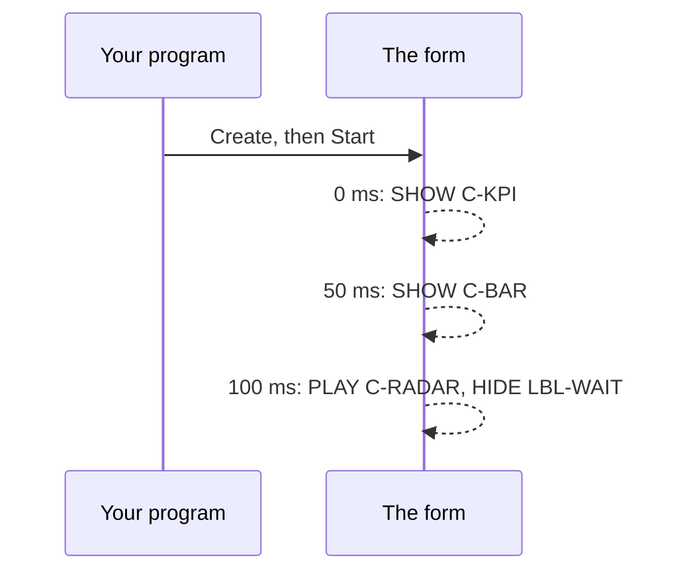
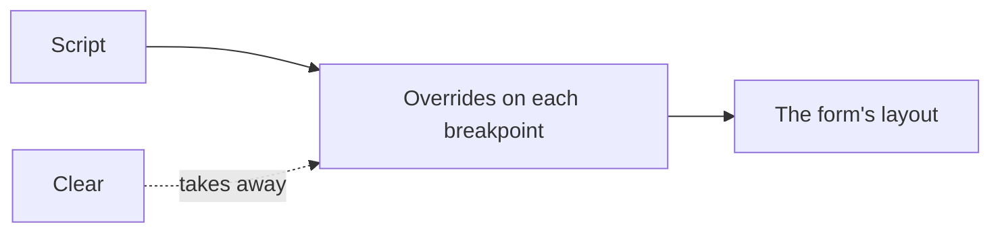

<!--
SPDX-License-Identifier: Apache-2.0
Copyright (c) 2026 Emerson Lopes and PowerRustCOBOL contributors
-->

# Guide notes — spec 109 (kept here until 2.x.x is released; nothing under `docs/` on this line)

## S3 — Collections (2.0.104)

Audience: COBOL developers from Fujitsu PowerCOBOL and Veryant isCOBOL. To be
written into `docs/developers-guide-en.md` when 2.x.x merges to main.

**What it does.** `Split` can hand a list of pieces to the next method. Eight methods
work on a list: `Map`, `Filter`, `SortByDescending`, `Take` answer another list;
`Join`, `Sum`, `Max` answer one value. `PERFORM VARYING element THROUGH collection`
walks a list or an OCCURS table.

```cobol
       01 WS-NAMES PIC X(40) VALUE " b , a ,, c ".
           DISPLAY WS-NAMES::Split(",")
               ::Map(ITEM => ITEM::Trim())
               ::Filter(ITEM <> " ")
               ::Join("/")
      *> shows  b/a/c

           PERFORM VARYING NAME THROUGH WS-NAMES::Split(",")::Map(ITEM => ITEM::Trim())
               DISPLAY NAME
           END-PERFORM
```

**Notes**
- `ITEM => …` is an expression: a value (`Map`, the key of `SortByDescending`) or a test
  (`Filter`). It cannot assign or do I/O. The name exists only inside it.
- `Sum` of an empty list is zero; `Max` of an empty list stops the run with a message that
  names the method.
- `X::Split(sep)(n)` still answers piece n, and `X::Split(sep)` alone still answers piece 1.

**Caveats**
- A list is not a COBOL value: it cannot be `MOVE`d or `DISPLAY`ed. End a chain with `Join`,
  `Sum` or `Max`, or walk it with `THROUGH`.
- The loop element is a copy: writing to it does not change an OCCURS occurrence.
- The pieces of a `Split` of a fixed-width field keep the field's trailing blanks; `Trim` them.
- Not available in Web or Mobile projects yet: the build refuses `THROUGH` and says so.

📷 Screenshot needed: the editor's completion popup after `::` on a data item.

## S2 — Formatting (2.0.105)

**What it does.** A numeric item declared with `FORMAT IS "name"` is shown formatted
in `DISPLAY`, `STRING`, an interpolated string and `Format()`; it is stored and compared
as the number it is.

```cobol
       01 WS-LOCALE PIC X(16) VALUE "pt-BR".
       01 WS-ASSETS PIC S9(13)V99 VALUE 1234567.89
           FORMAT IS "currency BRL" LOCALE IS WS-LOCALE.
       01 WS-RATIO  PIC 9V999 VALUE 0.425.

           DISPLAY WS-ASSETS                          *> R$ 1.234.567,89
           MOVE "en-US" TO WS-LOCALE
           DISPLAY WS-ASSETS                          *> R$1,234,567.89
           DISPLAY F"Margin: {WS-RATIO:percent}"      *> Margin: 42.5%
           DISPLAY WS-RATIO::Format("percent", "pt-BR")  *> 42,5%
```

**Formats:** `number` (the item's own decimals), `currency` (the currency's decimals),
`compact` (`1,2 mi`), `currency-short` (`R$ 1,2 mi`), `percent` (the value is a ratio).
**Locales:** `pt-BR`, `en-US`, `fr-FR`. Names and tags ignore case.

**Notes**
- `{expr:format}`: the format follows a single `:`; `::` is the member operator.
  `{{` and `}}` print a brace.
- The currency is part of the format text: `"currency BRL"`. A project may name a default.
- Rounding is half away from zero; a negative value shows a leading minus.

**Caveats**
- Only a numeric item can be formatted; `MOVE` copies the stored digits, not the text.
- Not available in Web or Mobile projects yet: the build refuses a `FORMAT` clause.
- Until the project's default locale is wired in, an item with no `LOCALE` uses `en-US`.

📷 Screenshot needed: a form label showing a formatted currency in two locales.

## S1 — User-defined functions (2.0.107)

**What it does.** A `FUNCTION-ID` unit is a function you call inside an expression.

```cobol
       IDENTIFICATION DIVISION.
       FUNCTION-ID. DOUBLE-AMOUNT.
       DATA DIVISION.
       LINKAGE SECTION.
       01 ARG-AMOUNT PIC S9(5)V99.
       01 RESULT-AMOUNT PIC S9(5)V99.
       PROCEDURE DIVISION USING BY VALUE ARG-AMOUNT RETURNING RESULT-AMOUNT.
           COMPUTE RESULT-AMOUNT = ARG-AMOUNT * 2
           GOBACK.
       END FUNCTION DOUBLE-AMOUNT.

           COMPUTE WS-TOTAL = FUNCTION DOUBLE-AMOUNT(WS-PRICE) + FUNCTION DOUBLE-AMOUNT(5)
```

**Notes**
- Arguments are copies; the function never changes the caller's items.
- A function may call other functions and itself. Each call has its own arguments and result.
- Put functions you share in Common Code (`src/`): every form sees them.
- A function cannot have an intrinsic function's name (`MAX`, `SUM`, …): the build says so.

**Caveats**
- The number of arguments is checked when you build.
- Not available in Web or Mobile projects yet: the build refuses `FUNCTION` calls.

📷 Screenshot needed: the Check panel on a call with the wrong number of arguments.

## S4 — Control collections (2.0.108)

**What it does.** Work on a group of controls without naming each one.

```cobol
           PERFORM VARYING CTL THROUGH PNL-KPI::Descendants()
               CTL::SetProperty("Visible" "1")
           END-PERFORM

           ME::Controls("BTN-1" "BTN-2" "BTN-3")::SetProperties(
               "BackgroundColor" "#FFFFFF" "ForegroundColor" "#1B2A4E")
```

**Notes**
- `Descendants()` follows who is inside whom, not what overlaps on screen. The container
  itself is left out; hidden controls are included.
- In the loop, the element is the control: use it like any control name.
- `SetProperties` takes pairs, name then value. Either every control is written or none.

**Caveats**
- `Controls("…")` stops with an error for an id the form does not have, and for a repeat.
- A value is written as `SET` would write it; it is not checked against the property's type.
- Not available in Web or Mobile projects yet.

📷 Screenshot needed: a form whose group of buttons was restyled by one `SetProperties`.

## S8 — View options of a read-only binding (2.0.110)

**What it does.** A grid bound to a table, an indexed file, SQL or PartiQL can show its
rows in an order and its numeric columns formatted, without touching the data.

```text
DataBindings (in the form): order_by = { field: "AMOUNT", descending: true }
                            mapping AMOUNT -> format "currency BRL"
```

**Notes**
- Numbers sort as numbers, text as text; equal values keep the source's order.
- A format works on numeric columns only; a blank cell stays blank.
- The order is applied first, to the real values; the format is applied after.

**Caveats**
- Only a read-only binding: a writable grid is edited by line and writes cells back as shown,
  so the Binding Guardian refuses an order or a format there.
- The locale of a formatted column is the application's default.
- The Web and Mobile player does not apply them yet.

📷 Screenshot needed: a read-only grid sorted by amount, with a currency column.

## S5 — Compact control storage (2.0.111)

**What it does.** Every control on a form gets a group of data items in the generated
program (`WS-BTN-OK`, with its text, visible and enabled flags). Most are never read. A
form can ask for the unread ones to be left out, which makes the program shorter to read.

```text
<Form ... compact-storage="true">
```

**Notes**
- A group stays when any line of the program names it: a handler, a procedure, your own
  working-storage, a `REDEFINES`.
- A name that only *begins* like the group (`WS-TXT-A-COUNT`) also keeps it. Keeping too
  much is the safe mistake.
- Off by default. A form without the attribute is generated exactly as before.

**Caveats**
- The debugger cannot watch an item that was left out.
- There is no switch in the IDE yet; the attribute is set in the form file.

## S7 — Animation sequences (2.0.114)

**What it does.** A form can show, hide and animate several controls at set moments from one
call, instead of a timer paragraph that counts ticks. You describe the moments in a small script,
create the sequence once, and start it when you want it.

```cobol
COBOL::AnimationSequence("Create", "DASHBOARD-INTRO", ```
    SHOW C-KPI                      AFTER 0
    SHOW C-BAR                      AFTER 50
    PLAY C-RADAR "fade-in"          AFTER 100
    HIDE LBL-WAIT                   AFTER 100
```)

COBOL::AnimationSequence("Start", "DASHBOARD-INTRO")
COBOL::AnimationSequence("Status", "DASHBOARD-INTRO", WS-STATE)   *> Playing or Stopped
COBOL::AnimationSequence("Stop", "DASHBOARD-INTRO")
```



**Notes**
- `AFTER` counts milliseconds from the start of the sequence, never from the previous line. It is 0
  when left out. Entries at the same moment run in the order written.
- One line per entry, or separate them with `;` — so a plain literal works in fixed format:
  `"SHOW A AFTER 0; SHOW B AFTER 50"`. Blank lines and `*>` comments are ignored.
- `Create` checks the script and, when the form is running, that each control exists; the error names
  the line. `Start` on a sequence that is playing does nothing; `Restart` begins again; `Stop` drops
  the entries that have not come yet but does not undo what already happened; `Delete` forgets it.
- `PLAY` starts an animation by name, as `PlayAnimation` does; the animation's own delay adds to `AFTER`.
- A closed form takes its sequences with it. Two open forms never share one.

**Caveats**
- Entries come due while the form waits for an event. A long handler delays them until it returns.
- A name the program never created is an error, in `Status` too.
- Not available in Web or Mobile projects yet: the build says so.
- The script word `PLAY` does not check the animation's name.

📷 Screenshot needed: a dashboard whose cards appear one after another.

## Block literal — what follows the closing fence (2.0.113)

A ``` block can now be closed in the middle of a statement: ```` ```) ```` ends the block and the
parenthesis closes the call. Before, everything after the fence on its line was dropped.

## S6 — Layout from a script (2.0.115)

**What it does.** A container can be re-arranged from your program with one call: how its
children flow, the gaps, the columns, and what changes when the window gets narrow. You write
the rules once as a small script instead of setting properties control by control.

```cobol
COBOL::Layout("Apply", "PNL-FILTERS", ```
    MODE FLEX ROW WRAP
    GAP 14
    PADDING HORIZONTAL 24
    ORDER LV-DROP BTN-GO
    ITEM LV-DROP SPAN 2 MIN-WIDTH 160 MAX-WIDTH 480
    WHEN Compact
        MODE FLEX COLUMN
        GAP 8
```)

COBOL::Layout("Clear", "PNL-FILTERS")
```



**Notes**
- The lines before the first `WHEN` apply at every breakpoint. A `WHEN` section runs to the next
  `WHEN` and applies only while that breakpoint is active, on top of the general lines.
- The breakpoints are the form's own. By default: Compact below 600, Medium from 600, Expanded from 1024.
- `MODE FLEX ROW|COLUMN [WRAP]`, `MODE GRID`, `MODE FLOW`; `GAP n` or `GAP row column`;
  `PADDING n`, `PADDING HORIZONTAL n`, `PADDING VERTICAL n`; `COLUMNS 3` (three equal columns) or a list
  such as `COLUMNS 200px 1fr`; `ROWS`; `ORDER` names the children in reading order;
  `ITEM` sets `SPAN`, `ROW-SPAN`, `GROW`, `MIN-WIDTH`, `MAX-WIDTH`, `MIN-HEIGHT`, `MAX-HEIGHT`.
- Entries can share a line with `;`, so a plain literal works in fixed format.
- Applying a script to a container again replaces its earlier one. `Clear` removes it and the form
  goes back to its design. The saved form is never changed.
- A value your own program sets on a control still wins over the script, as it wins over any breakpoint.

**Caveats**
- `Create` checks the controls exist and names the line of a mistake. It cannot check a breakpoint name:
  a `WHEN` for a name the form does not have does nothing.
- The form must be responsive. On a form that is not, the script waits and does nothing.
- There is no placement relative to a sibling (below, to the right of): use `ORDER` inside a flex, grid or flow container.
- Not available in Web or Mobile projects yet: the build says so.

📷 Screenshot needed: the same panel in Expanded and in Compact.
