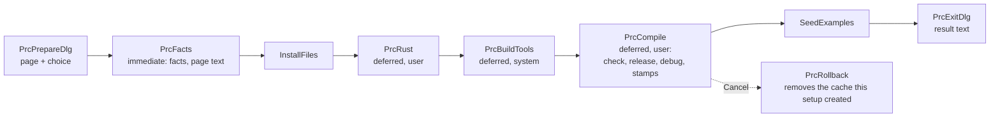

<!--
SPDX-License-Identifier: Apache-2.0
Copyright (c) 2026 Emerson Lopes and PowerRustCOBOL contributors
-->

# Plan — The Windows setup prepares the platform for Debug and EXEC RUST

- **Status:** draft
- **Spec:** ./spec.md   **Date:** 2026-11-23

## 0. What this plan could and could not establish

This session runs on macOS. Nothing below was *run* on Windows. Each claim is one of three kinds, and the plan says which:

- **Read from our code** (`warmup.rs`, `build_cache.rs`, `toolchain.rs`, `lib.rs`, the WiX source in `build-all-platforms.yml`).
- **Documented by Microsoft** (a custom action learns of Cancel only by calling `MsiProcessMessage` and reading `IDCANCEL`; it then returns `ERROR_INSTALL_USEREXIT`; `MsiProcessMessage` is one of the few calls a deferred action may make; the immediate action sets the progress total and the deferred one reports ticks against it).
- **Unverified**, to be settled by the spike of §6 (T0) before any other work depends on it.

Where the spec asked the plan to "resolve by trying", §5 gives the answer the evidence supports and the exact experiment that settles it.

## 1. Approach

The setup gets one new wizard page, three new deferred actions and a small supervisor library. The long work itself is done by the IDE executable, in a new headless mode beside `--seed-examples` (the same pattern, for the same reason: the `.msi` calls code that is already tested).

**The pieces**

1. **`PowerRustCOBOL.exe --prepare-platform --step <rust|build-tools|compile> --result <file>`** (new module in `cobolt-ide`, switch handled in `main.rs` before logging and eframe, like `--seed-examples`). It does the real work and prints one **progress line** per event (§3). It reuses what exists: `toolchain::detect`, `with_link_check` and `probe_link` for R6/R7; `warmup::release_rust`, `platform_prep`, `stamp_name`, `mark_current_warm`, `variants()` and `build_variant` for R9; `build_cache::cargo()`. Nothing in it is `#[cfg(windows)]` except where the steps themselves differ.
2. **`cobolt-setup`** (new crate: a `cdylib` for the `.msi`'s Binary table, plus an `rlib` for tests). It is the only code that talks to Windows Installer, and it holds:
   - the **facts** immediate action `PrcFacts` (what R1 and R4 need: Rust and linker present, free space per volume, stamps of this version) and the **page text** composed from them;
   - the **supervisor** `PrcRun`, one entry point used by all three deferred actions: it starts the executable in a **job object** (kill on close), reads its progress lines, answers each with an `ACTIONDATA` message, polls for Cancel every 500 ms with a zero-tick `PROGRESS` message, and on `IDCANCEL` terminates the job and returns `ERROR_INSTALL_USEREXIT`;
   - `PrcReadResult`, the immediate action that turns the result file into the finish page's text (R12), and `PrcRollback`.
3. **The pure decision** (`prepare.rs` in `cobolt-compiler`: *given these facts, what does the preparation do, and what does the page say*) is plain functions over plain values. Both the IDE mode and `cobolt-setup` call it, and it is what AC12 tests on every OS. `cobolt-setup` depends on `cobolt-compiler` only if the dependency is light enough; otherwise the decision lives in a third dependency-free crate (§4 D3 settles it at T1).

**Requirement map**

| Requirement | Met by |
|---|---|
| R1, R3 | `PrcPrepareDlg` (banner style, §4 D5) with text from `PrcFacts`; names source, size, licence per missing requirement |
| R2 | The page's two-way choice sets `PRC_PREPARE` to `1` or `0`; `0` schedules none of the three actions and the file list is unchanged |
| R4 | `PrcFacts` measures free space on the **volumes written to** (build folder; system volume when the Build Tools are missing); the page disables *prepare now* below need plus margin (amendment A2) |
| R5 | In a non-full UI `PRC_PREPARE` is copied from the public property `PREPARE_PLATFORM`; absent means `0` |
| R6, R7, R8 | `--step rust`, `--step build-tools`, and the check at the start of `--step compile`; the final check is `toolchain::detect` plus the link probe, not the page's hint |
| R9, R10 | `--step compile` with the user's token and environment block (§4 D7), `build_variant` generalised by profile |
| R11 | `build_cache::cargo()` keeps below-normal; the compile asks for normal through a new priority argument |
| R12 | Each step writes `ok` / `failed: <why>` to the result file and **returns success to the installer**; the finish page reads the file |
| R13 | Progress lines become `ACTIONDATA` text and tick the bar per compile unit (§3) |
| R14, R15 | `IDCANCEL` becomes `ERROR_INSTALL_USEREXIT`, which is what makes the engine roll back; `PrcRollback` removes the cache only if the setup created it |
| R16 | `PrcFacts` reads the stamps; the page is shown only when `NOT Installed`, so a repair or maintenance run never offers a compile (AC10 second half), and a newer version is a new product that has no stamp |
| R17, R18 | No action touches the cache on uninstall; `platform_prep` and the 2.1.19 question are untouched |
| R19 | Every figure on the page is a constant in one place, filled from the AC9 run; a test asserts the page prints exactly those constants |

**Spec amendments this plan needs** (the operator decides; `spec.md` is not edited here):

- **A1 (R14, AC8).** A cache that existed before the setup cannot be returned "as it was": cargo has written finished units into it. Honest wording: nothing half-written that a Build trips on, no stamp for what did not finish, and the folder is removed only if the setup created it.
- **A2 (R4).** Free space is checked on the volumes the setup writes to (the build folder's, and the system volume for the Build Tools), not only "the volume of the build folder".
- **A3 (AC4).** A program that uses a platform crate outside the three variants compiles those crates at its first Build. AC4 becomes: *only the program and the platform crates its features add beyond the three variants*, counted and reported.
- **A4 (R14).** An installer of the Build Tools that has started is allowed to finish after a Cancel (§5 R-3): stopping it midway damages Visual Studio's own installation. The page and the confirmation say so.
- **A5 (R10).** "The installing developer" is the account Windows Installer impersonates. When an administrator's credentials were typed over a standard user's shoulder, that is the administrator — the same limitation `SeedExamples` has today. The Guide says so.

## 2. Affected crates / files

- `crates/cobolt-compiler/src/prepare.rs` (**new**) — the pure decision (`Facts`, `Plan`, `page_text`, `result_text`), the free-space rule, the progress-line grammar and the result-file format. Registered in `lib.rs`.
- `crates/cobolt-compiler/src/warmup.rs` — `build_variant` takes a `Profile` (release or debug), streams cargo's output instead of `.output()`, honours a cancel flag and reports each crate; new `prepare_platform(...)` that loops profile × `variants()` and writes `stamp_name(version, debug)` through `mark_current_warm`; `produce_libs` keeps calling the release path unchanged.
- `crates/cobolt-compiler/src/build_cache.rs` — `cargo()` gains a sibling taking the priority; the default stays below-normal.
- `crates/cobolt-compiler/src/lib.rs` — the argv of the two installs for the setup (`rust_install_command` and `linker_install_command` stay as the IDE's copy-paste text); `pub mod prepare`.
- `crates/cobolt-ide/src/prepare.rs` (**new**), `main.rs` — the `--prepare-platform` mode, handled before logging and eframe.
- `crates/cobolt-ide/src/toolchain.rs` — nothing changes; it is *called*. If its detection is only reachable through `app.rs`, the smallest move to make it callable headless is part of T3.
- `crates/cobolt-setup/` (**new**, `cdylib` + `rlib`) — the supervisor, the facts, the page text. `windows-sys` only; static CRT, because this DLL runs on a machine that may have no Visual C++ runtime yet (the reason the setup exists).
- `Cargo.toml` (workspace members).
- `.github/workflows/build-all-platforms.yml` — Windows leg only: build `cobolt-setup`, add the Binary and the CAs, the page, the sequence, `PRC_*` properties, the `.wxl` override, the finish page text. **No timeout change** (§4 D9).
- `.github/workflows/prepare-platform-smoke.yml` (**new**, `workflow_dispatch` only) — installs the `.msi` with `PREPARE_PLATFORM=1` and checks the stamps and a Debug Build (§6).
- `docs/developers-guide-en.md` — the section "The libraries that come with PowerRustCOBOL" and the Windows installation text; then delete `developers-guide-{es,pt,fr,jp,cn}.md` (GOLDEN RULE #8).
- `.claude/skills/installer-look/SKILL.md` — the new page and the reversed standing decision; and the workflow's own comment on the finish page, which records "that is the user's call to make, on Microsoft's page" and must now say what changed and why (one rule, three places).
- `CHANGELOG.md`, `crates/cobolt-ide/src/version.rs` — the `z` bump of each change.
- **No** `i18n.rs` change: the setup is English (spec §6). **No** System KB change.

## 3. Data / model changes

**Windows Installer properties** (all-uppercase names are public; those the execute phase reads are listed in `SecureCustomProperties`):

| Property | Set by | Meaning |
|---|---|---|
| `PRC_PREPARE` | page, or copied from `PREPARE_PLATFORM` when not interactive | `1` runs the three actions |
| `PREPARE_PLATFORM` | the administrator, public | the silent opt-in (R5, Q8) |
| `PRC_TEXT`, `PRC_NEED`, `PRC_DISK_OK`, `PRC_ALREADY` | `PrcFacts` | page text, whether *prepare now* is offered, whether this version is already prepared |
| `PRC_CANCEL_NOTE` | the page when *prepare now* is chosen | one sentence appended to the stock cancel confirmation (R14) |
| `PRC_RESULT` | `PrcReadResult` | the finish page's text |

**Files.**

- The **result file** is a few lines in the msiexec client's `%TEMP%`, named after the ProductCode, passed to every step in its `CustomActionData`: one `step=<name> status=ok|failed|skipped` line and a plain sentence for each. The `SYSTEM` step and the user's steps both reach it. Deferred actions cannot set properties, which is why a file and an immediate reader are needed.
- The **created marker** `<cache>/.prepared-by-setup` is written by `--step compile` only when it created the folder; `PrcRollback` removes the cache only if the marker is there. The stamps `warm/<v>` and `warm/<v>-debug` are the existing ones (no format change).
- The **progress line**, one per event on the child's stdout, ASCII, `key=value`:
  `PRC step=<rust|build-tools|release|debug> unit=<forms|forms-sql|forms-graphics|-> crates=<n> elapsed=<s>` and `PRC note=<text>`. It is heart-beaten at least every 5 s so AC7's ten seconds hold even inside one long crate. The grammar is parsed in `prepare.rs`, tested round-trip.
- **Progress ticks.** `PrcTicks` (immediate, in the execute sequence) adds a fixed total; `PrcRun` reports against it as units finish: rust, build-tools, then the six compile units, each weighted by its **measured** share of the time (AC9). The bar therefore moves per unit and the text moves per crate; the page does not pretend a crate count is a percentage.
- No `.cfrm`, `.cidx`, generated-code or `Cargo.toml` change; the stand-in program of `build_variant` is unchanged.

**Compatibility.** A setup that is skipped installs exactly today's files (AC1). Stamps keep their format, so an IDE that finds them behaves as in 2.1.19.

## 4. Key decisions & alternatives

- **D1 — A Rust supervisor DLL, not `WixQuietExec`.** Why: Microsoft documents exactly one way for a custom action to learn of Cancel, calling `MsiProcessMessage` and reading `IDCANCEL`, and the same call is the only way to put text on the progress page. A quiet-exec action shows neither, and nothing documents it honouring Cancel. Rejected: `WixQuietExec` and an EXE-type custom action (no session handle, so no Cancel and no progress text); a PowerShell script (outside the PRIME DIRECTIVE, and no handle either); a C++ DLL (not Rust). Fallback if the DLL proves unworkable: none that keeps R14 — the feature would drop *Cancel mid-compile* and say so, which is a spec change, so it stops and asks.
- **D2 — The IDE executable does the work, the DLL only supervises.** Why: the logic stays in tested Rust shared with the IDE (`--seed-examples` precedent), the DLL stays small enough to review, and the same child can be run by hand for support. Rejected: doing the compile inside the DLL (untestable, and a crash would take `msiexec` with it).
- **D3 — The decision is pure and shared.** Why: AC12 needs it testable on every OS, and the page and the finish text must not drift from what the IDE does. Where it lives (in `cobolt-compiler`, or a dependency-free crate if linking `cobolt-compiler` into a `cdylib` makes the DLL tens of megabytes) is decided at T1 by measuring the DLL, not by guessing. Rejected: restating the rules in WiX conditions (untestable, and it would rot, exactly as `product.wxs` itself warns for the example copy).
- **D4 — Three deferred actions, three identities.** `PrcRust` as the user, `PrcBuildTools` as `SYSTEM` (the Visual Studio bootstrapper needs elevation and cannot raise a prompt from a service), `PrcCompile` as the user (the cache is theirs, and `default_build_root` reads `LOCALAPPDATA`). Order: after `InstallFiles`, **before** `SeedExamples`, so a cancel does not leave a copied example project behind (a copy we cannot know to have created is *user code* and is never rolled back). Rejected: one action for everything (it could not be both elevated and the user).
- **D5 — The page is banner-style, with a radio pair.** The finish page's comment records that a `CheckBox` paints an opaque system background on the dark artwork. `LicenseAgreementDlg` and `InstallDirDlg` are banner-style, white bodies, where stock controls are the norm. A banner-style `PrcPrepareDlg` between `InstallDirDlg` and `VerifyReadyDlg` carries a `RadioButtonGroup` (*Prepare now*, the default; *Skip*) and scrollable text. Rejected: two push buttons on the dark artwork (cannot show the amount of text R1 and R3 require).
- **D6 — The cancel confirmation is the stock one with one added sentence.** `CancelDlgText` is a localised string; a small `.wxl` passed to `light -loc` overrides it to end with `[PRC_CANCEL_NOTE]`, which is empty unless *prepare now* was chosen and then says that Rust and the Build Tools installed by this setup stay installed. Rejected: a second cancel dialog (two dialogs would open from the same button). If the override is refused at link time (§5 R-8), the page's own sentence carries the information instead.
- **D7 — The child is started with the impersonated user's primary token and that user's environment block** (`OpenThreadToken`, `DuplicateTokenEx`, `CreateEnvironmentBlock`, `CreateProcessAsUser`, created suspended, put in the job, then resumed). Why: `default_build_root` reads `LOCALAPPDATA` and the toolchain reads `CARGO_HOME` and `PATH`; a service's environment would put the cache under `systemprofile`. The executable refuses a build root under `\config\systemprofile\` with a plain message, so a wrong environment is a visible R12 and not a silent cache in the wrong profile.
- **D8 — Toolchain installs.** Rust: `rustup-init -y --default-toolchain <pinned> --profile minimal` when there is no rustup; `rustup toolchain install <pinned> --profile minimal` beside the developer's Rust when there is (R8). `minimal` skips documentation, `clippy` and `rustfmt`; T3 verifies a Build needs nothing else. The Build Tools: Microsoft's bootstrapper (`aka.ms/vs/17/release/vs_BuildTools.exe`) with `--quiet --wait --norestart --add Microsoft.VisualStudio.Workload.VCTools --includeRecommended`. The existing winget text lacks `--includeRecommended`, which is what brings the Windows SDK a link needs, and winget is not on every machine. Downloads are **verified**: `rustup-init.exe` against the SHA-256 Rust publishes, the bootstrapper by its Authenticode signature (publisher Microsoft). Exit code 3010 is success if the link probe then passes (Q5).
- **D9 — No CI time is added to the release workflow, and no timeout changes.** The compile runs on the developer's machine. A job that ran the whole preparation on a hosted runner would take on the order of "Compile the platform libraries" (38.1 min of a 127.9 min Windows leg in the last full run, release profile only, plus the debug profile and the checks) and the hosted runner already has Rust and the C++ tools, so it cannot prove the *installing* paths of AC3. Decision: a **manually dispatched** `prepare-platform-smoke.yml` (own timeout above the measured time) that proves the compile, the stamps and AC4 on demand; the installing paths and every Cancel are proved on a clean Windows machine by the operator (§6). Rejected: running it in every release.
- **D10 — A failed or declined preparation never fails the install** (R12). Every step returns success to the engine after writing its result, and only `IDCANCEL` returns `ERROR_INSTALL_USEREXIT`. A **watchdog** in the supervisor kills a step that prints no line for 15 minutes (30 for the Build Tools), so a hung child ends as R12 rather than an install that never finishes.
- **D11 — A maintenance run never prepares.** The page is `NOT Installed`; a repair or change runs no preparation. Rejected: a repair that compiles for an hour on a click that looks harmless.

## 5. Risks & mitigations

- **R-1 — Nested installer deadlock (blocking, unverified).** Windows Installer runs one installation at a time; its execute phase holds the `_MSIExecute` mutex. The Visual Studio installer installs some components through Windows Installer (the Windows SDK, the C++ redistributable), and a nested `msiexec` fails with 1618 *or waits*. If it waits for our transaction while our transaction waits for it, the setup hangs. → **T0 decides before anything else is built.** Hypotheses and consequences: *(a)* it works or it retries and finishes: the plan stands as written. *(b)* it fails or deadlocks: the Build Tools step leaves the transaction. Fallbacks, in order of preference: **F1** run `vs_BuildTools.exe` as an immediate action in the UI sequence *before* `ExecuteAction` (interactive only; the mutex is not yet held; the bootstrapper raises its own prompt in the user's session), with the watchdog of D10; **F2** a Burn bootstrapper that chains Build Tools, Rust, the `.msi` and the compile (the Microsoft-endorsed shape, but it replaces the settled wizard look and is a larger change); **F3** the Build Tools are *detected and named* on the page and the finish page, the Rust and the compile still run, and R6's installation of the Build Tools is dropped. F1 to F3 change the spec; the operator chooses.
- **R-2 — The environment of an impersonated action.** `LOCALAPPDATA`, `CARGO_HOME`, `PATH` may be the service's. → D7, the `systemprofile` refusal, and T0 prints `whoami`, `USERPROFILE`, `LOCALAPPDATA` and the token's elevation from inside a deferred action. The hosted runner's administrator cannot show the cross-account case (A5); the clean machine does.
- **R-3 — Cancel while the Build Tools installer runs.** The Visual Studio installer starts its own service and children that are not in our job. Killing the bootstrapper midway can leave a half-installed product. → A4: the supervisor does not kill it; it answers *Cancelling: waiting for Microsoft's installer to finish* and returns `ERROR_INSTALL_USEREXIT` when it ends, within the 30-minute watchdog. T0 records what a kill actually does.
- **R-4 — Progress for a step with no count.** Cargo knows the crates it compiles only as it goes. → ticks per unit, text per crate, heartbeat (§3); the bar is honest about being a step bar.
- **R-5 — The page is a wall of text.** R1 and R3 ask for a lot. → a scrollable text control; the first sentence is the plain one the operator wants ("take a seat…"), the figures follow, sources and terms last; the figures are the constants of R19.
- **R-6 — A reboot.** The Build Tools may ask for one. → Q5 as assumed: continue if the link probe passes, else R12 with "restart, then build".
- **R-7 — The pinned Rust is not found by the IDE after rustup** (PATH not yet seen by Explorer, so a Start-menu IDE does not inherit it). → T3 asserts that `toolchain::detect` finds `%USERPROFILE%\.cargo\bin` without a new `PATH`; if it does not, the detection gets that fallback, which is a fix to existing code and is reported as such.
- **R-8 — `light` refuses the `.wxl` override.** → WixUI's strings are marked overridable; the CI build is the test. If refused, D6's fallback.
- **R-9 — The Microsoft terms.** `--quiet` accepts them for the person at the keyboard (Q4). → the page names them and links Microsoft's own terms page; the link is checked against the bootstrapper's own wizard before it is printed (never typed from memory). *Prepare now* is the acceptance; a silent install accepts them only through `PREPARE_PLATFORM=1`.
- **R-10 — Antivirus slows an hour of compiling.** → the AC9 run is made with the system's default protection on, and the figure says so.
- **R-11 — Same version, other install folder.** The stamps carry the version, not the folder; path crates are keyed by their path. → existing behaviour, not changed here; the first Build recompiles the platform's own crates (minutes). Named in the Guide.
- **R-12 — A crash in the DLL takes `msiexec` with it.** → the DLL only supervises (D2), uses no `unwrap` on handles, and every Windows call returns a message instead of panicking; `panic = "abort"` is not used, `catch_unwind` guards each entry point.

## 6. Test strategy

**Order matters: T0 first, alone.**

- **T0 — the spike, on a Windows runner.** A throw-away dispatchable workflow builds a toy `.msi` (one file, the real DLL skeleton) with a deferred action that, in turn: (1) prints `whoami`, the environment and elevation; (2) runs `vs_BuildTools.exe modify` adding one small component that Windows Installer installs, to learn what a nested install does (R-1); (3) sleeps 20 minutes sending `ACTIONDATA` once a second, to show that a deferred action may run that long and that the text reaches the progress page; (4) the same with a simulated Cancel (a client that answers `IDCANCEL` through a test UI handler). Its log is attached to the plan as an addendum. **If (2) deadlocks, nothing else proceeds until the operator picks F1, F2 or F3.**
- **Unit and integration tests, every OS, real results reported (GOLDEN RULE #7).**
  - `cobolt-compiler`, `prepare.rs`: a table over Rust (none, other, pinned) × linker (absent, present) × stamps (none, this version, older) × disk (enough, low) × interactivity (full, silent, silent with opt-in) → the actions and the page text; the free-space rule at its edges; the progress-line grammar round trip; the result-file text for each failure of R12; the figures the page prints equal the constants of R19. One result block: cases, forms, counts, pass/fail.
  - `cobolt-compiler`, `warmup.rs`: `build_variant` for both profiles writes the two stamps and no more; a cancel flag stops after the current crate and writes none; cargo's `Compiling` lines are counted; release and debug stay stamped apart (extends `a_debug_build_leaves_its_own_stamp`).
  - `cobolt-ide --bin cobolt-ide`: the `--prepare-platform` argument parser, the `systemprofile` refusal, the steps' exit codes and result files with the installs replaced by a recorded fake (no network, no process).
  - `cobolt-setup`: parsing `vswhere` and `rustup toolchain list` output, the page text, the tick budget; the Windows-only calls are not unit-tested (a fake `MSIHANDLE` would test the fake).
  - A guard test that the workflow's `.msi` source still schedules `PrcRun` after `InstallFiles` and before `SeedExamples`, and that no action but `IDCANCEL` returns failure to the engine (reads the WiX text; precedent: `warmup.rs` already cites the workflow).
- **Workflow checks on every release build:** `candle`/`light` accept the new page, sequence and `.wxl`; the Binary is the DLL; `dumpbin /dependents` shows no `VCRUNTIME`/`api-ms-win-crt` (static CRT).
- **On demand, `prepare-platform-smoke.yml` (D9):** installs with `PREPARE_PLATFORM=1`, checks both stamps, then a Debug Build and an `EXEC RUST` Build of fixtures, counting crates compiled (AC4 as amended by A3), and records the times.
- **By the operator on a clean Windows machine (no Rust, no Build Tools), a table of runs the plan lists and the operator ticks:** AC1 to AC3, AC5 to AC8, AC10, AC11, and the AC9 measurement, with the free-space and network-cut cases (AC6) and a Cancel in each of the three steps (AC8). Never driven by UI automation from here; the operator judges what the pages look like.

## 7. Steering compliance

- [x] i18n: no IDE string is added; the setup is English like the rest of the `.msi` (spec §6). If the plan's work adds an IDE string anywhere, it is a `Tr` field in all six languages.
- [x] Generated-code banner + regenerate-on-action contract preserved (no generated file changes).
- [ ] English dev guide updated in the same change as the feature; the five translations of that guide then deleted (GOLDEN RULE #3, #8).
- [x] Fix vs feature: **feature**, branch `features-windows-install-prep`; a `z` bump and a top `CHANGELOG.md` entry for every change; the spec and this plan commits carry theirs; nothing merged or pushed unless asked; no push 09:00 to 18:00 Monday to Friday (São Paulo).
- [x] No "cobolt" in user-facing text (the DLL's crate name is build-only and never shown); COBOL identifiers untouched.
- [x] Rust only: the DLL, the supervisor and the tests are Rust; WiX and YAML are configuration. No script of another language enters the repository.
- [x] No credentials: nothing here needs a key; the staged diff is scanned before each commit.
- [x] Interpreter/binary parity and System KB: not touched (no runtime or language change).
- [ ] The measured figures (AC9) are in the page's constants **before** the feature is merged; until then the feature is not releasable.

## 8. Order of work (for `/tasks` to expand)

1. **T0** the Windows spike (R-1, R-2, R-3, the long action, Cancel); operator decision on F1 to F3 if needed; amendments A1 to A5 answered.
2. **T1** `prepare.rs` pure decision with its tests; decide where it lives.
3. **T2** `build_variant` by profile, streaming, cancel flag, priority argument.
4. **T3** `--prepare-platform` steps, result file, verified downloads.
5. **T4** `cobolt-setup`: facts, supervisor, result reader, rollback.
6. **T5** the WiX page, actions, sequence, properties, `.wxl`, finish text; workflow build of the DLL.
7. **T6** `prepare-platform-smoke.yml`.
8. **T7** the clean-machine run: AC1 to AC11, the AC9 figures into the constants, the page's wording.
9. **T8** Guide, `installer-look`, workflow comment, translation deletion; `z` and changelog.
