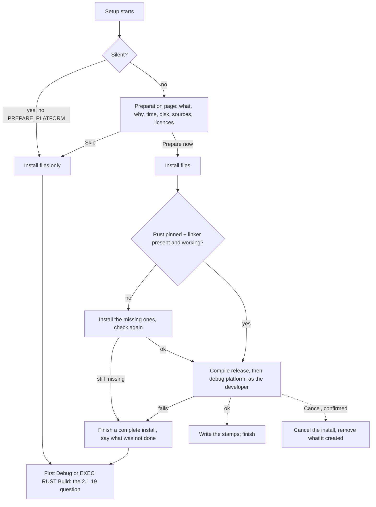

<!--
SPDX-License-Identifier: Apache-2.0
Copyright (c) 2026 Emerson Lopes and PowerRustCOBOL contributors
-->

# Spec — The Windows setup prepares the platform for Debug and EXEC RUST

- **Status:** draft
- **Folder:** specs/112-windows-install-time-preparation/
- **Author:** Emerson Lopes (idea) · drafted with Claude Sonnet 5.5   **Date:** 2026-11-23

## 1. Overview

A Build that needs Cargo (a **Debug** build, an **`EXEC RUST`** block, a Cargo-path project) cannot start until PowerRustCOBOL's own parts are compiled on the developer's machine, and until Rust and the Visual Studio Build Tools are there. Since 2.1.19 the Build **asks first** (`CompilerError::PlatformPrep`, "Compile PowerRustCOBOL's platform?", 10 to 30 minutes, an hour or more for Debug) and compiles then. The Windows setup (`.msi`) installs files only; Rust and the Build Tools are left to the developer, and the finish page just opens Microsoft's page.

This spec moves that work into the setup, **on the developer's own confirmation**. The setup says in plain words that it needs about an hour and why, checks that every requirement is present, installs what is missing, compiles the platform for **release** (`EXEC RUST`, Cargo-path Builds) and **debug** (Debug), and only then finishes — so the first Debug or `EXEC RUST` Build compiles only the developer's program and asks nothing. Cancelling during it cancels the install, after a confirmation.

**Windows only.** The macOS `.dmg` runs no code at install time. The Linux `.deb` and `.rpm` run as root inside the package manager's lock, where an hour of compiling does not belong. Both keep the 2.1.19 question at the first Build, which also stays the fallback on Windows.

## 2. Goals / Non-goals

- **Goals:**
  - G1. After a setup that was confirmed, the machine has what a Cargo-path Build needs: Rust (the release's pinned version) and a working linker, **checked**, not assumed.
  - G2. The same setup compiles the platform for the release and the debug profiles into the **installing developer's** shared compiled-crate cache, so the first Debug or `EXEC RUST` Build compiles only the program.
  - G3. The developer knows beforehand what will happen, how long it takes, how much disk it uses and what declining costs, and nothing long or large starts without a yes.
  - G4. Cancelling is possible, is confirmed first, and leaves nothing of PowerRustCOBOL's own behind.
  - G5. A preparation that fails does not fail the install: the install is complete and the 2.1.19 question remains.
- **Non-goals:**
  - macOS and Linux (see §1). Windows on ARM: the packages are built for x64 only; the code paths that exist for ARM (`rust_install_command`) are not exercised here.
  - **External Crates.** They are the developer's own, differ per project and compile on that project's first Build.
  - Shipping the compiled platform inside the release, or the debug libraries as an asset (not part of this spec: the release installers are already 1.1 to 1.3 GB in release 2.0.613). Making the shipped third-party libraries reusable across machines is a separate matter (memory `cargo-fingerprint-path-makes-shipped-libs-unreusable`); this spec does not depend on it, because it compiles **on the machine the cache is for**.
  - Changing which projects take the Cargo path, the Build's own question, or the Web and Mobile build paths.
  - Translating the installer: the `.msi` is English only today (`Language="1033"`) and stays so.

## 3. User stories

- As a developer who will use Debug and `EXEC RUST`, I want the setup to do the long compile once, with me watching a clear page, so that my first Debug Build is not a wait of an hour I did not expect.
- As a developer who has neither Rust nor the Build Tools, I want the setup to install them and check they work, so that I am not sent to three web pages and a restart.
- As a developer who only uses the forms and the runner, I want to decline and still get a complete install, so that a long compile is never forced on me.
- As an administrator running `msiexec /qn`, I want a silent install not to start an hour of compiling or accept a vendor's licence for anybody, so that deployments stay predictable.

## 4. Requirements (EARS)

**The page and the consent**

- **R1 (event):** When the setup runs interactively, it shall show a **preparation page** before any file is installed, saying in plain words: what it will do, why (so that Debug and `EXEC RUST` Builds start at once and at full speed), the time on a modest machine, the disk it needs, what each missing requirement is and where it comes from, and what happens if the developer declines (the first Debug or `EXEC RUST` Build asks, then compiles, as in 2.1.19).
- **R2 (ubiquitous):** The page shall offer two answers: **prepare now** (the default) and **skip**. Skipping shall run none of R3 to R9 and leave an install identical to today's.
- **R3 (event):** When the developer chooses *prepare now* and a requirement would be installed from outside (Rust, the Build Tools), the page shall name it, its source (the vendor's own download address), its approximate size and the vendor's licence terms, and nothing shall be downloaded or installed before that choice.
- **R4 (state):** While the free space on the volume of the build folder is below the measured need plus a margin (AC9), the page shall say how much is needed and how much is free and shall not offer *prepare now*.
- **R5 (state):** While the setup is silent (`/qn`, `/passive`), it shall not prepare unless the public property `PREPARE_PLATFORM=1` is given, and then it shall treat the property as the choice and the acceptance of R3's terms.

**The requirements**

- **R6 (event):** When the preparation runs, it shall check that **Rust at the release's pinned version** ([`warmup::release_rust`]) and a **working linker** are present, with the detection the IDE already uses (`toolchain::detect`, the link probe `with_link_check`), and install what is missing: Rust through `rustup` as the installing user (no elevation), the Visual Studio Build Tools (the C++ build tools) through Microsoft's own installer, elevated, waited for. Neither is bundled in the `.msi` (Microsoft's import libraries are not redistributable; the workflow `spike-windows-without-msvc.yml` records the attempt to do without them).
- **R7 (event):** When an installation of R6 ends, the setup shall check again with the same detection. A requirement still missing or not working shall end the preparation (R12) with a message that names it and the next step, and shall not be reported as installed.
- **R8 (ubiquitous):** The Rust the setup installs shall be the release's pinned version. Where `rustup` is already there, it shall be installed beside the developer's Rust (`rustup toolchain install`), leaving their default as it is — a Build selects it by `RUSTUP_TOOLCHAIN` since 2.1.19; where there is no `rustup`, it is installed with `rustup` and becomes the default.

**The compile**

- **R9 (event):** When R6 and R7 hold, the preparation shall compile PowerRustCOBOL's platform for **both profiles** (release and debug) for every variant a Build of a form or console program can need — the three the shipped libraries are made with (`warmup::variants`: `forms`, `forms-sql`, `forms-graphics`) — into the shared compiled-crate cache of the **installing developer**, using the build folder the IDE would use for that developer (the default; the setting of §7 Q6), and shall then write the stamps `warm/<version>` and `warm/<version>-debug`.
- **R10 (ubiquitous):** The compile shall run as the installing developer, not as the system account (the per-machine `.msi` runs elevated; the seeding of the examples already runs as the developer, `--seed-examples`), with the same toolchain selection (`RUSTUP_TOOLCHAIN`), the same cargo home and the same folders a Build from the IDE uses, so that the cache is the one a later Build finds fresh.
- **R11 (ubiquitous):** The compile shall run at **normal priority**, using the machine at full speed. (The IDE's below-normal priority of 2.1.19 is for a Build made while the developer works, and is not changed.)

**Progress, cancelling, failing**

- **R12 (event):** When the preparation cannot be completed for any reason other than the developer cancelling (no network, no disk, a requirement that does not install, a compile that fails), the setup shall **finish a complete install**, say plainly on the finish page what was not done and why, write no stamp for what did not finish, and leave the 2.1.19 question to do its work at the first Build.
- **R13 (state):** While the preparation runs, the setup shall show progress that tells the developer something is happening: the step (requirements, release platform, debug platform), the crates compiled so far and the time spent. Where the installer's own progress cannot show it, the page shall say so and show the step and the elapsed time.
- **R14 (event):** When the developer presses Cancel during the preparation, the setup shall ask for confirmation, saying that the installation will be cancelled and that what it installed from outside stays installed. On **yes** it shall stop the compile and every process it started, remove PowerRustCOBOL's files as any cancelled install does, and remove the cache folder **only if this setup created it**. On **no** the preparation shall go on.
- **R15 (ubiquitous):** A cancel shall abort the install, not be turned into R12's "finish anyway".

**Versions and ownership**

- **R16 (event):** When a version is installed over another, the preparation shall run again (the platform changes with the version), and the page shall say so. When the stamps of this version already exist for this developer (a repair, a reinstall), the page shall say the platform is already prepared and offer no compile.
- **R17 (ubiquitous):** Uninstalling shall not delete the shared cache: it is the developer's build folder, shared by their projects.
- **R18 (ubiquitous):** The 2.1.19 question at the first Build shall remain, unchanged, as the path for every case R2, R5 and R12 leave unprepared, for another Windows user of the same machine, and for macOS and Linux.

**Honesty about numbers**

- **R19 (ubiquitous):** Every figure the page shows (time, disk, download size) shall come from a measured run on a reference Windows machine, recorded in this spec's acceptance (AC9), and the time shall be worded as an estimate for a modest machine. The first sentence of the page may use plain language ("take a seat, we need about an hour"); the figure inside it shall be the measured one.

## 5. Acceptance criteria

- [ ] **AC1** (R1, R2) — The built `.msi` shows the preparation page before any file is installed, with *prepare now* as the default and *skip*; choosing *skip* installs exactly what today's `.msi` installs (a file list comparison) and starts no process of R6 to R9.
- [ ] **AC2** (R3, R5) — With no choice made, nothing is downloaded: a run under a network monitor that stops at the page shows no request to the vendors; `msiexec /qn` without `PREPARE_PLATFORM=1` makes none and finishes in the time of today's silent install.
- [ ] **AC3** (R6, R7, R8) — On a Windows machine with neither Rust nor the Build Tools, *prepare now* installs both and the check of R7 passes; on a machine with the Build Tools and another Rust, it installs the pinned Rust beside it and the default Rust is unchanged (`rustup default` before and after).
- [ ] **AC4** (R9, R10) — After a confirmed setup, a **Debug** Build and a **Build** of a project with an `EXEC RUST` block each ask nothing (`platform_prep` is `Ready` for `debug` and `release`) and compile only the program: the number of crates compiled is measured and is the program alone.
- [ ] **AC5** (R11) — During the compile the processes run at normal priority (read from the system, not from the code).
- [ ] **AC6** (R12) — With the network cut after the page, with a full disk, and with a requirement that does not install, in turn: the setup finishes a complete install, the finish page names what was not done, no stamp is written for it, and the next Debug Build shows the 2.1.19 question.
- [ ] **AC7** (R13) — The progress shows the step and elapsed time at least every ten seconds during a compile of more than a minute (measured).
- [ ] **AC8** (R14, R15) — Cancel during the requirements step, during the release compile and during the debug compile: each asks first; *no* continues; *yes* leaves no PowerRustCOBOL file or registry entry, no running `cargo` or `rustc` of the setup, and a build folder as it was before (or absent if the setup created it); Rust and the Build Tools installed by the setup remain and the confirmation said so.
- [ ] **AC9** (R4, R19) — Recorded here when measured, per GOLDEN RULE #7, on a reference Windows machine: the time of each step, the disk used by the cache and by each download, and the free-space margin. The page's figures equal them. *(Not measured yet: the 10-to-30-minute and hour-or-more figures of 2.1.19 are estimates.)*
- [ ] **AC10** (R16) — Installing a newer version over an older one prepares again; reinstalling the same version offers no compile.
- [ ] **AC11** (R17, R18) — Uninstalling leaves the build folder; a second Windows user of the machine gets the 2.1.19 question at their first Debug Build.
- [ ] **AC12** — Logic that does not need Windows (the decision of what the preparation does from the facts, the free-space rule, the messages) is tested on every operating system in `cargo test -p cobolt-compiler` and `-p cobolt-ide --bin cobolt-ide`, with real results reported as GOLDEN RULE #7 asks.

## 6. Constraints & steering check

- **i18n (6 languages):** the page, the progress and the finish text live in the `.msi`, which is English only today; they stay English, like the rest of the setup. Anything the IDE itself shows (a Build's question, unchanged) is already in six languages. A new IDE string, if the plan adds one, is a `Tr` field in all six.
- **Generated-code / regenerate contract:** none. The generated `.cbl` and `Cargo.toml` are unchanged.
- **Docs (English guide):** yes. `docs/developers-guide-en.md`: the section "The libraries that come with PowerRustCOBOL" and the Windows installation text (the finish page's requirements) change; per GOLDEN RULE #3 in the same change, then the five translations of that document are deleted (GOLDEN RULE #8).
- **System KB:** no behaviour, control, property, method or event changes.
- **Interpreter / binary parity:** none (no runtime change).
- **Fix vs feature:** **feature**. It gives the setup a capability it has not had (installing Rust and the Build Tools, compiling) and **reverses a standing decision** recorded in the workflow's comment on the finish page: the Build Tools "are a multi-gigabyte privileged install and that is the user's call to make, on Microsoft's page, not something this installer does for them". The reversal is only on the developer's explicit choice (R1 to R3) and never silently (R5). Branch `features`; confirm at §7 Q1.
- **CI time:** this design **adds no time to the release workflow**. The compile runs on the developer's machine; "Compile the platform libraries" (`prebuild_libs`) and its timeout are unchanged. The only addition would be a CI job that exercises the whole preparation to prove AC3 to AC8 (a runner with neither Rust nor the Build Tools is not available, so those are proved on a clean Windows machine by the operator); a job that ran the compile would need its own timeout above the measured time of AC9, and the plan shall decide whether such a job is worth it. The operator's request to raise the build timeout for extra building is therefore **not applied** by this spec.
- **Known risks the plan must resolve by trying, not by assuming:** whether the installer's quiet-exec action honours Cancel and stops the process tree; whether a `.msi` custom action may run for an hour under the installer's service; how a Windows Installer progress bar shows a step it cannot count; whether the dark artwork of the pages allows the control that carries the choice (the finish page's comment records that a `CheckBox` paints an opaque system background there); the licence acceptance of the Build Tools' quiet install.

## 7. Open questions

Each is taken at the answer shown until the operator says otherwise.

- **Q1 — Classification.** *Assumed:* a feature (above). If the operator treats it as withdrawing a requirement (a fix, by the spec 101 precedent), the branch changes, nothing else.
- **Q2 — Skip.** *Assumed:* the page offers **skip** (R2). The idea as first put had no skip: declining meant cancelling the install. A developer who only uses the runner would then pay an hour or leave; the assumed answer keeps the install free of that.
- **Q3 — What a cancel keeps.** *Assumed:* the cache the setup created is removed (R14). The alternative keeps it so a retry resumes where it stopped (cargo continues), at the price of several gigabytes left behind by an install that never finished.
- **Q4 — The Microsoft terms.** A quiet install of the Build Tools accepts Microsoft's licence terms for the person at the keyboard. *Assumed:* the page names the terms and links them, and *prepare now* is the acceptance (R3). The operator should confirm that is acceptable for a redistributed installer.
- **Q5 — A restart.** The Build Tools sometimes ask for one. *Assumed:* the compile continues when the link probe passes without it; otherwise R12 applies and the finish page says to restart and build (the first Build then asks).
- **Q6 — The build folder.** *Assumed:* the setup prepares the **default** build folder of the installing developer. A folder chosen later in Settings holds another cache, which gets the 2.1.19 question (the Guide already says so).
- **Q7 — Another Windows user.** *Assumed:* only the installing developer is prepared (R10, R18).
- **Q8 — The silent opt-in.** `PREPARE_PLATFORM=1` for `/qn` (R5) is a new public property; *assumed* acceptable.
- **Q9 — The figure.** The operator's estimate is "about an hour"; 2.1.19's is "10 to 30 minutes" with the shipped libraries and "an hour or more" without. Neither is measured on a reference machine (AC9). The wording waits for the measurement.
