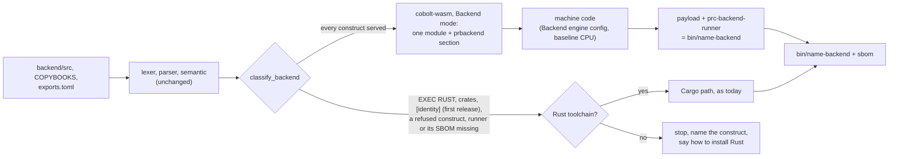
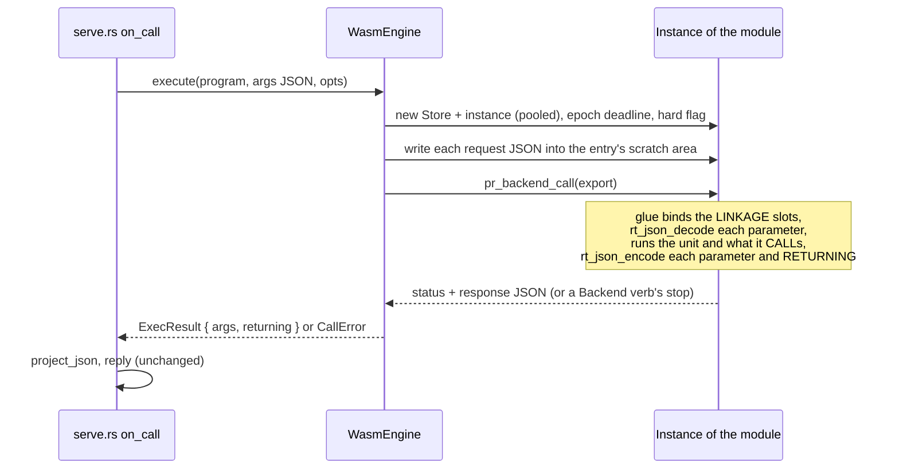

<!--
SPDX-License-Identifier: Apache-2.0
Copyright (c) 2026 Emerson Lopes and PowerRustCOBOL contributors
-->

# Plan — The Backend as a WebAssembly module: a Backend with no Rust toolchain, run by a prebuilt headless runner

- **Status:** draft (2026-11-26), for the operator's review. The spec's open questions Q1–Q7 are answered here with the spec's own recommendations; each answer is marked **proposed** in §4 and stands until the operator says otherwise. The four questions this plan asked (P1–P4, §8) were **answered by the operator on 2026-11-26**: the setting and the flags as assumed (P1), the default flipping only when M5 closes (P2), **runner variants by capability set** instead of one runner (P3), and spec 112 landing first (P4).
- **Spec:** ./spec.md   **Tasks:** ./tasks.md (2026-11-26; it lists five divergences from this plan, to be written back here in its T47)   **Date:** 2026-11-26
- **Branch:** `features` (the spec is a feature, Q6 proposed), synced from `main` at `f2101e00` (2.1.41).
- **Ground truth:** read 2026-11-26 at `f2101e00`. File:line references are to that tree. The facts in §0.1 come from three read-only passes over the source; the ones this plan leans on hardest (marked ✔) were read again by hand. Nothing was built or run: **no claim about speed, size or acceptance is made here**; M0 measures them.

## 0. What the code says, and what it changes in the spec

### 0.1 Facts found while planning

**The four shipped Backends need less than the spec assumed.** Counted 2026-11-26 over `backend/src` and `backend/COPYBOOKS` ✔:
- None of them uses a Backend verb (`COBOL::"WS-…"`, `AUTH-OP`), a stream, a `long_running` export, an `[identity]` or `[auth]` section, `[[crates]]`, `EXEC RUST`, the SQL object, `RestClient` or `AgentObject`; none sets `[backend] state` (per-call).
- What they use: **PowerOficina**, `ORGANIZATION IS INDEXED` files (34 files, 5 with `ACCESS MODE IS DYNAMIC`), `COBOL::"PARTIQL"` (52) and `COBOL::"PARTIQL-FETCH"` (14), `SORT` (3), `GOBACK`; **PowerAnalyticsWeb**, `EXEC SQL` (155 statements: `INCLUDE SQLCA/SQLDA`, `CONNECT`, `DECLARE … CURSOR` static and `FOR S-x`, `PREPARE`, `OPEN [USING DESCRIPTOR]`, `FETCH … INTO` with indicators, `CLOSE`, `EXECUTE IMMEDIATE`, `SELECT INTO`, `INSERT/UPDATE`, `COMMIT`, `ROLLBACK`); the two hello Backends, nothing but arithmetic and MOVE.
- So **the first deliverable needs no `backend` capability**: exports with their JSON entry, the file capabilities, `sort`, `partiql.files` and `sql` carry all four. The Backend verbs come after (M5). (The `WS-FAIL` the grep finds in PowerOficina is a data item of `seed-load.cbl`, not the verb.)

**What runs a call today (`cobolt-server`).**
- A call travels `serve.rs` `on_call` (1229) → `spawn_blocking` at **1467–1471** (`exec::Session::execute` or `exec::execute`) → `exec.rs` `Unit::new` (221–227), which builds an `Interpreter` from a **clone of the whole AST** (so each call pays an AST clone) → `run_call` (311) with `catch_unwind` (348). A panic is `PROGRAM_FAULT` 9001.
- **No engine abstraction exists.** The sites a seam must cover: `serve.rs` 61 (import), 707 (`Conn.state`), 816 (`Session::new`), 1453 and 1705 (`ExecOptions`), 1467–1471 (call), 1472 (`ExecResult`), 1717 (stream), and `identity/routes.rs` 167–177 (identity operations). Everything else in the crate reaches the interpreter only through `exec.rs`.
- The boundary is **JSON text**: `args: Vec<String>` in, `ExecResult { args, returning, display }` out; the group⇄JSON mapping runs inside the interpreter (`group_from_json`/`group_to_json`, `cobolt-runtime/src/interpreter/remote.rs` 364/372, over `cobolt_wire::mapping`). The server then projects the result with `mapping::project_json` (`serve.rs` 1583, 1591), outside the engine. `ExecResult.display` is collected and never read.
- `server` **cannot link without `cobolt-runtime`** today: the feature enables the dependency (`Cargo.toml` 33) and `exec.rs` imports it unconditionally. Only `exec.rs`, the `IdentityHook` impl in `identity/routes.rs` (159) and `client.rs` (595) name it. The `IdentityHook` type also sits in the type of `ExecOptions.identity` (`exec.rs` 75).
- Cancel is **two flags** per call: the hard flag is read once per statement in the interpreter (`interpreter.rs` 4445); the soft flag is seen only by `WS-CANCELLED`, `WS-PROGRESS`, `WS-PAUSE` and `WS-EMIT`. The wall-clock timeout (`serve.rs` 1472) answers `CALL_TIMEOUT` and **does not abort the blocking thread**; the permits can be released before it has stopped. **No per-call memory or CPU limit exists** (only the 64 MiB program stack guard).
- `[backend] state` is a **project-manifest setting** (`backend_build.rs` 133–141), baked into the bundle (`bundle.rs` 29, 58), not a `backend.toml` key (`ServerConfig` has no `[backend]` and denies unknown keys). Per-connection state keeps one `Unit` per exported program per connection (`exec.rs` 261–300); streams ignore the mode and always run a per-call interpreter (`serve.rs` 1717).
- `Backend::build` (`backend.rs` 400, 475–486) clones **every other non-identity program into each exported program's `nested_programs`**: an exported program has its own copy of everything it can `CALL`, and so its own WORKING-STORAGE for them. The module path must keep this isolation.
- The Backend's verbs split in two (`remote.rs`, dispatch `interpreter.rs` 11134–11164): **nine are Backend-side** (`WS-FAIL`, `WS-PROGRESS`, `WS-CANCELLED`, `WS-PAUSE`, `WS-EMIT`, `WS-CLAIM`, `WS-FILE-PATH`, `WS-FILE-PUBLISH`, `AUTH-OP`; they need the call's hooks, with differences: `WS-FAIL` and `WS-EMIT` refuse without them, `WS-CLAIM`, `WS-PAUSE`, `WS-PROGRESS` and `WS-CANCELLED` do not, and `AUTH-OP` works only inside an identity program) and **nine are client-side** (`WS-LAST-ERROR`, `WS-SHOW-PROGRESS`, `WS-STREAM-ITEM`, `WS-SUBSCRIBE`, `WS-UNSUBSCRIBE`, `WS-UPLOAD`, `WS-DOWNLOAD`, `WS-VERSION`, `WS-WARNING`), which on a standalone Backend are inert or answer `NOBACKEND`.

**What the generator and the runner have (`cobolt-wasm`, `cobolt-runner`).**
- The generator has **no per-program entry** ✔: `pr_run` is exported only in program mode and runs unit 0 (`module.rs` 1564–1574); `REQUIRED_EXPORTS` (`codes.rs` 303–315) lists only the form exports. It already holds every program unit of a source in one module, lays LINKAGE out as items with a 4-byte hidden slot (`layout.rs` 318–374) filled by a `CALL` (`rt_bind`), and lowers a `CALL` of a unit of the same source as a transfer (`lower_call.rs` 40–135, 183–296).
- The manifest carries **no per-export LINKAGE layout** (`manifest.rs` 118–150). The layout `Item` of the generator (`layout.rs` 24–64) is internal. But a **byte-layout JSON mapper exists, in the module**: `cobolt-wasm-rt/src/json.rs` (`encode` 573, `decode` 1037; exported `rt_json_encode/decode`), driven by a descriptor blob that `cobolt-wasm/src/json_layout.rs::build` (65) makes from the generator's layout and `cobolt_wire::layout::Item`. It runs today only for `CALL … WITH WEBSOCKET LINKAGE` in browser modules (`lower_remote.rs` 202), and is held equal to `cobolt-wire` by the golden vectors `specs/WASM-005…/vectors/group-json.v1.json` (`cobolt-wasm/tests/json_vectors.rs`, `cobolt-wire/tests/vectors.rs`). **No host-side function maps a byte buffer and a descriptor.**
- The support tables classify the nine Backend-side verbs and `AUTH-OP` as `Native::Cargo(D_REMOTE)` for the Desktop and `Support::BackendOnly` for a browser module; `WS-LAST-ERROR` is `Support::Module`; the other eight client-side verbs are `Support::Unsupported` (`support.rs` 257, 326–342). `EXEC SQL` is `Native::Host(cap::SQL)` (402); `CALL … WITH WEBSOCKET LINKAGE` is `Cargo(D_REMOTE)` (391). The Desktop refusal is applied in `Lower::stmt` (`lower.rs` 2485–2493) and `lower_form.rs` 308–382.
- There is **no `backend` capability and no `ws_*` import** (`cap` module `codes.rs` 174–235, 25 names; `NATIVE_IMPORTS` 271–292). A new capability needs an amendment row (the next after A58 in `specs/WASM-ABI-v1.md`) and an `NATIVE_IMPORTS` entry; a name is never retired (A27, DESKTOP-WASM-001 R5).
- **The runner is not headless** ✔: `cobolt-runner` has no `[features]`, links `cobolt-form-host`, `cobolt-forms` (render) and `cobolt-runtime` (with audio, graphics, aws, images, sql, http, kb, maps, pdf, office). Its `State` (`lib.rs` 346) holds `files`, `db`, `http` and `pq` as `Rc<RefCell<…>>` ✔: **not `Send`**, which is fine as long as one call owns one `State` on one thread. The data providers (`files.rs`, `sql.rs`, `http.rs`, `partiql.rs`) need only `cobolt-runtime` and `cobolt-abi-host` ports; `app.rs`, `forms.rs`, `gfx.rs` are the egui side. `linker_for` (485–970) is one `func_wrap` per declared import.
- **No limit exists at engine level** ✔: `consume_fuel`, `epoch_interruption`, `StoreLimits`, the pooling allocator and `max_wasm_stack` appear nowhere in `crates/`. `cobolt-runner-engine::config()` (116–131) sets multi-memory, NaN canonicalisation, an explicit target with a baseline CPU, and parallel compilation; `precompile` (179) and `load` (223) share it. The module's memory is **static** (min = max pages, no `memory.grow`).
- The Desktop's packaging is the model: `cobolt-program-package` (`Kind::{Module=1, MachineCode=2, MachineCodeEngine=3, Other(n)}`; payload `PRPAYLD\0` appended as an ELF/PE overlay or a Mach-O `__PRPAYLOAD` segment, re-signed ad hoc), and `wasm_build` (`cobolt-compiler/src/lib.rs` 4036–4110): precompile for the baseline CPU, `encode`, `embed(runner, payload)`, atomic install. The runner is found through `PRC_RUNNER`, else beside the running executable (`runner_near`, 2055–2092): **no download, not embedded**; a missing runner is `CompilerError::RunnerNotFound`, with no Cargo fallback.

**The Build and everything around it.**
- `build_backend` (`backend_build.rs` 197–379, 453 lines) touches Rust **first** (`host_triple()` runs `rustc -vV`, line 210), writes `contract/interface.json` before the contract check, builds a Cargo project per project (not the shared cache), installs `bin/<name>-backend` and writes `bin/sbom.cdx.json` from `cargo metadata`. `BackendBuildOptions` (37–47) has no engine; `BackendBuildResult` (51–60) has no engine, phase or time; there is no progress callback (only a `log` closure that prints when verbose). It is called by `rcrun backend build` (`main.rs` 670), spec 113's package (`package.rs` 563) and tests; **the IDE and the MCP tools do not call it**.
- `rcrun backend` (`main.rs` 516–690) has `run`, `describe`, `check`, `release`, `build`, `auth test`; **no `--engine`, `--cargo` or `--wasm` exists**. `run` starts `cobolt_server::dev::DevServer` in the `rcrun` process on the interpreter; the IDE spawns `rcrun backend run` as a child (`backend_run.rs`). `rcrun` already links wasmtime (through `cobolt-compiler` → `cobolt-runner-engine`); `cobolt-server` does not.
- The standalone executable's interface (`standalone.rs`): `--config --env-file --log-file --service --service-name --check --describe --version`; `--version` prints `backend (cobolt-server X)`; `--describe` prints the interface JSON before the config is read; `--check` prints `configuration ok: contract C on ADDR (N exported program(s))`; exit 0 clean, 1 load or start failure, 2 refused configuration. Spec 113's `prove` (`package.rs` 336–374) parses that `--check` line; its `zip_entries` (462–499) adds `bin/sbom.cdx.json` **only if the file exists, silently omitted otherwise**.
- CI: `build-all-platforms.yml` builds `-p cobolt-ide -p cobolt-cli -p cobolt-web-preview -p cobolt-runner` in one command (176–180), stages `prc-runner` into the flat directory, the macOS `.app` (315, ad hoc signing 367) and the installers (all harvest the staged tree), and checks it by name (379–388, 446–462, deb 1212, rpm 1360). `desktop-wasm.yml` has a `no-toolchain` job that removes `rustc`, `cargo` and `rustup` on four platforms: the template for the Backend's. The workspace forces the **dynamic CRT on MSVC** (`.cargo/config.toml` 15–27); the Cargo Backend overrides it only in its staging folder (`backend_build.rs` 96–106) so that `web-install-package.yml` passes its dependents check (Windows 387–394, Linux `ldd`, macOS system libraries only). **No document gives the size of a release `prc-runner` for this tree** except the CHANGELOG's 80,059,136 bytes (macOS arm64, 2.0.627); none exists on this machine.
- **No tool measures what the generator accepts of a Backend.** `support.rs` is a lookup table, not a report; `GenError::all_kinded()` lists every refusal of a program with line and subject, so a ~30-line example (`Backend::load` → `compile_program` per exported program with `Options { native: true, … }`) is the whole measurement.

### 0.2 Spec corrections made with this plan

Each is marked "(plan, 2026-11-26)" in `spec.md`.

| # | Spec | Correction |
|---|---|---|
| C1 | R4, §1 | Only the **nine Backend-side verbs** are served by the `backend` capability. The nine client-side verbs do nothing on a standalone Backend; a program that uses one takes the Cargo path, with the verb named. `WS-DOWNLOAD` is unsupported everywhere. |
| C2 | R1, R7, R8, §1 | `[backend] state` is a **project-manifest** setting baked into the Backend (as the spec's text half says); it is not in `backend.toml`. The module's manifest carries it. |
| C3 | R7, R12, AC2 | `--check`, `--describe` and `--version` stay **byte-identical on stdout**. The engine line (R12) goes to stderr and the log only, so spec 113's `prove` parses what it parsed. |
| C4 | R19, AC8 | The package's zip includes the SBOM only when the file exists. The module path **must write `sbom.cdx.json`** beside the file, or the package ships without one; AC8 asserts the SBOM is in the zip. |
| C5 | R8, R11 | The isolation to keep is **per exported program**: each exported program has its own copy of everything it can `CALL` (`backend.rs` 475–486). The module path keeps one instance per call, and per `(connection, exported program)` under `per-connection`. |
| C6 | R10, R11 | Today's interpreter has **no memory or CPU limit** and its timeout does not stop the thread. The module path gives more (a static memory, a trap at the next epoch); equality is asked of the *answers*, not of these. Each difference goes to `WASM-PARITY.md`. |
| C7 | R5, R7 | The Windows runner must be **linked with the static C runtime**; the workspace default is the dynamic one. It is built by its own `cargo` command in the release workflow. |
| C8 | R17 | A Backend built with no `cargo` cannot run `cargo metadata`. The release workflow writes the **runner's own SBOM** next to the runner; the Build adds the module's component. A runner with no SBOM file sends the Build to the Cargo path, named. |
| C9 | §1 "What exists today" | PowerOficina has no `EXEC SQL` (corrected earlier); the shipped Backends use no Backend verb at all (§0.1). R15's measurement is therefore **the gate for M3**, not a ranking of verbs. |

## 1. Approach

### 1.1 The path (R1–R3, R5–R7, R13–R14)

1. The Build classifies the Backend (§4 D8). If every construct of every program is served, it takes the module path; otherwise the Cargo path, saying which construct and why.
2. The generator, in **Backend mode**, compiles every program of `backend/src/` (and the copybooks, and the generated identity programs when the first release serves them) into **one module**. For each exported program it emits an **entry** the runner can call with JSON, and a custom section `prbackend` that holds the export table and the descriptor blob of each parameter and of `RETURNING` (the blob `json_layout::build` already makes).
3. The Build precompiles machine code for the platform's baseline CPU with the **Backend engine configuration** (§4 D6), packs `{interface, exports, history, state, module, machine code}` into one payload, embeds it in a copy of the prebuilt **`prc-backend-runner`**, and installs the result as `bin/<name>-backend` with its SBOM.
4. At start the runner (the same `standalone` start-up as today, with a different loader): reads the payload; refuses a capability it does not provide, naming it (R2); builds the `Backend` from the interface and exports; loads the machine code or makes it again (DESKTOP-WASM-001 R16); and serves with `serve::start` through a **`WasmEngine`**.

### 1.2 One call (R8–R11)

- The **entry glue is generated**, not interpreted: for each export it reserves the record storage the LINKAGE items need, fills their slots as a `CALL … USING BY REFERENCE` does, and jumps to the unit through the machinery `call_unit` already has. The request is decoded and the answer encoded by the routines of `rt.wasm` the browser's remote call already uses, so the refusals of R9 (unknown field, wrong kind, a string over its `PIC`, a table over its `OCCURS`) and their codes come from the **same golden vectors** the interpreter's reference (`cobolt-wire`) is held to.
- A Backend verb, when M5 lands, is a host import of the new `backend` capability; `WS-FAIL` records the failure on the call's host state and then ends the run as `STOP RUN` does, so the glue returns "failed" and the host discards the parameters, as `exec.rs` 377–382 does.
- **Time and cancel (R10):** the Backend engine configuration turns on wasmtime's epoch interruption. One ticker thread per runner advances the epoch every 10 ms; each call's store has an **epoch callback** that returns an interrupt when the call's hard flag is set or its wall-clock deadline has passed, and continues otherwise. A loop that never reaches an interpreter statement is therefore stopped within one tick, which the interpreter could not do. The call ends as *cancelled* or `CALL_TIMEOUT` exactly as `exec.rs` 355–361 decides today. The soft flag is read by the `ws_cancelled` import (M5).
- **Isolation (R8, R11):** a new `Store` and instance per call from a **pooling allocator** (Q2, measured at M0 against the interpreter's per-call cost, which includes an AST clone). The module's memory is static, so a call's memory is bounded by construction; a `StoreLimits` is set to the declared size as a second guard. Under `per-connection`, the session keeps one instance per exported program for the life of the connection, and the calls take turns, as `serve.rs` 1404 and `exec.rs` 290–300 already ensure.
- **Providers (R6):** the data capabilities are the ones the Desktop runner has, served by one implementation. Each call owns a `State` with its own `Rc<RefCell<…>>` providers on its own blocking thread, which is how the interpreter's `ExternalStore` works (per call, or per connection under `per-connection`); nothing is shared across threads.
- **`DISPLAY` in a Backend** goes nowhere today (`ExecResult.display` is never read); the module's console output is discarded, which keeps the answer equal and is recorded in `WASM-PARITY.md`.

### 1.3 Milestones

The Build keeps the **Cargo path as the default** until M5 closes; M4 offers the module path with `--wasm` and the project setting. **A Backend counts as moved only when its parity run (AC3) is green.**

| M | Delivers | Falls back (named) | Closes |
|---|---|---|---|
| M0 | **Measure.** `backend_support` over the four Backends (what the generator accepts, by reason); the spikes (instance cost with and without pooling, epoch overhead on a loop, per-call cost of the interpreter, a cold and warm `build_backend`, a release runner's size); the baseline numbers in `WASM-PROGRESS.md` | nothing changes | R15, R16 baseline, AC10 baseline; **decides M2's order** |
| M1 | **The seam.** An `Engine` trait in `cobolt-server`; today's code becomes the interpreter engine behind a new `interpreter` feature (on by default); the channel tests run per engine; `server` without `interpreter` links no `cobolt-runtime` | everything stays on the interpreter | R5 (part), AC4's harness |
| M2 | **The generator's Backend mode.** `Options.backend`, the entry glue, `prbackend`, the manifest's `backend` section, the Backend column of the support tables; differential tests of entry-by-entry against `exec::execute` on small programs | the nine Backend-side verbs, identity, client-side verbs, forms, `EXEC RUST` | R1, R2 (part), R9 |
| M3 | **The headless runner.** `cobolt-runner` gets a `forms` feature; the new crate `cobolt-backend-runner` (library and `prc-backend-runner`): payload loader, `WasmEngine`, pooled per-call instances, epoch cancel and timeout, the data capabilities; the four shipped Backends run on it and are compared with the interpreter | as M2 | R5, R6, R8 (per-call), R10, R11, R12; AC3 on the four, AC5 (per-call), AC6 |
| M4 | **The Build.** `classify_backend`; the module path in `build_backend` behind `--wasm`; the payload kind; machine code; the SBOM; phases and a progress callback; `--cargo`/`--wasm`; the project setting; spec 113's package on the module path | as M2, plus runner or its SBOM missing | R7, R13, R14, R16, R17, R19, R22; AC1, AC2, AC7, AC8 |
| M5 | **The Backend verbs and the session.** The `backend` capability (A59) and the eight Backend-side verbs; `per-connection`; streams (`WS-EMIT`); files (`WS-FILE-PATH`, `WS-FILE-PUBLISH`); the loopback, client-contract and fuzz tests on both engines; **the default flips to Auto** when AC3–AC6 are green | `AUTH-OP` and `[identity]`, client-side verbs | R4, R8, R10 (`WS-FAIL`), R20; AC3 (full), AC4, AC5, AC6 |
| M6 | **Around it.** `rcrun backend run --engine wasm`; the release workflows (build, stage, sign, check the new runner on four platforms; a no-toolchain Backend job; the package test on the module path); the runner's SBOM; the module corpus; the Guide; the System KB; `WASM-PARITY.md`; the measurements on three systems | as M5 | R18, R21; AC8 on CI, AC9, AC10, AC11, AC12 |

**Honest sizing.** M1 is small to medium (eight sites and a feature split). M2 is medium to large (a generator mode and a manifest section, but the JSON routines and the unit-call machinery exist). **M3 is the largest** (a new crate, the feature gate in a runner that Desktop programs depend on, and the engine configuration). M4, M5 and M6 are medium each. No hours are promised: M0 produces the numbers, and each milestone ends at a gate that names its tests.

## 2. Affected crates / files

**New crate:**
- **`crates/cobolt-backend-runner`** (library and the binaries `prc-backend-runner-<variant>`, Q7, D6; one cargo feature per group of providers): the payload loader, `WasmEngine` (implements the server's `Engine`), the `backend` capability's imports, the linker that adds the providers of `cobolt-runner`, the ticker. `rcrun` depends on its library for `--engine wasm`.

**Changed files:**
- **`crates/cobolt-server`:**
  - `src/engine.rs` (new): the `Engine` and `EngineSession` traits, a neutral identity-operations trait.
  - `src/exec.rs`: becomes the interpreter engine, behind `interpreter`.
  - `src/serve.rs` (the eight sites of §0.1), `src/identity/routes.rs` (167–177, and the `IdentityHook` impl at 159 behind `interpreter`), `src/backend.rs` (`ExportedProgram`'s body is the AST or a module entry; a second constructor builds a `Backend` from an interface and an export table), `src/standalone.rs` (`main` takes a loader; the engine line to stderr), `src/dev.rs` (`DevOptions.engine`), `src/testkit.rs` (`rig_on(engine, …)`).
  - `Cargo.toml`: feature `interpreter` (the `cobolt-runtime` dependency), on by default; `server` no longer implies it.
  - `tests/dependency_guards.rs`: `server` without `interpreter` links no `cobolt-runtime`; `tests/loopback.rs`, `client_contract.rs`, `fuzz_dispatch.rs`: run per engine.
- **`crates/cobolt-wasm`:** `src/module.rs` (`Options.backend`), a new `src/backend_entry.rs` (the glue), `src/support.rs` (the Backend column: the nine verbs and the entry rows), `src/lower_form.rs`/`lower.rs` (the gate), `src/json_layout.rs` (reuse), `examples/backend_support.rs` (M0), `tests/backend_entry.rs`, `tests/subset_table.rs` (every Backend-side verb has a row). `assets/rt.wasm` is rebuilt (`cargo run -p cobolt-wasm --example build_rt`) only if a support routine is added.
- **`crates/cobolt-wasm-abi`:** `src/codes.rs` (`cap::BACKEND`, its imports in `NATIVE_IMPORTS`), `src/manifest.rs` (`backend`, serialised only when present, so no other module's bytes change), `src/scan.rs` (the Web bundler refuses a module that needs `backend`); `specs/WASM-ABI-v1.md` (A59).
- **`crates/cobolt-runner-engine`:** `backend_config()` (epoch interruption) beside the unchanged `config()`; `precompile`/`load` take the configuration.
- **`crates/cobolt-program-package`:** `Kind::Backend = 4` and its container (§3).
- **`crates/cobolt-runner`:** a `forms` feature (default on) around `app.rs`, `forms.rs`, `gfx.rs`, `viewer.rs`, `audio.rs`, the control-side `rest/aws/agent/kb` and the egui dependencies; the capability registration made callable by both runners.
- **`crates/cobolt-compiler`:** `src/backend_build.rs` (engine option, `classify_backend`, the module path, phases, a progress callback, the SBOM), `src/lib.rs` (`BACKEND_RUNNER_ENV`, the lookup of `prc-backend-runner`, new `CargoReason` variants, `browser_subset_doc` Backend column 8170–8300 and the Desktop path text 7640–7760), `src/project_kind.rs` (`BackendSettings.build_path`).
- **`crates/cobolt-cli`:** `src/main.rs` (`--cargo`, `--wasm`, `--engine`; prints engine, reason and phases).
- **`crates/cobolt-project-tools`:** `src/web/package.rs` (557–568: the engine in the notes, the SBOM asserted, the Windows CRT note only on the Cargo path).
- **`crates/cobolt-ide`:** `src/i18n.rs` (the engine, fallback-reason and phase lines in six languages), `src/web_package.rs` (the lines).
- **`.github/workflows`:** `build-all-platforms.yml` (the `-p` list at 176–180 is for the other binaries; the Backend runner gets its own `cargo` command for the Windows static CRT; staging 237–251, `.app` 315/367, checks 379–388 and 446–462, deb 1212, rpm 1360), `desktop-wasm.yml` (a no-toolchain Backend job on the model of `no-toolchain`), `web-install-package.yml` (the runner beside `rcrun`; the dependents checks on the runner copy). The spec 112 branch also edits workflows: merge order matters (§5).
- **Docs and data:** `docs/developers-guide-en.md` (24, 24.11 and the Rust note of 23.11), the System KB tables and `assets/knowledge/chunked.data`, `specs/WASM-PARITY.md`, `specs/WASM-PROGRESS.md`, `tests/module-corpus/backend/` (the append-only corpus), `CHANGELOG.md`.

## 3. Data / model changes

- **The payload (`Kind::Backend = 4`, permanent, R3).** A versioned container holding: the interface description JSON (the `InterfaceDescription` `build_backend` writes today), the export table (each export's name, `long_running`, `stream`, `independent`, roles), the released-contract history, the state mode, and the module bytes. Machine code uses the existing kinds 2 and 3; a runner that cannot use it makes it again (R16). An unknown kind is tolerated by an older runner (`Kind::Other`), and a **new** runner reads every payload version ever written (AC9).
- **The module.** One `.wasm`, with the manifest's new `backend` section (the export names and entry indices, the state mode, the descriptor blob offsets) and the custom section `prbackend` (the descriptor blobs). The manifest's `capabilities` list gains `backend` (M5) beside the data capabilities already named (`files.indexed`, `sort`, `sql`, `partiql`, `partiql.files`, `http`).
- **Imports (A59, M5):** in the `prn` namespace, one per Backend-side verb (`ws_fail`, `ws_progress`, `ws_cancelled`, `ws_pause`, `ws_emit`, `ws_claim`, `ws_file_path`, `ws_file_publish`; `auth_op` joins when identity is served). The set is fixed when the capability first ships.
- **Engine configuration.** `backend_config()` = `config()` plus epoch interruption and the pooling allocator. It is a separate function, so **the Desktop's machine code is unchanged** (guarded by the module corpus).
- **Project setting (assumed, §8 P1).** `[backend] build_path = "auto" | "wasm" | "cargo"` (default `auto`: the module path when `classify_backend` says the module serves the Backend in full, the Cargo path otherwise, with the reasons named; D9), the Backend's twin of `[desktop] build_path`. A project without it reads the default; nothing in a `.cfrm`, `.cidx`, `exports.toml`, `backend.toml` or the developer's COBOL changes (R22).
- **The Build's report.** `BackendBuildResult` gains `engine`, `reasons` (each: construct, file, line, reason), `phases` (check, generate, machine code, assemble, contract) with times and peak memory; `BackendBuildOptions` gains `engine` and a progress callback. `CargoReason` gains `Identity`, `BackendVerb { verb }` and `ClientVerb { verb }`; `RunnerUnavailable` is reused (and now falls back instead of stopping, because a Backend can still be built with Cargo).
- **The runner's SBOM** (`prc-backend-runner-<variant>.sbom.json`, written by the release workflow with `cobolt_wire::sbom`, one per variant) sits next to its runner; the Build reads the chosen variant's and adds the module's hash. The Build picks the variant from the manifest's `capabilities` (D6).

## 4. Key decisions & alternatives

- **D1. The seam lives in `cobolt-server`, as a trait.** — Why: eight call sites, no other crate reaches the interpreter, and every channel, identity, limit and TLS behaviour stays one implementation (R5). — Rejected: a second server crate (duplicates the channel and its fuzz tests); a feature flag that swaps `exec.rs` at compile time (the dev server needs both engines in one process for `--engine wasm` and for the parity tests).
- **D2. The entry is generated glue plus the `rt.wasm` JSON routines.** — Why: the mapper, its refusals and its golden vectors already exist and are shared with the browser; the interpreter's mapping is `cobolt-wire`, held equal by the same vectors; it adds no new mapper to keep equal. — Rejected: a host-side mapper over a byte buffer (a second implementation of the wire mapping to maintain beside two others); decoding in the interpreter and passing bytes (re-introduces the interpreter).
- **D3. Time and cancel by wasmtime epoch interruption, with a separate engine configuration.** — Why: it needs no change to the generator, stops a loop that has no statement to check, and leaves `config()` and the Desktop's machine code alone. — Rejected: the form mode's cooperative slicing (`pr_resume`, 20,000-block budget): it changes the module's shape for Backends and keeps the program-mode loop uninterruptible; fuel (a cost on every block, and no wall-clock meaning).
- **D4. One instance per call from a pooling allocator (Q2, proposed).** — Why: the simplest semantics and a clean WORKING-STORAGE; the interpreter pays an AST clone per call, so the module should not be slower. M0 measures both; if pooling is not faster, plain instantiation stays. — Rejected: resetting a pooled instance's memory by hand (faster only if M0 shows it; more code, a leak if a reset is missed).
- **D5. `cobolt-runner` gets a `forms` feature instead of an extraction crate (Q4, decided here).** — Why: no code moves out of the Desktop's runner, whose suites (`console`, `esql`, `files`, `sql_*`, `http_builtins`, `partiql_builtins`, the module corpus) keep guarding it; R6's "one implementation" holds trivially. A test fails if the headless build's dependency tree names `egui`, `eframe`, `winit` or `wgpu`. — Rejected: a `cobolt-native-caps` crate (moves about 500 lines of linker closures whose `State` is entangled with the form run); a copy (breaks R6).
- **D6. `prc-backend-runner` comes in variants by capability set (operator, 2026-11-26, P3).** The library has one cargo feature per group of providers; each variant is one binary per platform, named `prc-backend-runner-<variant>`; the Build reads the module's declared capabilities and picks **the smallest variant that provides all of them**. — Why: a Cargo-built Backend links only what its programs reach (`runtime_features::scan_program`), so a variant keeps a Backend's binary, attack surface and SBOM close to that, and a Backend that needs only files and PartiQL does not carry SQL drivers, an HTTP stack or the AWS client. — The groups and their count are **fixed at M0 from measured sizes**; the starting proposal is `core` (the file capabilities, `sort`, `partiql.files`), `sql` (core and `sql`), `net` (sql and `http`, REST and AWS) and `full` (net and `kb`, agents, models). The shipped Backends need `core` (PowerOficina, PowerWebHello, PowerMobileHello) and `sql` (PowerAnalyticsWeb). — Cost: N binaries on four platforms to build, check, sign and ship, N runner SBOMs, and a lookup that can fail per variant (a missing variant is a named fallback to the Cargo path, like a missing runner). — Rejected: one runner with every provider (simplest to ship, but about 80 MB for the Desktop's and a wider SBOM than any Cargo-built Backend has); a runner that loads providers as plug-ins (a second ABI to keep permanent).
- **D7. The shipped runner is found as the Desktop's is:** `PRC_BACKEND_RUNNER` (a folder, since there are variants), else beside the running executable. — Why: the same installers, the same lookup, no download.
- **D8. `classify_backend`, in this order:** `[backend] build_path = "cargo"` or `--cargo`; `[[crates]]`; `EXEC RUST`; a Backend program with a control (`D_FORMS`) or a named-item object (`D_SQL_ITEMS`, `D_REST_ITEMS`, `D_AGENT_ITEMS`); `[identity]` or `AUTH-OP` (first release); a client-side verb; any other construct the generator refuses (all of them listed, from `GenError::all_kinded()`); then a runner variant that provides every capability the module declares, and its SBOM. — Why: the Desktop's order, so the reasons read alike. A missing runner is a **fallback** here, not an error as on the Desktop, because the Cargo path can still build a Backend; with no toolchain either, the existing toolchain error names both.
- **D9. The module path is `auto`'s choice from the end of M4, for the Backends the module serves in full.** *(Amended 2026-11-26 evening, on the operator's instruction "the build must produce wasm"; D9 had held the flip until M5 closed.)* — Why: the reason for the wait was that a developer's production Backend must not change engine before the parity run on the shipped Backends is green, and it is (G3: 176 calls equal, 0 different, on all four). What the module does not serve yet cannot change engine silently, because `classify_backend` sends it to the Cargo path with a named reason: a program using a Backend-side verb (the generator refuses it), `[identity]`/`AUTH-OP`, a client-side verb, `EXEC RUST`, a named-item object, and — until T37 — `[backend] state = "per-connection"`. M5 then **widens** what the module serves (the verbs, per-connection state), one reason fewer at a time, and the channel suites on both engines (T38, T39) are its gate; they do not gate the default. The setting `build_path = "cargo"` and `rcrun backend build --cargo` keep the Cargo path one word away. — Rejected: keeping the default on Cargo until M5 closes (the operator asked for the module now), and default-on with no per-connection reason (it would change a shipped behaviour silently).
- **D10. `--check`, `--describe`, `--version` print what the Cargo-built file prints, and the engine and module hash go to stderr and the log (C3).** — Why: spec 113's `prove` parses the `--check` line and the install scripts and units depend on nothing else. — Rejected: an engine line on stdout (a second line would need `prove` to be taught to ignore it).
- **D11. The dispositions of the spec's open questions (proposed):** **Q1** the interpreter stays the dev server's default; `--engine wasm` opts in; revisit after AC3 and AC4 have been green for a release. **Q2** D4. **Q3** a follow-up spec once AC10 shows the runners are small enough to ship all four. **Q4** D5. **Q5** the first release serves exports, the data capabilities and (M5) the eight Backend-side verbs, per-connection state and streams; `[identity]`/`AUTH-OP`, the client-side verbs, forms and the named-item objects stay on the Cargo path with named reasons (§0.1 shows the four shipped Backends need none of the refused set). **Q6** feature: a new engine path and a new executable, beyond what the IDE did; the precedent "removing a requirement that should never have applied" fits only the Rust-toolchain half. **Q7** `prc-backend-runner`.

## 5. Risks & mitigations

- **A runner is large, and a full one has a wide SBOM** (the Desktop's is about 80 MB on macOS arm64 per the CHANGELOG, unmeasured for this tree). → D6's variants; M0 builds each candidate variant in release and measures it, and fixes the groups from the numbers; the `full` variant's wider SBOM is stated in the Guide.
- **Variants multiply the release work** (N binaries × four platforms to build, check, sign, stage and package, and N SBOMs). → One cargo feature per group, one workflow step that loops over the variants, one named fallback when a variant is missing; the count stays small (starting proposal: four).
- **Feature-gating `cobolt-runner` could break the Desktop.** → No code moves; the Desktop suites and the module corpus run after every task that touches the crate; the headless build is a separate `cargo` target, so the Desktop's default build is unchanged.
- **A different engine configuration invalidates machine code, and epoch checks cost speed.** → `config()` is untouched; the Desktop's corpus proves it; M0 measures the overhead on a loop; AC10 reports it, never gates it.
- **Windows: the static C runtime and the dependents check.** The workspace default is dynamic. → The runner is built by its own `cargo` command with `+crt-static` (a step in `build-all-platforms.yml`); `web-install-package.yml` runs its existing check on the runner copy; until a Windows runner has passed, the CHANGELOG says "not verified" (spec 113 already carries that wording for the installer).
- **Behaviour differences between the engines** (arithmetic, rounding, file status, SQL conditions, `DISPLAY`). → The generator is already held equal to the interpreter by NIST NC/IF/IC and `corpus.rs`; the new differential tests run the same calls through `exec::execute` and the module and compare byte for byte; the runner serves `EXEC SQL` through the interpreter's own SQL (`sql.rs`), so the semantics are the same code; every difference found goes to `WASM-PARITY.md` with who is right, and the default does not flip while one is open (D9).
- **The seam touches the production hot path.** → M1 is behaviour-preserving and ends green on the interpreter alone before M2 starts; the channel tests become engine-parameterised there.
- **The identity of module bytes (R2).** → `compile_determinism.rs` extends to Backend mode; the corpus pins hashes.
- **Provider state is not `Send`.** → One `State` per call on its own thread, as in §1.2; a test runs N parallel calls (AC5).
- **Merge order with the spec 112 branch**, which edits the same workflows and `CHANGELOG.md`. → Land spec 112 first (it is pending) and rebase this work's workflow edits on it.
- **`rt.wasm` is a committed blob.** → If the glue needs a new routine, rebuild with `build_rt` in the same change; the existing test that compares the blob with its source stays green.

## 6. Test strategy

Each test ends in one result block (GOLDEN RULE #7): its name, the cases it ran, the timings or throughput, and a pass/fail tally. Real measurements only.

- **M0 — `cobolt-compiler/examples/backend_support.rs`:** per example Backend, the programs tried, the constructs refused by reason, the count accepted. **Spikes** (`cobolt-bench` or examples): instance cost per call (plain and pooled), epoch overhead (a 10⁸-iteration loop, with and without), the interpreter's per-call cost on a shipped export, cold and warm `build_backend`, a release runner's size.
- **M1:** `cobolt-server`'s `loopback`, `client_contract`, `fuzz_dispatch` and `identity_routes` suites run with the interpreter engine through the new seam and print the same counts as before; the guard `server` without `interpreter` links no `cobolt-runtime`.
- **M2 — `cobolt-wasm/tests/backend_entry.rs`:** for a table of small programs (each `PIC`, `OCCURS`, `DEPENDING ON`, a group, `RETURNING`), at least five calls each (ordinary, empty, at each limit, over-limit refused, a program that ends early), the module's answer equals `exec::execute`'s byte for byte; prints calls, equal, different. `json_vectors` and `layout_golden` stay green; `compile_determinism` covers Backend mode; `subset_table` fails on a verb with no Backend row.
- **M3 — `cobolt-backend-runner/tests/parity.rs`:** the four shipped Backends' exports, at least five calls each, on the runner and on the interpreter, with equal JSON, equal codes and equal effects on files and databases; `files`, `esql` and `partiql` tests of the Desktop runner stay green with `forms` on and off; the guard on the headless dependency tree; AC5 (N parallel calls never share WORKING-STORAGE); AC6 (an infinite loop is stopped by the timeout, and the Backend keeps serving; the time from timeout to end is printed).
- **M4:** `backend_build_wasm003.rs`'s black-box test of the built file runs on both paths with the same arguments × outputs table (AC2); a Build with `cargo` and `rustc` removed from `PATH` succeeds for each accepted Backend (AC1); an `EXEC RUST` Backend takes the Cargo path and `--wasm` refuses it, with each construct, file, line and reason printed (AC7); `package_web.rs` (the `#[ignore]` one) runs on the module path and the zip holds the SBOM (AC8, C4).
- **M5:** the channel suites run on **both** engines with the same counts (AC4); one case per Backend-side verb; per-connection isolation (AC5); `WS-FAIL` discards the parameters (AC3's failing case).
- **M6:** the corpus fixture from the first release runs on every later runner (AC9); the three-system measurements print the phases against the 30 s goal and the throughput of both engines (AC10); no secret in the module or manifest, a release Backend refuses an `unsafe_*` setting, the module's imports equal its declared capabilities (AC11); `prebuilt_chunked_kb_matches_the_published_documentation` green after `build_chunked_kb` (AC12).
- **Manual (the operator, or a runner):** build and package PowerOficina on a machine with no Rust; install it in the container of spec 113's proof and call an export through nginx (AC8); dispatch the workflows for Windows and macOS. The window is never driven; the IDE's Output lines are read through the MCP tools.

## 7. Steering compliance

- [x] i18n: the Build's engine, fallback-reason and phase lines are `Tr` fields in six languages (`i18n.rs`); the reasons that name a construct stay as the generator writes them, English.
- [x] Generated-code banner and regenerate-on-action contract preserved: generated COBOL is untouched; the module is a build product beside the executable, like `interface.json`.
- [x] English Developer's Guide updated (24, 24.11, the Rust note of 23.11); no translations exist for it, none are touched.
- [x] Fix vs feature: **feature** (proposed, Q6) → branch `features`, a `z` bump and a CHANGELOG entry per change; the operator raises `x` and `y`; a fix found on the way (for example the dead `ExecResult.display`) is its own commit on `fixes`.
- [x] System KB: the support tables change (a Backend column; the nine verbs now served), so the `cobolt-compiler` doc tables and `assets/knowledge/chunked.data` are regenerated in the same change.
- [x] Interpreter/binary parity: this adds a host (the Backend runner) and holds it equal by R20; each difference goes to `WASM-PARITY.md`.
- [x] No "cobolt" in user-facing text (the runner is `prc-backend-runner`, an internal file name); COBOL identifiers stay English; no Fujitsu binary-compatibility claim.
- [x] Credentials: no secret in the module, the manifest, a fixture or a test; the example `.cfrm` files, which carry live keys, are never copied into fixtures.
- [x] Rust-only repository: the workflows, tests and tools are Rust and YAML; no script in another language enters the repo.

## 8. Open questions for the operator

None blocks `/tasks`; each has the answer this plan assumes.

- **Q1–Q7 of the spec:** answered in D11 (**proposed**). Say if any is wrong.
- **P1 — The project setting.** `[backend] build_path = "auto" | "wasm" | "cargo"` and the `--cargo`/`--wasm` flags, as the Desktop has (DESKTOP-WASM-001 A1). *Answered 2026-11-26: as assumed.*
- **P2 — When the default flips.** *Re-answered 2026-11-26 (evening) by the operator's instruction "the build must produce wasm":* at the end of M4, for a Backend the classification says the module serves in full (D9, amended); not at the end of M5. *First answer (2026-11-26, morning): when M5 closes with AC3–AC6 green.*
- **P3 — Runner variants.** *Answered 2026-11-26: variants by capability set (D6).* The groups are fixed at M0.
- **P4 — Spec 112 first.** This work edits the release workflows that the spec 112 branch also edits. *Answered 2026-11-26: spec 112 lands first.*
