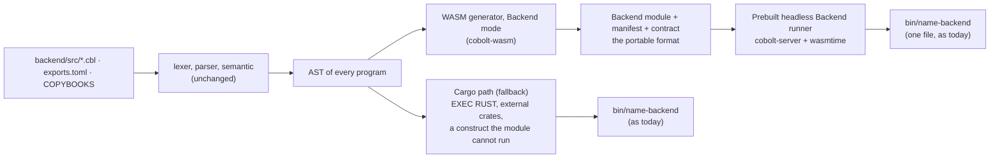

<!--
SPDX-License-Identifier: Apache-2.0
Copyright (c) 2026 Emerson Lopes and PowerRustCOBOL contributors
-->

# Spec — The Backend as a WebAssembly module: a Backend with no Rust toolchain, run by a prebuilt headless runner

- **Status:** draft (written 2026-11-25 while the operator was away). The plan (`./plan.md`, 2026-11-26) answers Q1–Q7 with the recommendations below, marked proposed; corrections it made here are marked "(plan, 2026-11-26)".
- **Folder:** specs/114-backend-as-wasm-module/
- **Author:** Emerson Lopes (design) · drafted with Claude   **Date:** 2026-11-25
- **Branch:** `features`, cut from `main` once spec 113 is merged (spec 113's package is the first consumer of this one: AC8).
- **Origin:** the operator, 2026-11-25, while reviewing spec 113's Web package: *"Why do we need Cargo in the Backend?"*, then *"Why isn't the Backend generated as WASM, reusing what is already done for the desktop version? It would be quick and already tested"*, then *"and it would still be multi-platform; only the player changes"*. The same night the operator asked for this spec.
- **Operator instruction, 2026-11-26 (evening), while 2.1.58 was being verified:** *"the build must produce wasm, and the packaging must make it ready for deployment in a remote server as a zip and a simple command-line script that would configure nginx, copy the files and start the binary as a service (Linux, macOS and Windows)"*. Read against this spec: **(a)** the Backend Build produces the module by default, which is R13 with the default `auto` choosing the module path for every Backend the module serves (the plan's D9 and P2 had held the flip until M5; this instruction moves it to the end of M4, with a conservative `classify_backend`: anything the module does not serve yet stays on the Cargo path with a named reason); **(b)** the zip, the one install script (nginx, files, native service) and the three systems are **spec 113, already built**, and R19/AC8 here make it need no Rust; **(c)** a package for an operating system other than the machine's own needs that system's runner, which the IDE does not ship: it stays Q3 (a follow-up), and the package is made, as spec 113 decided, for the machine that packages.
- **Builds on:** DESKTOP-WASM-001 (the module as the portable program format, the prebuilt native runner, the capability list of ABI A27), WASM-003 (the Backend and the secure channel), WASM-014 (the contract), WASM-010 (the generator), spec 113 (the Web package that ships the Backend). **Amends:** WASM-010 §1's statement that the Backend is the interpreter's (the interpreter stays the engine of development; the built Backend gains a second engine, held equal).

## 1. Overview

A built Backend today is **the interpreter plus the programs' ASTs**, linked by `cargo build --release` on the developer's machine (`cobolt_compiler::backend_build::build_backend`: it reads and checks `backend/`, writes `contract/interface.json`, generates a small Cargo project that depends on `cobolt-server` and the runtime features the programs reach, builds it and installs `bin/<name>-backend` and `sbom.cdx.json`). That is the one place where a Web project still needs a Rust toolchain: the page is built without one (WASM-002, WASM-010) and a Desktop program is built without one when the WebAssembly path accepts it (DESKTOP-WASM-001). It is also why spec 113's **Package Project** of a Web project can take minutes, and fails on a machine that has no Rust.

This spec makes the Backend follow the Desktop's way: **the generator turns each exported program, and the procedures they `CALL`, into one WebAssembly module with a manifest; a prebuilt, headless Backend runner loads it** — the runner is the `cobolt-server` (channel, identity, limits, TLS, service plumbing: all unchanged) with `wasmtime` as the engine that runs a call, instead of the interpreter. `bin/<name>-backend` stays one file with the same name, the same arguments and the same `backend.toml`: it is a copy of the runner with the module inside it, carried the way a Desktop program is (`cobolt-program-package`).

The module is portable: the same bytes run on Linux, Windows and macOS; only the runner is per platform. What a developer sees is a Build that needs no Rust and takes seconds.

### What exists today (checked 2026-11-25, 2.1.41)

- **The Backend's executable is a Cargo build.** `backend_build.rs` (module header): read and check, write the interface, compare it with the released contracts, *generate a small Cargo project — no forms, no `eframe`, no `egui` — and build it*, install `bin/<name>-backend` and the SBOM. `cobolt-server` is headless: its `Cargo.toml` says nothing there knows egui or eframe.
- **A call runs on the interpreter.** `exec.rs`: by default (`[backend] state = "per-call"`) each call gets **its own interpreter** built from the program's AST (fresh WORKING-STORAGE, nothing shared); `per-connection` keeps one run unit per exported program for the life of a connection. The arguments are read into the program's LINKAGE items by the wire mapping (`cobolt_wire`) before it starts — an unknown field, a number where text belongs, a string over its `PIC` or a table over its `OCCURS` is refused and the program never runs — and written back after it ends. `COBOL::"WS-FAIL"` ends the call and discards the parameters' changes; `WS-PROGRESS` and `WS-EMIT` send things while it runs; a cancel is seen through `WS-CANCELLED` and at the next statement. A program generated for a web form's control is seeded with the control's properties and the project's `[[configuration]]`.
- **The generator already holds every program unit of a source in one module** (`lower_call.rs`: a `CALL` of a program of the same source is a transfer inside the module; storage is static and one region), already lays out LINKAGE (`layout.rs`), and already classifies every statement and built-in for the WebAssembly path in `support.rs` (`Support`: compiled, conformance, memory files, backend-only, unsupported; `Native`: module, **host through a capability**, files, form, **Cargo with a named reason**). `Native::Host` appears 49 times in it (entries, and the code that reads them): the host-capability mechanism this spec reuses is in use.
- **The Backend's own verbs are in that table and are not yet served.** `WS-CANCELLED`, `WS-CLAIM`, `WS-EMIT`, `WS-FAIL`, `WS-FILE-PATH`, `WS-FILE-PUBLISH`, `WS-LAST-ERROR`, `WS-PAUSE`, `WS-PROGRESS`, `WS-SHOW-PROGRESS`, `WS-STREAM-ITEM`, `WS-SUBSCRIBE`, `WS-UNSUBSCRIBE`, `WS-UPLOAD`, `WS-VERSION`, `WS-WARNING`, `AUTH-OP` and `CALL … WITH WEBSOCKET LINKAGE` are *backend-only* in a browser module and `cargo(D_REMOTE)` on the desktop path: 19 entries whose reason is that nothing serves them there. (`WS-DOWNLOAD` is unsupported on every build.)
- **The desktop runner already serves what a Backend uses for data.** `cobolt-runner` has `files.rs`, `sql.rs`, `http.rs`, `rest.rs`, `aws.rs`, `partiql.rs`, `agent.rs` and `kb.rs`, behind the capabilities of ABI A27 (`files.*`, `sort`, `sql`, `http`, …), on `wasmtime =44.0.3` (Cranelift). The runner also carries the form engine (egui), which a Backend must not: the headless runner shares the providers and leaves the windows out.
- **The shipped Backends are small, and two kinds.** `examples/` holds four Backends (counted 2026-11-26 with `grep` over `backend/src` and `backend/COPYBOOKS`): **PowerOficina**, files only (21 source files, 5,576 lines, 20 exports, 34 `SELECT … ASSIGN`, **no `EXEC SQL`**); **PowerAnalyticsWeb**, SQL (11 files, 1,350 lines, 11 exports, **155 `EXEC SQL` statements**); PowerWebHello (2 files, 28 lines, 2 exports); PowerMobileHello (1 file, 13 lines, 1 export). None has `EXEC RUST`, `ConnectionDataItem`, `ResultSetDataItem`, `RestClient`, `AgentObject` or the SQL object. Whether the module accepts them today is **not measured**; measuring it is the first task (R15). *(An earlier draft of this paragraph gave PowerOficina 120 `EXEC SQL` statements: wrong, corrected here.)*
- **Known limits of the desktop path that a Backend will meet** (`support.rs`): the objects that name the program's data items by name at run time (`COBOL::SqlDatabase`'s `ConnectionDataItem`/`ResultSetDataItem`, `RestClient`, `AgentObject` items) take the Cargo path (`D_SQL_ITEMS`, `D_REST_ITEMS`, `D_AGENT_ITEMS`, DESKTOP-WASM-001 M6); a program with no form has no control or application object (`D_FORMS`), which is the case of every control-seeded Backend program.
- **What spec 113 needs from the Backend:** one executable named `bin/<name>-backend` with `--config`, `--env-file`, `--log-file`, `--service [--service-name]`, `--check`, `--describe`, `--version`; the install scripts, the service units and the deploy kit depend on nothing else.

## 2. Goals / Non-goals

- **Goals:**
  - A Web or Mobile project's **Backend builds with no `cargo` and no `rustc`** wherever the WebAssembly path accepts it: no Rust on the developer's machine, none on the server.
  - **`bin/<name>-backend` keeps its interface**: same file name and place, same arguments, same `backend.toml`, same wire protocol, same contract, same `--check` and `--describe` answers, same exit codes. Spec 113's package, installers and service units work with no change.
  - **The two engines answer alike**: for every exported call, the module and the interpreter give the same JSON (and the same failure, with the same code); `WS-FAIL`, `WS-PROGRESS`, `WS-EMIT`, cancel, streams, files and claims behave the same.
  - A **portable Backend module** whose bytes do not depend on the Rust release, the compiler or the operating system that produced it, and that every later runner runs (the promise of DESKTOP-WASM-001 R5).
  - **No project loses**: a Backend the module cannot run builds on today's Cargo path, and the Build names the construct and the reason.
  - A **build-time goal of 30 s** on every supported platform (4 cores, SSD, 16 GB), measured and reported per phase — a goal, not a limit, as in DESKTOP-WASM-001 R17.
- **Non-goals:**
  - Replacing the interpreter. It stays the engine of `rcrun backend run`, the IDE's Run and Preview, and `rcrun run`.
  - Changing the wire protocol, the contract, the identity settings, the limits or the service plumbing (WASM-003, WASM-013, WASM-014, spec 113).
  - Run-time throughput **budgets**: throughput of the two engines is measured and reported, never gated.
  - `EXEC RUST` and external crates in a Backend module (they keep the Cargo path).
  - Packaging for **another operating system** than the machine's own (the module is portable, but the runner shipped with the IDE is the machine's own; see Q3).
  - Any change to a developer's COBOL, `.cfrm`, `.cidx`, `exports.toml` or `backend.toml`.

## 3. User stories

- As a **COBOL developer**, I want to build and package a Web application on a machine with no Rust installed, so that the build step is not a second product to install and maintain.
- As a **developer**, I want the Package of my Web project to finish in seconds, not minutes, so that I can package often.
- As a **server operator**, I want `bin/<name>-backend` to be the same kind of file and take the same arguments as before, so that my service and my scripts need no change.
- As a **developer**, I want a Backend built years ago to run on this year's runner, so that a new release never forces me to rebuild and re-ship it.
- As a **developer**, I want the Build to tell me, per project, which engine it used and why, so that a Backend that falls back to Cargo is never a surprise.

## 4. Requirements (EARS)

**The module**

- **R1 (ubiquitous):** The generator shall have a **Backend mode** that turns the programs of `backend/src/` and the copybooks they use into one module in which each exported program is an entry the runner can call with its LINKAGE area filled, and whose manifest carries, for each export, the layout of its parameters and `RETURNING` item (the same layout the wire mapping reads today), the project's `[backend] state`, and the capabilities the module needs.
- **R2 (ubiquitous):** The module shall be **portable**: its bytes shall not depend on the Rust release, the compiler or the operating system that made it, and the manifest shall list every capability and import it needs (ABI A27), so that a runner that cannot provide one refuses to start and names it.
- **R3 (ubiquitous):** Every ABI, import, capability and section name introduced shall be permanent (DESKTOP-WASM-001 R5): a module built by any release runs on every later runner.
- **R4 (ubiquitous):** The Backend's verbs (`WS-FAIL`, `WS-PROGRESS`, `WS-EMIT`, `WS-CANCELLED`, `WS-CLAIM`, `WS-FILE-PATH`, `WS-FILE-PUBLISH`, `WS-PAUSE`, and `AUTH-OP` once identity is served) shall be served by a **new capability** (`backend`) of the runner, in a namespace of their own; a browser page and the Desktop runner shall refuse a module that needs it. *(plan, 2026-11-26, C1: the nine client-side verbs — `WS-LAST-ERROR`, `WS-SHOW-PROGRESS`, `WS-STREAM-ITEM`, `WS-SUBSCRIBE`, `WS-UNSUBSCRIBE`, `WS-UPLOAD`, `WS-DOWNLOAD`, `WS-VERSION`, `WS-WARNING` — do nothing on a standalone Backend and are not served; a program that uses one takes the Cargo path, with the verb named.)*

**The runner**

- **R5 (ubiquitous):** A prebuilt **headless Backend runner** per supported platform shall carry `cobolt-server` (the channel, identity, limits, TLS, idempotency, service plumbing) and an engine that runs the module, and shall contain no window, no `egui` and no `eframe`. *(plan, 2026-11-26, C7: the Windows runner is linked with the static C runtime, so that it starts on a machine without the Visual C++ Redistributable, as the Cargo-built Backend does.)*
- **R6 (ubiquitous):** The runner shall provide the **data capabilities the Backends use** through the providers the Desktop runner already has (indexed, sequential, line-sequential and relative files, `sort`, `sql`, `http`/REST, AWS, PartiQL, knowledge base, agents) — one implementation, not a copy.
- **R7 (ubiquitous):** `bin/<name>-backend` built on this path shall be **one file**: the runner with the module (and, by default, its machine code for the runner's target) inside it, carried as a Desktop program is (`cobolt-program-package`); its arguments, `backend.toml`, `--check`, `--describe`, `--version`, signals, exit codes, environment file and log file shall be those of the executable built on the Cargo path. *(plan, 2026-11-26, C2, C3: `[backend] state` is a project-manifest setting that the Build bakes into the file, not a `backend.toml` key; the three commands print the same stdout byte for byte, and the engine line of R12 goes to stderr and the log.)*
- **R8 (state):** While `[backend] state = "per-call"`, each call shall run with fresh WORKING-STORAGE and share nothing with another call; while `"per-connection"`, one run unit per exported program shall live for the life of the connection, its calls taking turns. *(plan, 2026-11-26, C5: each exported program has its own copy of everything it can `CALL`, as `Backend::build` makes today, so the isolation is per exported program.)*
- **R9 (event):** When a call is refused by the wire mapping (unknown field, wrong kind, a string over its `PIC`, a table over its `OCCURS`), the program shall not run, with the same error code as on the interpreter (WASM-003 R15).
- **R10 (event):** When a program ends with `WS-FAIL`, the call shall end with that failure and the parameters' changes shall be discarded; when a call is cancelled or times out, it shall stop at a safe point and end as *cancelled*, its effects not undone; a runaway program (a loop that never reaches a statement the interpreter would stop at) shall also be stopped.
- **R11 (state):** While calls run in parallel (the Backend's limits), the engine shall keep them isolated from each other and shall not let one call's memory or time starve the others beyond the limits.
- **R12 (ubiquitous):** The runner shall report, in its log and in `--check`, which engine runs the Backend and the module's hash.

**The Build**

- **R13 (event):** When a Backend is built, the Build shall choose the module path when every construct of every program is served by the module and the runner, and the Cargo path otherwise; it shall say which, and for the Cargo path name **each** construct, its file and line, and the reason (the same text the Desktop Build gives). `rcrun backend build --cargo` shall force the Cargo path, `--wasm` shall refuse to fall back.
- **R14 (ubiquitous):** The module path shall need **no Rust toolchain**: building shall succeed with no `cargo` or `rustc` reachable from `PATH`.
- **R15 (ubiquitous):** Before any engine work starts, the first task shall **measure** how much of the shipped Backends (the four of `examples/`) the module accepts today, per construct, and record it; the figures shall decide the order of the work and appear in the CHANGELOG.
- **R16 (ubiquitous):** The Build shall measure and report its phases (check, generate, machine code, install, contract) and compare their total with the 30 s goal on each supported platform.
- **R17 (event):** When a Backend module path is built, `sbom.cdx.json` shall be written beside the file as today, listing the runner's components and the module's hash. *(plan, 2026-11-26, C4, C8: spec 113's zip omits the SBOM silently when the file is absent, so the file is mandatory; with no `cargo` at Build time the runner's components come from an SBOM the release workflow writes next to the runner.)*

**Development, and spec 113**

- **R18 (optional):** Where the developer asks (`rcrun backend run --engine wasm`), the development server shall run the Backend's module instead of its interpreter, so that what ships can be tried before it ships; without the flag the interpreter runs, as today.
- **R19 (ubiquitous):** Spec 113's Package of a Web project shall use the module path when it applies and shall need no Rust toolchain when it does; its zip layout, installers, service units and deploy kit shall not change, and its **Prove** step (`--check`) shall run on the new file as on the old.

**Parity and safety**

- **R20 (ubiquitous):** The module and the interpreter shall be **held equal** by tests that run the same calls on both and compare the JSON byte for byte, the failures with their codes, and the effects on files and databases; each known difference shall be listed in `specs/WASM-PARITY.md` and say which engine is right.
- **R21 (ubiquitous):** The module path shall not weaken any protection of WASM-013: no secret in the module or the manifest, `unsafe_*` settings still stop a release Backend, and the module's imports shall be exactly the capabilities it declared.
- **R22 (ubiquitous):** The module path shall never delete or rewrite a developer's source; a Backend it refuses is reported, not changed.

## 5. Acceptance criteria

- [x] **AC1 — No Rust.** With `cargo` and `rustc` removed from `PATH`, building each shipped Backend that the module accepts (R15) succeeds and installs `bin/<name>-backend`; the test reports the Backends tried, the engine chosen for each and the time per phase. (R13, R14, R16)
- [x] **AC2 — Same interface.** `bin/<name>-backend --version`, `--describe`, `--check` and a start with `--config`, `--env-file` and `--log-file` behave as the Cargo-path file does: the same output text (apart from the engine line, R12), the same exit codes, the same files written. A test reports the arguments × outputs compared. (R7, R12)
- [x] **AC3 — Same answers.** For every exported program of the accepted shipped Backends, a table of calls (at least 5 per program: ordinary, empty, at each `PIC`/`OCCURS` limit, an over-limit refused one, one that ends with `WS-FAIL`) gives byte-equal JSON, equal codes and equal database/file effects on the interpreter and on the module. The test prints the number of calls, equal, different. (R8, R9, R10, R20)
- [x] **AC4 — The channel tests on the new engine.** `cobolt-server`'s loopback, client-contract and fuzz-dispatch tests run against the module engine with the results of the interpreter run. (R5, R20)
- [x] **AC5 — Isolation.** N parallel calls of one program (N from the Backend's own limits) never see each other's WORKING-STORAGE under `per-call`; under `per-connection`, two connections never share a run unit and one connection's calls take turns. (R8, R11)
- [x] **AC6 — Cancel and timeout.** A program that loops forever is stopped by the timeout and ends as cancelled, and the Backend keeps serving; the test reports the time from the timeout to the end of the call. (R10)
- [x] **AC7 — The fallback is named.** A Backend with `EXEC RUST` (or another construct the module does not serve) builds on the Cargo path, and the Build prints each construct, file, line and reason; `--wasm` on it refuses instead. (R13)
- [ ] **AC8 — Spec 113 unchanged.** The Web package of a shipped project, made on the module path, installs with the unchanged Linux script in the container of spec 113's proof, the service starts and answers a call through nginx; the test reports the steps and the time of the package against the Cargo path's. (R19)
- [x] **AC9 — Permanent compatibility.** A Backend module kept from the first release of this feature runs on the runner of the current one (a fixture committed with the feature, run by every later release's tests). (R3)
- [ ] **AC10 — Measured, not gated.** The Build time per phase and the throughput of both engines (calls per second for the shipped Backends' commonest call, one connection and N connections) are measured and printed on each of macOS, Linux and Windows runners; the 30 s goal is stated as met or not met per platform. (R16, goal)
- [x] **AC11 — Secure.** The module and manifest hold no secret; a release module refuses an `unsafe_*` setting; the module's imports equal its declared capabilities. (R21)
- [x] **AC12 — Documented.** The Developer's Guide chapter 24 says what the Build now makes, when it falls back and why, `--engine wasm`, and the caveats; the system knowledge base is regenerated; the CHANGELOG says, per system, what was proved and what was not. (§6)

## 6. Constraints & steering check

- **i18n (6 languages):** yes — the Build's output in the IDE (which engine, the fallback reasons, the phases) is a `Tr` field in all six languages; the reasons that name a construct stay as the generator writes them, English, like every report of the tools. COBOL names stay English.
- **Generated-code / regenerate contract:** the generated COBOL and the developer banner are untouched; the module is a build product, written beside the executable like `interface.json`.
- **Docs:** `docs/developers-guide-en.md` (chapter 24, section 24.11, and the packaging section of spec 113), English only; delete the five translations if any exist then; the System KB tables change (a new capability, the Backend verbs now served) and `assets/knowledge/chunked.data` is regenerated.
- **Interpreter/binary parity:** a runtime change reaches every host. This spec adds a host (the Backend runner) and holds it equal to the interpreter by R20.
- **Tests:** quantified result blocks (rule #7) for each acceptance test; user-provided tests are report-or-fix.
- **Versioning:** a `z` bump and a CHANGELOG entry per change; the operator raises `x`/`y`.
- **Classification (rule #5):** proposed **feature** — a new engine path and a new executable for the Backend, beyond what the IDE did. The precedent *"removing a requirement that should never have applied"* (the Rust toolchain) points the other way for the part that removes the requirement; the operator decides (Q6).
- **Never claim Fujitsu binary compatibility; never write "cobolt" in user-facing text.**
- **Credentials:** no secret in the module, the manifest, a fixture or a test; the example `.cfrm` files carry live keys and are never copied into fixtures.

## 7. Open questions

- **Q1 — The development server's default engine.** Keep the interpreter (R18 as written: the module is opt-in with `--engine wasm`) or run the module by default once parity is proved? *Recommended: the interpreter, until AC3 and AC4 have been green for a release.*
- **Q2 — Per-call isolation.** A new instance per call is simplest and safest; resetting a pooled instance's memory is faster. The requirement is only the semantics (R8, R11); the plan measures both. *Recommended: fresh instance from a pooled allocator, measured against the interpreter's per-call cost.*
- **Q3 — A package for another operating system.** The module is portable, so a Windows package could be made on a Mac if the IDE had the Windows runner. Out of scope here (the IDE ships its own platform's runner); should it be a follow-up spec? *Recommended: yes, after AC10 shows the runners are small enough to ship all four.*
- **Q4 — Where the providers live.** The data providers of `cobolt-runner` (`files`, `sql`, `http`, `rest`, `aws`, `partiql`, `agent`, `kb`) must serve both runners (R6). Extract them into a crate both depend on, or make the headless runner a mode of `cobolt-runner` with its forms behind a feature? *The plan decides; the requirement is one implementation.*
- **Q5 — What the first release serves.** The objects that name data items by name at run time (`D_SQL_ITEMS`, `D_REST_ITEMS`, `D_AGENT_ITEMS`) and a Backend program with a control (`D_FORMS`) take the Cargo path today. Is the first release to serve the exports, the `WS-*` verbs, files and `EXEC SQL` (what the shipped Backends are made of: PowerOficina uses files, PowerAnalyticsWeb `EXEC SQL`) and leave the rest on the Cargo path with named reasons? *Recommended: yes; R15's measurement may move the line.*
- **Q6 — Fix or feature (rule #5).** See §6.
- **Q7 — Name of the runner.** `prc-backend-runner`, parallel to `prc-runner`? *Recommended: yes; it is an internal file name, never shown to the developer.*
