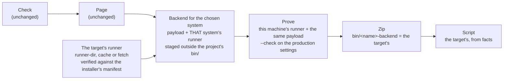

# Plan — Package a Web project for another system (Linux from a Mac or a Windows machine)

- **Status:** draft
- **Spec:** ./spec.md   **Date:** 2026-11-27
- **Answers taken to the spec's open questions (the operator, "Accept, plan it", 2026-11-27):**
  Q1 fetch from the release, checked against a manifest the installer carries, `--runner-dir` as the
  escape hatch; Q2 `linux-x86_64` offered, `linux-aarch64` only if the release builds it; Q3 build the
  Linux runner against an older glibc and let measurement decide; Q4 a small window before the folder
  dialog; Q5 no machine code for another system; Q6 `--target linux-x86_64`.

## 1. Approach

The Backend a Web package ships is **a payload joined to a runner**. Everything about the payload is
the same on every system; only the runner differs. `cobolt_program_package::embed` already joins by
the runner's own format (ELF, PE, Mach-O), not by the host's, so an ELF runner can be joined on a Mac.
The plan changes the three things that assume the packaging machine and adds the one thing a Mac lacks:

- **A system is a value (R1, R2).** `System { os, arch }` in `cobolt-compiler::backend_runners` (the
  crate the Build, the CLI, the tool and the IDE all depend on; `cobolt-web-bundle` is below
  `cobolt-compiler`'s reach, since `cobolt-compiler` does not depend on it), with its spelling
  (`linux-x86_64`), its release triple, its executable suffix, and one list: `System::TARGETS` (the
  Linux pair the code can make) and `System::offered(manifest)` (the host plus every target the
  installer's manifest has a runner for). The three entry points read that one function (AC8).
  `cobolt-web-bundle`'s `TargetOs` stays as it is; `cobolt-project-tools` maps `System.os` to it.
- **The target's runner is found, verified, never trusted (R7, R8, R13).** A new module
  `cobolt-compiler/src/backend_runners.rs`: `runner_for(system, how) -> RunnerFiles`. For the host's own
  system it is today's `find_runner` and nothing else (R9). For another system: (1) a folder the
  developer names (`--runner-dir`, `PRC_BACKEND_RUNNER_DIR`), (2) the cache
  (`<build root>/runners/<version>/<system>/`), (3) a fetch if the caller allowed it. **Every**
  file is checked against `runners/manifest.txt`, the manifest that travels in the installer next to
  `libs/` (the pattern of `warmup.rs`, same `<sha256>  <name>` line format), including a file the
  developer supplied and a file already in the cache. No manifest, no runner, or a hash that differs:
  refuse, naming expected and found.
- **The Build can make a Backend for a system (R3, R5, R10).** `BackendBuildOptions` gains
  `target: Option<BackendTarget>` (system, the verified runner, a bin folder). With a target the Build
  forces the module path (a Cargo reason refuses, R5), names the executable for the system, installs
  it into the target's own folder (**never** the project's `bin/`, or a Linux ELF would overwrite the
  Mac's Backend that Run and Preview start), and makes no machine code (the module compiles at the
  first start, 9 to 51 ms). `target: None` is today's path, untouched (R9).
- **Prove runs a twin (R6).** `package_web` takes the payload out of the target's executable
  (`cobolt_program_package::locate`), joins it to **this machine's** runner, writes that to a scratch
  folder and gives it to the existing `prove`. The shipped executable is the one that was not run: the
  Output and the reports say so.
- **The script is a function of facts (R4).** `Install.os` becomes `system.os`; the script generators
  already take the system as data and are tested for every system and language on any host. The file
  names come from the system (`.sh` or `.ps1`).
- **The release publishes what R7 compares with (R13).** A job `runners-linux` in
  `build-all-platforms.yml` builds the Linux runner (and only it) in a container with an older glibc,
  writes its bill of materials (`runner_sbom` example, exists), makes `runners/manifest.txt` and
  attaches both to the release; every installer job `needs` it and ships the manifest.

## 2. Affected crates / files

- `crates/cobolt-web-bundle/src/install/mod.rs` — **no change of type**: `Install.os: TargetOs` stays;
  its per-system script tests are re-run for the Linux script made on a Mac host. (Corrected at
  `/tasks`: the plan first put `System` here; the dependency direction puts it in `cobolt-compiler`.)
- `crates/cobolt-compiler/src/backend_runners.rs` (new) and `lib.rs` (`pub mod`) — `System` (+ `TARGETS`,
  `offered`, `parse`, `triple`, `exe_suffix`, `Display`) with tests of the spellings, the list and a
  refused word naming the list; manifest read,
  `runner_for`, the cache, the fetch behind a trait (`Fetch`, `CurlFetch` like `warmup`'s `curl` line:
  `--fail --location --proto =https --tlsv1.2`, both tag spellings), the errors with expected and
  found hashes. `warmup.rs` — `parse_manifest` and `sha256_file` become `pub(crate)` and are reused,
  not copied.
- `crates/cobolt-compiler/src/backend_build.rs` — `BackendTarget`, `BackendBuildOptions.target`; the
  exe name, the bin folder and the machine-code skip follow it; a Cargo reason with a target is
  `BackendForeignRefused` (a new `CompilerError`, worded for packaging).
- `crates/cobolt-compiler/src/backend_module.rs` — `ModuleBuild` takes the machine-code triple as an
  `Option` (`None` skips it) instead of reading `Target::host()` inside.
- `crates/cobolt-project-tools/src/web/package.rs` — `PackageOptions { lang, system, runner_dir,
  fetch }` replaces the `lang` argument (4 callers: IDE, CLI, tests, the tool); `file_names(project,
  system)`; the Backend step passes the target; the twin for Prove; `Install.os` and the exe name come
  from the system; `Packaged` records the system and whether the shipped executable was run.
- `crates/cobolt-cli/src/main.rs` — `cmd_package` / `package_web_command`: `--target`,
  `--runner-dir`, `--fetch-runner`; the help text of `rcrun package`.
- `crates/cobolt-project-tools/src/tools/ide.rs` — the `package_project` tool's schema and text:
  `target`, `runner_dir`, `fetch_runner`; `crates/cobolt-ide/src/app/mcp_ide_tools/project.rs` reads them.
- `crates/cobolt-ide/src/panels/package_modal.rs` (new, modelled on the small modals, with the window
  rules of `leaderboard_modal.rs`: its own size, `fixed_size`, one grip) — the systems offered, the
  one-time question before a fetch; `app.rs` (`do_package_project`, `package_web_to`, the
  `FileRequest::PackageWebProject` flow: modal, then the folder dialog); `web_package.rs` (the
  `Run` carries the options; the lines name the system and what Prove did and did not run).
- `crates/cobolt-compiler/src/project_kind.rs` — `WebSettings.package_system: String` (`#[serde(default)]`,
  empty = this machine) so the choice is remembered per project; `panels/web_settings.rs` shows it.
- `crates/cobolt-ide/src/i18n.rs` — new `Tr` fields ×6 (see §7).
- `.github/workflows/build-all-platforms.yml` — job `runners-linux`; the installer jobs `needs` it
  and ship `runners/manifest.txt`; the release step attaches the runner and its bill of materials.
  `.github/workflows/web-install-package.yml` — jobs that package for Linux on macOS and Windows,
  hand the two files to a Linux job that installs them (the steps of the existing `linux` job).
- `docs/developers-guide-en.md` — 23.11 (the choice, the table of systems, the runner and where it
  comes from, the glibc floor, a mermaid of what is made where, a screenshot placeholder, Notes and
  Caveats: *Prove did not run the target's executable*) and 24.11's "same system" sentence; the
  `rcrun` option table and the tool's row in the agent section.
- The System KB: the `cobolt-compiler` doc tables that describe `rcrun package` and the tool, then
  `cargo run -p cobolt-ide --example build_chunked_kb` (`assets/knowledge/chunked.data`).
- `crates/cobolt-ide/src/version.rs` and `CHANGELOG.md` — one `z` per commit.

## 3. Data / model changes

- **`runners/manifest.txt`** (in the installer, beside `libs/`): one line per file,
  `<sha256>  <system>/prc-backend-runner` and `<sha256>  <system>/prc-backend-runner.sbom.json`.
  Absent in a checkout or an older install: no system but the host's is offered, and a named one is
  refused saying why. `PRC_RUNNERS_MANIFEST` names another file for tests, like `PRC_BACKEND_RUNNER`.
- **Release attachments:** `prc-backend-runner-<version>-<system>` and
  `prc-backend-runner-<version>-<system>.sbom.json`, at `releases/download/<version>/` (and `v<version>`).
- **Cache:** `<build root>/runners/<version>/<system>/{prc-backend-runner,prc-backend-runner.sbom.json}`,
  written as `.part` then renamed; verified again at every use (hashing 37.6 MB costs about a tenth of a second).
- **Project file:** `[web] package_system = "linux-x86_64"` (optional; the field is skipped when empty,
  so a project made before keeps its file byte for byte).
- **Payload, ABI, manifest of the Backend, `backend.toml`, the zip layout:** unchanged. A package for
  another system differs from the host's only in `bin/<name>-backend`, its bill of materials and the script.

## 4. Key decisions & alternatives

- **D1 A system is (operating system, processor), spelled `linux-x86_64`.** *Why:* the runner and the
  script are per operating system, the runner and its glibc per processor, and the release's own legs
  are named this way. *Rejected:* exposing Rust triples (they say `gnu` and `unknown`, which a developer
  does not choose).
- **D2 The offered list is the host plus the targets the installer's manifest carries.** *Why:* adding
  `linux-aarch64` (Q2) is then a change of the release matrix, not of the code. *Rejected:* a list
  compiled into the IDE (offers a system the installation cannot make).
- **D3 One trust anchor, the installer's manifest, applied to every runner including the developer's own
  copy.** *Why:* R7 allows no exception; an air-gapped machine copies the release's file and passes the
  same check. *Rejected:* trusting `--runner-dir` (the escape hatch would be a hole); signing the
  attachments separately (a second anchor with nothing to hold it).
- **D4 Fetch with `curl`, behind a trait.** *Why:* it is what `warmup` does on all three systems, the
  IDE adds no HTTP client, and a test substitutes the fetcher. *Rejected:* a Rust HTTP client in
  `cobolt-compiler` (a new dependency tree for one GET).
- **D5 The IDE asks once before fetching; `rcrun` and the tool only fetch when told** (`--fetch-runner`,
  `fetch_runner`). *Why:* a network call on a developer's machine is theirs to allow (R8).
- **D6 The target's executable is staged outside the project's `bin/`.** *Why:* Run, Preview and
  `rcrun backend start` use `bin/<name>-backend` and would try to start an ELF.
- **D7 Prove twin = the same payload on this machine's runner.** *Why:* it proves exactly what ships
  (the settings and the module) with a runner that can run here. *Rejected:* running the Linux
  executable in a container (needs Docker on every packaging machine); skipping Prove (loses the
  settings check, the guard that stopped real mistakes in 113).
- **D8 No machine code for another system (Q5).** *Why:* the first start compiles in 9 to 51 ms; wasmtime's
  `all-arch` is a larger runner and IDE and a change to `cobolt-wasm`'s dependency guard for nothing the
  developer sees. The first task still *tries* it (the spec's note) and records the size.
  **Tried 2026-11-27 (T1, a probe outside the repo, wasmtime 44.0.3 as `cobolt-runner-engine` pins it,
  release build on the aarch64 Mac):** without `all-arch`, a module for `x86_64-unknown-linux-gnu` and for
  `x86_64-pc-windows-msvc` is refused with "Support for this target is disabled" (the same architecture,
  `aarch64-unknown-linux-gnu`, does compile: 198 KB for a 34-byte module); with `all-arch` both x86-64
  targets compile (13.6 KB, 0.2 to 0.7 ms) and the probe binary grows from 9,035,152 to 14,233,904 bytes
  (+5.2 MB, +57 % of a binary that holds only wasmtime and Cranelift; the compile time of the dependency
  went from 1 m 42 s to 3 m 08 s). The decision **stands**: +5 MB in the IDE, the runner and every
  installer, plus a change to the dependency guard, to save a 9 to 51 ms compile at the first start.
- **D9 The Linux runner is built in a container with an older glibc, in a job of its own (Q3).** *Why:*
  the manifest's hashes must exist before the installers are made, and no installer leg can know
  another leg's hash; the runner alone builds in minutes. Debian 11 (glibc 2.31) is the starting point:
  it covers Debian 11 and 12, Ubuntu 20.04 and 22.04, Amazon Linux 2023 and RHEL 9 by those
  distributions' published versions, **to be measured in AC11**. *Rejected:* shipping all runners in
  every installer (Q1a); musl (a different C library under OpenSSL, SQLite and wasmtime's helper, for a
  gain glibc 2.31 already gives).
- **D10 The host's own system takes today's code path exactly (R9).** `target: None`, no manifest read,
  no cache, no fetch. *Why:* the byte-identical guarantee is then a property of the code, and AC4
  measures it against the packager of 2.1.75.
- **D11 The choice is remembered in the project, not in the IDE's settings.** *Why:* a project goes to a
  server; the same developer packages another project for another one.

## 5. Risks & mitigations

- **The Linux runner does not start on an older Linux (glibc).** → D9 builds against 2.31; AC11 runs it in
  `debian:12`, `ubuntu:22.04`, `amazonlinux:2023` (and `ubuntu:20.04`, `debian:11` to name the floor);
  the Guide names what was measured and nothing else.
- **No Linux runner on this Mac.** Colima is installed here but not running, there is no zig or `cross`
  and no Linux Rust target. → The runner is built **inside a Linux container with the job's own
  commands** (the same steps as `runners-linux`, so the job's recipe is tried before the first release
  run). On an Apple-silicon Mac a native container is aarch64; an x86_64 one runs under Rosetta or QEMU,
  slower. The local proof therefore may be of the mechanism on one architecture and of `linux-x86_64`
  only with the release job's runner; the Guide and the report say which.
- **The release workflow cannot be run here.** → Edited by reading, as in 114; its container steps are
  run by hand in colima; the real run is the operator's dispatch. Until then: *not verified*.
- **`cfg!(windows)` is spread through the Build and the package** (the executable's suffix, the mode of
  the file, the Visual C++ note). → They move behind the system; a Windows host packaging for Linux is
  covered by the workflow's Windows leg and is *not verified* until it runs.
- **A runner and a payload that disagree** (the runner is another version than the IDE). → The manifest
  is of this release's runner, so they agree by construction; the cache folder carries the version.
- **GitHub is unreachable or rate-limits.** → The refusal names the URL, the expected hash and
  `--runner-dir`; nothing is written.
- **The stand-in runner in tests is not a runner.** → Unit tests use a stand-in ELF (any bytes that begin
  with the ELF magic are a format `embed` accepts) for the *mechanics* (naming, staging, payload,
  verification); the claim that a real Linux runner starts is made only by AC3 and AC11.

## 6. Test strategy

Every new test ends with one result block: the cases it ran, the counts, the times; real measurements only.

- **`cobolt-compiler` (`System`):** every spelling in and out, the list, a bad word names the list.
- **`cobolt-web-bundle`:** the Linux script made on this Mac equals the script made for Linux in every
  language (the existing per-system tests, unchanged, re-run).
- **`cobolt-compiler` (`backend_runners`):** with an injected `Fetch` — a verified runner is used; one
  byte changed is refused with expected and found; a file in the cache that was altered is refused;
  no manifest is refused; the fetch is not called when the file is there; a fetch that returns a wrong
  file leaves no `.part`.
- **`cobolt-compiler` (`backend_build`):** a Build with a target writes the executable and its bill of
  materials into the target's folder, leaves the project's `bin/` alone, names it without `.exe`,
  carries the same Backend container bytes as the host Build (the module's SHA-256 equal) and no machine
  code; a Backend with a Cargo reason is refused with the reasons.
- **`cobolt-project-tools` (`package_web`):** the 2026-11-27 audit as tests — the zip holds no
  `.cbl .cob .cfrm .wcfrm .mcfrm .cidx .rs`, no `src/`, no `COPYBOOKS/` (AC2); a package for Linux has an
  ELF at `bin/<name>-backend` with mode `0755`, `OS=linux` in the script, the unchanged `web/` and
  `data/` entries; the twin's payload equals the shipped one; Prove's note is in the report.
- **AC4 (host unchanged), measured:** before the first edit, copy the current `target/release/rcrun`
  (2.1.75) to a place outside the repo; after the change package the same copy of PowerOficina with
  both and compare the SHA-256 of the zip and of the script.
- **Parity of entry points (AC8):** one test per entry point reads `System::offered`; the CLI test runs
  `rcrun package --target bogus` and sees the list.
- **IDE:** the modal's logic without painting (the list, the default, the remembered choice, the
  fetch question), `cargo test -p cobolt-ide i18n`, and the manual check: open PowerOficina, Package
  Project, the window lists this machine and Linux, the Output names the system and says the
  executable was not run here. (A screenshot placeholder in the Guide.)
- **The proof the specs never had (AC3):** build the Linux runner in a container, package PowerOficina
  on this Mac with `--target` and that runner, `docker create` + `docker cp` the two files into a Debian 12
  container with systemd and nginx (spec 113's method), run the script, check the service, nginx's 200
  and a call answered by the real Backend; run the script again and check `data/` is kept. Reported with
  the times.
- **CI (AC12):** `web-install-package.yml` packages for Linux on macOS and on Windows, a Linux job
  installs the result (the existing `linux` job's steps), and checks the ELF magic and the script. The
  operator dispatches it; the Windows and Linux-host cells are *not verified* until then.
- **Sweeps:** `cobolt-web-bundle`, `cobolt-compiler`, `cobolt-project-tools`, `cobolt-cli`, `cobolt-ide`
  (`--bin`), each `--no-fail-fast`, every `test result:` line read; a red that was already red before the
  first edit (compare with the baseline run taken at task 1) is reported as known, never as new.

## 7. Steering compliance

- [ ] i18n: new `Tr` fields ×6 — the window's title and its system labels ("this computer", "Linux
  (x86-64)"), the Output lines (the system a package is for; Prove ran the settings and the module,
  not the target's executable), the five refusals (not offered, runner missing, runner does not
  verify, Cargo-path Backend, no manifest), the fetch question and its two buttons
- [ ] Generated-code banner + regenerate contract preserved (no COBOL is generated differently)
- [ ] English Developer's Guide updated (23.11, 24.11, `rcrun` table, the agent tool); no translation exists to delete
- [ ] System KB tables updated and `chunked.data` regenerated in the same change
- [ ] Fix vs feature: **feature** → branch `features`; the pending fixes on `main` (2.1.72 to 2.1.75) are
  pushed first (rule #5); one `z` bump and one CHANGELOG entry per commit; the feature's commits are not mixed with a fix
- [ ] No "cobolt" in user-facing text (the runner is `prc-backend-runner`); no credential in any diff; no Fujitsu claim
- [ ] Windows and Linux-host results are written as *not verified* until the workflow has run on them
