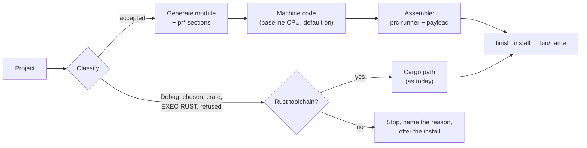

<!--
SPDX-License-Identifier: Apache-2.0
Copyright (c) 2026 Emerson Lopes and PowerRustCOBOL contributors
-->

# Plan — The WebAssembly module as the portable program format: native builds without a Rust toolchain per program

- **Status:** accepted by the operator, 2026-11-13 (2.0.481). Broken into tasks 2026-11-14 (2.0.482, `./tasks.md`), which refines §1.2's order and §7's guide item.
- **Spec:** ./spec.md   **Date:** 2026-11-13
- **Branch:** `features-2x-desktop-wasm` (2.x), cut from `main` at 2.0.484. The plan was written on `features-2x-wasm-program-format`.
- **Ground truth:** read 2026-11-13 at `8142a5ad` (2.0.480). File:line references are to that tree.
- **Name:** this spec and plan were numbered WASM-037 until 2.0.480; the operator renamed them DESKTOP-WASM-001 when reviewing the first draft of this plan.
- **Added at review (operator, 2026-11-13):** *"add as the success criteria the pixel perfect behavior before/after wasm"*. It becomes R27, R28, AC19 and AC20 in the spec, and §1.2 below.

## 0. What the code says, and what it changes in the spec

### 0.1 Facts found while planning

**The Desktop Build.**
- `build_project` (`cobolt-compiler/src/lib.rs:1962`) calls `build_core` (:2182), which **checks the Rust toolchain first** (:2219–2223), before anything else is known about the project.
- `BuildProgress` (:1834) carries a fraction and a message, with no phase and no time. `BuildResult` (:1929) is shaped by Cargo.
- The generated `main.rs` bakes the project's settings in (:3059–3084), runs forms through the template at :4487–4888, and honours `PRC_HEADLESS_SCRIPT` (:4873).

**The generator and the manifest.**
- The Web path turns forms into `FormSpec`s in `cobolt-project-tools/src/web/generator.rs:149–295`. The lowering at :251–268 is for the browser only.
- `Manifest::validate` (`cobolt-wasm-abi/src/manifest.rs:241`) refuses any ABI but the current one (`self.abi != ABI_VERSION`).
- Conformance files are text lines only (`cobolt-wasm/src/host.rs:292–401`).
- Nothing in the workspace precompiles WebAssembly to machine code: no call to `precompile_module` or `deserialize`.
- `init_alter_slots` (`lower.rs:1084`) walks `alter_slots: HashMap<usize, u32>` (:259) while it emits code. **The order of the emitted code can therefore change from one run to the next**, which R2 forbids.
- `SET` pointer is classed `Module` in `support.rs`, but nothing lowers it.

**The form host.**
- `cobolt-form-host` has no "program" abstraction. `build_form_instance_as` (`host.rs:5314`) starts an interpreter thread (:5379–5447).
- The web player's pure `Host`, `FormTree` and `methods` already drive a module through the whole ABI, and its tests run them natively under wasmtime (the `Rig` in `tests/common/mod.rs`). The closure is about 10 000 lines.

**Headless runs and pixels (for R27).**
- `cobolt_form_host::headless::run_headless` (`headless.rs:105`) runs a form from a JSON script with the steps `set`, `event` (with `"wait": false`), `click`, `wait_ms`, `read`, `dump` and `open_form`. `run_script_file` (:84) is what a built binary calls.
- It pictures **only the last frame**, with the CPU rasteriser: `cobolt_forms::raster::render_frame` (:254), then `to_png`.
- **Time is real.** Frames take `t = started.elapsed()` (:131, :136, :253), and the loop sleeps 16 ms per frame and 10 ms while it waits (:144, :155, :162).
- `host.rs` calls `Instant::now` **37 times** (timers, animations, entrance and exit effects, snackbars).
- **No clock or random pin exists** in `cobolt-runtime`, `cobolt-form-host` or `cobolt-forms`. Two runs of the same script can therefore draw different frames today.

**Packaging and Debug.**
- `rcrun package` does not read `bin/`. The installers ship the IDE; `prc-web-preview` is the precedent for a prebuilt helper shipped beside it.
- The IDE's Debug builds a Cargo debug binary even for a project with no `EXEC RUST` (`cobolt-ide/src/app.rs:4002`, the `(true, false)` case).
- The install offer is shown only on first run (`app.rs:2616`); the Build's toolchain failure is recognised by matching its text (:17237).

**The example projects.** The Desktop examples with neither `[[crates]]` nor `EXEC RUST` are PowerCallOfDuty (1 form), PowerCloud (5), PowerCobolCraft (2), PowerGraphics (9) and PowerSpatial (5). None has a `.cidx`. PowerAnalytics and PowerChat register a crate; PowerDemo3 has a crate and an `EXEC RUST` block.

### 0.2 Spec corrections made with this plan

Each is marked "(plan, 2.0.481)" in `spec.md`.

| # | Spec | Correction |
|---|---|---|
| C1 | R1, R5, AC15 | The form designs, menus, settings and theme art travel as **custom sections of the same module**: `prforms` (code-free `FormDescription`s), `prmenus`, `prsettings` and `prart`. The portable format stays **one self-describing `.wasm` file**. "Forever" (R5) covers these versioned section formats too. AC15 does not count literals, data names or `EXEC SQL` text as source. |
| C2 | R5 | `validate` accepts `1 ≤ abi ≤ ABI_VERSION`. No import, capability or section name is ever retired; a change of meaning takes a new name. |
| C3 | R2, AC2 | WHEN-COMPILED becomes a Build input, taken from `SOURCE_DATE_EPOCH` when it is set. Paths in `prlines` are written with `/`. |
| C4 | R11 | National and UTF-8 data are computation in the module, not a host capability. R11 is the end state, reached across milestones (§1.3). |
| C5 | §6 | Extractions from the interpreter that keep its behaviour are allowed, proven by its existing tests. |
| C6 | R8, AC13 | "One file" is the executable. `bin/` still receives the assets and licences, and `dist/` is copied as today. AC13 names `dist/` and the Platform SDK flow. |
| C7 | R17, AC6, R26 | The reference set is the five examples of §0.1. The ten-times project takes the largest value of each dimension among them, with a floor of 10 indexed files. |
| C8 | R25 | The toolchain check moves after classification. `generated/` may be rewritten; `bin/` stays untouched. |
| C9 | AC1, AC6 | The hosted `macos-latest` arm64 runner is smaller than the reference box. Use a larger or self-hosted runner, or record the deviation with the measurement. |
| C10 | WASM-ABI-v1 §8 | The document is corrected to the code: the `adv` argument, modes 2 = I-O and 3 = EXTEND, end of file −10, and the `switch_state` import. |
| C11 | Non-goals | A Debug Build stays on the Cargo path, as today, with the reason `DebugBuild`. |
| C12 | R1 | The format holds no interpreter. The runner binary still links `cobolt-runtime` for its stores; its size is measured at M1. |
| C13 | `support.rs` | `SET` pointer is lowered or reclassified, as a separate fix. |

## 1. Approach

### 1.1 The path (R1–R16)

1. The Build classifies the project (§4.7). If the WebAssembly path accepts it, the Build generates **one module** holding the code and the `pr*` sections (R1, C1).
2. By default it **precompiles machine code** for the platform's baseline CPU (R15).
3. It copies the prebuilt `prc-runner`, attaches the payload (the module and the machine code) and renames the result into place as `bin/<name>[.exe]` (R7, R8).
4. At start the runner:
   - checks the manifest's `capabilities` and refuses what it cannot provide (R4);
   - loads the machine code, or makes it again and caches it (R16);
   - drives the module with the ABI host extracted from the player (§4.3);
   - renders through `cobolt-form-host` and the egui form engine (R9);
   - serves native capabilities over the runtime's own stores (R10, R11).

### 1.2 Pixel-perfect parity (R27, R28, AC19, AC20)

The operator's criterion: a program built on the WebAssembly path must look and behave **exactly** as the same program built today.

**What the spec gains (operator, 2026-11-13):**
- **R27:** frames identical in every RGBA pixel, reads and dumps equal, console output identical byte for byte, given the same project, scripted input, window size, theme, pinned clock and random seed.
- **R28:** a deterministic test mode in the form host and both engines: a virtual clock, a pinned date and time, and a random seed. Test variables turn it on; it is never on by default.
- **AC19:** every form of every reference project the WebAssembly path builds, run headless under both binaries, a frame after every step, at three window sizes; **0 differing pixels in every pair**. The Cargo-built frames must also equal the golden hashes recorded at M0.
- **AC20:** the same script run twice on the same binary gives identical frames.

**How it is built:**
- **`cobolt-form-host`:**
  - A `HostClock`, real or virtual, replaces the 37 `Instant::now` calls in `host.rs`. Timers, animations, effects and snackbars read it.
  - `headless.rs` gains a deterministic mode: virtual `t` advancing a fixed 1/60 s per frame, no sleeping, and `wait_ms` advancing virtual time.
  - Two new steps: `{"shot": "<name>"}` writes the current frame as a PNG into `PRC_HEADLESS_SHOTS`, and `{"size": [w, h]}` resizes the window.
  - Scripted answers for message boxes and file dialogs, so no run waits on a person.
- **`cobolt-runtime`:** a run clock and random source, pinned by `PRC_TEST_CLOCK` and `PRC_TEST_SEED`, behind `CURRENT-DATE`, `ACCEPT … FROM` and `RANDOM`.
- **`cobolt-runner`:** feeds the `now` and `random` imports from the same variables, and honours `PRC_HEADLESS_SCRIPT`, `PRC_HEADLESS_LIMIT` and `PRC_HEADLESS_SHOTS` as the Cargo binary's `main.rs` does.
- **`cobolt-bench pixel-parity`:**
  1. builds each reference project twice, with `--cargo` and with the default;
  2. runs both binaries with the same script and pins;
  3. compares the PNGs exactly; on a mismatch, writes a diff image and both frames under `target/pixel-parity/`;
  4. prints one result block (GOLDEN RULE #7).
- **Scripts:** `tests/pixel-parity/scripts/<project>/<form>.json`. A generated base script raises every bound event once, in document order, with a `shot` after each step; hand-written flows are added where a form needs one.
- **Golden hashes:** sha256 of each frame's RGBA buffer, per platform, in `tests/pixel-parity/golden/<platform>.toml`. They are recorded at M0 from the Cargo path, **before any form-host refactor**, and re-recorded only by an explicit change in rendering that its CHANGELOG entry names.

**Why the CPU rasteriser is the reference.** Both binaries draw with the same `cobolt-forms` code. A differing pixel can therefore come only from program state or timing, which is exactly what R27 judges. The GPU window draws with the same code.

### 1.3 Milestones

The default is on from M1. Anything the WebAssembly path cannot build falls back with a named reason. **A project counts as moved to the WebAssembly path only when it also passes AC19.**

| M | The WebAssembly path accepts | Falls back | Closes |
|---|---|---|---|
| M0 | nothing (path off) | everything | R19 baseline; **R28 deterministic mode, the `shot` and `size` steps, the golden hashes (AC19's second guard, AC20)**; the determinism fix (§4.9); the AC2, AC16 and AC18 fixtures |
| M1 | console programs: statements computed in the module, console, environment and arguments, exit code, in-memory INDEXED and SORT | forms, disk files, SQL, HTTP, national data, `EXEC RUST`, crates, Debug, runner missing | R1–R8, R13–R16, R18, R20, R24, R25; the console part of R27; AC1, AC5, AC8, AC10–AC13, AC17 |
| M2 | plus forms: the ABI host's controls and methods, `OpenForm*`, `super::`, the shell and SideMenu, dialogs, timers, file dialogs | non-visual controls, Viewer verbs, canvas frames, window methods not yet implemented | R9, **R27 for forms**; AC3, AC4, AC14, **AC19** |
| M3 | plus disk files of every organisation; `SORT`/`MERGE` `USING`/`GIVING`; `COMMIT`, `ROLLBACK`, `UNLOCK` | SQL, HTTP, national data, non-visual controls | NIST SQ, IX, RL and ST measurable (AC9) |
| M4 | plus `EXEC SQL`, the SQL object, SqlDatabase, HTTP and RestClient | national data, non-visual controls | |
| M5 | plus national and UTF-8 data | non-visual controls | |
| M6 | plus AgentObject, KnowledgeBase, WebSearch, Maps, the Aws controls, model lists and MCP, AUDIO, ANIMATIONSEQUENCE, LAYOUT, Viewer verbs, window methods, canvas frames | `EXEC RUST`, crates, Debug | R11's end state |

**Honest sizing.**
- At M1 almost every example still falls back. Form projects move from M2, and most need M3–M6.
- **M6 is likely as large as M2–M5 together.**
- The harness reports, per project, the path taken, the reason for a fallback, and the AC19 result.

## 2. Affected crates / files

**New crates (main workspace):**
- **`cobolt-abi-host`:** the player's pure `Host`, `FormTree`, `methods` and their closure, moved out unchanged. The player depends on it by path, re-exports it, and adds it to `fingerprint::INPUTS`.
- **`cobolt-runner-engine`:** the one wasmtime `Config` (multi-memory, NaN canonicalisation, an explicit target, `parallel-compilation`), with `precompile()` and `load()`. `cobolt_wasm::host::engine()` delegates to it, so the tests and the runner use one engine setup.
- **`cobolt-program-package`:**
  - the executable's payload: a table of contents of `{kind, offset, len, sha256}` entries, kinds MODULE and MACHINE_CODE;
  - the carriers: an overlay on ELF and PE, a `__PRPAYLOAD` segment on Mach-O, and a pure-Rust ad-hoc Mach-O signer;
  - the `PRLOC` locator and `RunnerSettings`.
- **`cobolt-runner`** (binary `prc-runner`):
  - a linker per ABI version, and one program thread;
  - `WasmEngine`, which implements `ProgramEngine`;
  - the capability modules, over `cobolt-runtime`'s stores;
  - the test-mode pins and the headless variables (§1.2);
  - refusal messages in six languages.

**Changed files:**
- **`cobolt-compiler/src/lib.rs`:**
  - `classify`, `wasm_build`, and `desktop_form_specs` (shared with the Web generator);
  - `BuildPhase`, `BuildPath`, `CargoReason` and the typed toolchain error;
  - `finish_install`, factored out of today's install step;
  - a Desktop column in `browser_subset_doc`;
  - the generated `main.rs` honours `PRC_HEADLESS_SHOTS`, `PRC_TEST_CLOCK` and `PRC_TEST_SEED`.
- **`cobolt-compiler/src/project_kind.rs`:** `DesktopSettings` gains `build_path` and `machine_code`.
- **`cobolt-wasm`:** the determinism audit, `Options.native`, a native column in `support.rs` (R12), `capabilities`, and a re-export of `compile_project`.
- **`cobolt-wasm-abi`:** `capabilities` and the version range (`manifest.rs`), `NATIVE_IMPORTS` (`codes.rs`), and refusal of native capabilities at bundle time (`scan.rs`).
- **`cobolt-form-host`:**
  - `host.rs`: the `ProgramEngine` trait at `build_form_instance_as` (today's body becomes `InterpreterEngine`), and `HostClock`;
  - `headless.rs`: deterministic mode, `shot`, `size`, scripted dialog answers.
- **`cobolt-runtime`:** the run clock and random pins; and, each without changing behaviour, the extraction of `seqfile.rs` and the sort core (M3), the `EXEC SQL` binding (M4) and national data (M5).
- **`cobolt-cli`:** `rcrun build --cargo` and `--no-machine-code`, and the install hint.
- **`cobolt-ide`:** the typed Build failure and `offer_rust_install(reason)` at Build time; the path and phase report; the Desktop settings; `i18n.rs` in six languages.
- **`cobolt-project-tools`:** the `build` tool reports the path, the reason and the timings; `web/generator.rs` uses the shared `FormSpec` builder.
- **`cobolt-bench`:** `build-goal`, `pixel-parity`, and `ten_times.rs` (R26).
- **Test data:** `tests/pixel-parity/scripts/…`, `tests/pixel-parity/golden/<platform>.toml`, `tests/module-corpus/`.
- **CI:**
  - build, stage and sign `prc-runner` for the four platforms, once per release, shipped with the IDE (R6);
  - `build-goal.yml`, `determinism.yml`, a no-toolchain job;
  - `pixel-parity.yml` on the four platforms, on tags and on dispatch.
- **Also:** the installer file lists, `THIRD_PARTY_NOTICES.md`, `specs/WASM-ABI-v1.md` (C10), `WASM-PROGRESS.md`, `WASM-PARITY.md`, and the Developer's Guide when the implementing changes reach the 1.x documentation rules.

## 3. Data / model changes

- **Manifest (R3):** a `capabilities` list, serialised only when it is not empty, so a Web module's bytes do not change (AC16). Names: `console`, `env`, `files.sequential`, `files.line-sequential`, `files.relative`, `files.indexed`, `sort`, `sql`, `http`, `dialogs`, then the M6 controls.
- **Imports:** a new namespace, `prn`, with a fixed set per capability: the `f_*` file verbs, the `s_*` sort, `con_read`, `env_get`, `exit`, `sql_exec` (statements in a `prsql` section) and `http_call`. HTTP and dialogs suspend and resume the module as `remote` does. Records cross by `(ptr, len)` in memory 0.
- **Custom sections:** `prforms`, `prmenus`, `prsettings` and `prart`, each with its own version (C1).
- **`RunnerSettings`:** made by one function that also feeds the settings baked into the Cargo path's `main.rs`, so both paths start from the same values.
- **`DesktopSettings`:** `build_path: Wasm | Cargo` (default `Wasm`) and `machine_code: bool` (default `true`). A project without them reads the defaults (R24).
- **The Build's report:**
  - `BuildProgress` gains `phase` and `elapsed`.
  - `BuildResult` gains `path`, `phases` and `peak`; the Cargo-specific fields move under `cargo: Option<…>`.
  - `CargoReason` = `DebugBuild | Chosen | ExternalCrate | ExecRust { file, line } | Refused { construct, file, line } | DesktopControl { form, control } | RunnerUnavailable`.
  - `CompilerError::CargoNeedsToolchain` (R25), so the IDE no longer matches text.
- **Test-mode variables (never set by default):**
  - `PRC_TEST_CLOCK=<RFC 3339>` turns on the virtual clock and pins the date and time;
  - `PRC_TEST_SEED=<u64>` pins the random source;
  - `PRC_HEADLESS_SHOTS=<dir>` is where `shot` writes.

## 4. Key decisions & alternatives

1. **The default is on from M1.** — Why: Q5 and R21; every project the path cannot build falls back with a reason. — Rejected: waiting for M2.
2. **One file.** An overlay on ELF and PE, found through `PRLOC`; a `__PRPAYLOAD` segment on Mach-O, signed again ad hoc in pure Rust and checked by `codesign --verify --strict` in CI. — Rejected: an overlay on Mach-O (breaks the signature); the `apple-codesign` crate; needing the system `codesign` at Build time. `libsui` is evaluated in the M1 spike.
3. **The program side.** Extract `cobolt-abi-host`, and add `ProgramEngine` at `build_form_instance_as`. `WasmEngine` runs one program thread. Desktop controls the ABI host lacks are found by classification, before generation, and fall back. — Rejected: extending the test host; a third implementation of the control semantics.
4. **Capabilities.** Files over `IndexedStore`, `RelativeFile` and an extracted `SequentialFile`; `SORT` and `MERGE` done by the host for Desktop; a native class per `support.rs` entry, `Native { Module, Host(Cap), Cargo(&str) }`; `bundle_problems` refuses a native capability (R4).
5. **Forever compatibility (R5, R23).** The version range (C2), and `linker_for(abi, imports)`. `tests/module-corpus/` keeps one entry per tagged release, within 256 KiB per release, and CI refuses a deletion from it. — Rejected: git LFS; release assets.
6. **Machine code (R15, R16).** `precompile_module`, targeting x86-64-v2, and aarch64 at the Apple M1 level. Load order: sha256 → compatibility hash → `deserialize` → local cache (least recently used, 512 MiB) → compile at load. The M1 spike answers whether a baseline `.cwasm` loads in an engine that detects the host's CPU.
7. **Build order.**
   1. The front end (the per-form programs move earlier).
   2. Classify, in this order: Debug → chosen → `[[crates]]` → `EXEC RUST` (`cobolt_semantic::exec_rust::for_each_block`; R14 names the first block) → desktop control → runner present.
   3. WebAssembly path: generate (a `GenError` becomes `Refused`), machine code, assemble.
   4. Cargo path: the typed toolchain check (C8), then today's steps.
   5. Both: `finish_install`.
8. **Timing (R17–R20).** A timer per phase; resident memory sampled every 25 ms with `sysinfo`; `cobolt-bench build-goal`, with `--record` into `specs/WASM-BUILD-GOAL.json`; `build-goal.yml` on the four platforms.
9. **Determinism (R2).** `init_alter_slots` moves to a `BTreeMap`, after an audit of every map iterated while emitting; a test compiles twice and compares; `determinism.yml` compares a generator built by Rust 1.95.0 with one built by `stable`.
10. **Pixel parity (R27, R28).**
    - Compare pairs from the same commit (Cargo-built against WebAssembly-built) **and** the Cargo path against the M0 golden hashes, so neither the engine nor the form-host refactor can move a pixel unnoticed.
    - Exact equality, no tolerance.
    - Golden hashes, not images, so the repository stays small; images are written only on a failure.
    - Rejected: a mean-error threshold like the web parity job's (the operator asked for pixel-perfect); committed PNG goldens (size); GPU screenshots (they depend on the driver and need a display).

## 5. Risks & mitigations

| Risk | Mitigation |
|---|---|
| One program thread stalls the other forms while an import blocks | Slow operations suspend the module; recorded in `WASM-PARITY.md`. |
| Desktop and web semantics of a control differ | Classify and fall back; AC14 and AC19 catch any visible difference; each divergence found goes into `WASM-PARITY.md` (R22). |
| **The `HostClock` refactor (37 call sites) changes timing on today's path** | M0 records the golden hashes **before** the refactor, and AC19's second guard holds the Cargo path to them. |
| **A modal dialog or real I/O blocks a headless run** | Scripted dialog answers. Reference scripts make no network call; a step that needs one is a hand-written flow against a local stub. |
| **Fonts or the rasteriser draw differently on each platform** | Pairs are always compared on one platform; the golden hashes are kept per platform. |
| Changes to `cobolt-wasm-abi`, `cobolt-forms` or `cobolt-abi-host` make the committed player stale | Batch them per milestone; the freshness test names the rebuild. |
| macOS signing | `codesign --verify --strict`, and a launch on both Macs, in CI. |
| Linux packagers strip the overlay | The runner names a missing `PRLOC` payload instead of failing silently. |
| The runner's size | Measured at M1 (C12). |
| The default reaches a divergence | The A1 opt-out, the path named in every Build, and AC19. |
| The machine-code phase misses the 30 s goal | Parallel compilation; reported, never enforced (R17). |
| M6's size | The fallback keeps every milestone shippable. |

## 6. Test strategy

Every test that measures ends with **one result block** (GOLDEN RULE #7).

- **`cobolt-form-host`:**
  - `deterministic_mode_repeats_frames` (AC20; reports "frames N, identical N");
  - `shot_and_size_steps_write_pictures`;
  - unit tests for `HostClock`;
  - `InterpreterEngine` against `WasmEngine`, headless, same state (AC14).
- **`cobolt-runtime`:** `pinned_clock_and_seed_fix_current_date_and_random`.
- **`cobolt-bench pixel-parity` (AC19):** reports projects, forms, steps, sizes, frames compared, differing pixels (must be 0) and golden matches. Run by `pixel-parity.yml` on the four platforms; M0 records the goldens.
- **`cobolt-wasm`:** `same_input_same_bytes` (N of N); the ALTER fixture; `every_statement_and_builtin_has_a_native_class` (AC10).
- **`cobolt-wasm-abi`:** manifest bytes unchanged without capabilities; the ABI range; `bundle_problems` names a native capability (AC5).
- **`cobolt-web-tests`:** the PowerAnalyticsWeb module-hash fixture (AC16).
- **`cobolt-program-package`:** a round trip per carrier; a damaged table of contents is refused; Mach-O verified on macOS CI.
- **`cobolt-runner-engine` (AC8):** a foreign hash, truncated code and absent code each run and say which path they took.
- **`cobolt-compiler`:**
  - WebAssembly twins of `a_build_lands_in_the_chosen_folder…`, `a_missing_toolchain_is_named` (now typed) and `…current_code_not_a_stale_generated_file`;
  - new: `exec_rust_falls_back_before_compiling` (AC12), `refused_construct_falls_back_naming_file_and_line` (AC11), `no_toolchain_stops_and_leaves_bin_untouched` (AC17), `no_project_source_in_built_file` (AC15);
  - twins of the national, `EXEC SQL` and backend tests at M5 and M4.
- **`cobolt-cli`, the `*_hosts*` tests:** a runner twin per milestone.
- **CI:** no toolchain (AC1), across platforms (AC3), the corpus (AC4), the build goal (AC6, AC7), the ten-times hash (AC18), determinism across Rust releases (AC2), pixel parity (AC19, AC20).
- **Manual:** an IDE Build with no toolchain shows the install offer, then the path and phase report.

## 7. Steering compliance

- [ ] **i18n:** the path labels, machine code, the phase names, each `CargoReason` and the no-toolchain offer, in all six languages. The test-mode variables have no UI.
- [ ] **Generated code:** the banner and the regenerate-on-action contract are unchanged.
- [ ] **English Developer's Guide:** the default Build, how to choose the Cargo path, and the deterministic headless steps (`shot`, `size`); translations deleted (#8).
- [ ] **System KB:** the native column, the settings and the flags, then `build_chunked_kb`.
- [ ] **Fix vs feature:** **feature**, with `z` bumped per task. The M0 determinism fix (§4.9) and the `SET` pointer change (C13) are **fixes**: on a `fixes-2x-…` branch, in separate commits, landed first (#5).
- [ ] **No "cobolt" in user-facing text:** the binary is `prc-runner`, "the PowerRustCOBOL runner"; COBOL identifiers stay English.

## 8. Next

`/tasks`: break §1.3's milestones into tasks, M0 first, the two fixes on their own branch.
