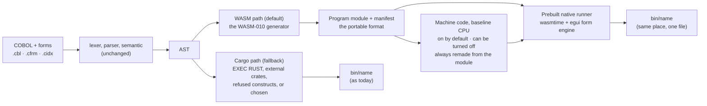

<!--
SPDX-License-Identifier: Apache-2.0
Copyright (c) 2026 Emerson Lopes and PowerRustCOBOL contributors
-->

# Spec — The WebAssembly module as the portable program format: native builds without a Rust toolchain per program

- **Status:** planned, 2026-11-13. Drafted 2.0.478; the operator answered Q1–Q10 at `/clarify` the same day (2.0.479) and accepted assumptions A1–A4 as written (2.0.480), §7. Planned 2.0.481 (`./plan.md`): at `/plan` the operator added the pixel-perfect criterion (R27, R28, AC19, AC20), and the plan corrected the spec to the code where marked "(plan, 2.0.481)". Not tasked. Nothing in it is implemented.
- **Folder:** specs/DESKTOP-WASM-001-portable-program-format-and-native-runner/
- **Name:** numbered WASM-037 at 2.0.478–2.0.480; renamed **DESKTOP-WASM-001** by the operator on 2026-11-13 (2.0.481). The CHANGELOG entries of 2.0.478–2.0.480 keep the old name.
- **Author:** Emerson Lopes (design) · drafted with Claude   **Date:** 2026-11-13
- **Branch:** `features-2x-wasm-program-format` (version line 2.x). First spec of the DESKTOP-WASM series (desktop programs built as WebAssembly); listed in `specs/WASM-INDEX.md`, on which it builds.
- **Origin:** the operator, 2026-11-13: *"we need an IL format for the binary of powerrustcobol that is not affected by rust version, nor need recompile and can be used to generate native code. what if we generate WASM instead the current lexer?"*
  - The same day the operator added: *"the compilation must take no more than 30s in a Linux/Windows box with 16GB RAM"*. At `/clarify` the operator made it **a goal, not a limit**, on **all supported platforms** (Q1b): R17, AC6.
  - "Instead of the current lexer" is read as *instead of the current back end*: the lexer, the parser and the semantic pass stay and still produce the AST; what changes is what is made from it.
- **Amends:** WASM-010 §2 (its non-goals on files, SQL and `EXEC SQL`) **for the Desktop kind only**; Web and Mobile are unchanged. Adds a capability list to the ABI manifest (WASM-ABI-v1 §10), as an additive amendment, and makes every ABI version permanent (R5). Neighbours: WASM-012 (mobile shell, untouched), WASM-029 (run-time budgets, proposed), WASM-032 (`EXEC RUST` on `wasm32`, proposed), spec 041 (`EXEC RUST`), spec 042 (the one form host).

## 1. Overview

A built Desktop program today is **the interpreter plus the program's AST**, linked by `cargo build --release` on the developer's machine. That ties every Build to a Rust toolchain and to one pinned Rust release, and makes every Build a recompile of a large dependency tree.

This spec makes the **WebAssembly module that `cobolt-wasm` already generates (WASM-010) the portable format of a built program**. The module plus its manifest is one file pair that does not depend on the Rust release, the compiler or the operating system that produced it. A **prebuilt native runner**, built once per release and shipped with the IDE, loads the module and runs it. By default the Build also **translates the module to machine code** and ships it in the same file; that machine code is always disposable, because the runner can make it again from the module. A Build becomes *emit the module, make its machine code, place both with the runner*, with no `cargo`, no `rustc` and no Rust toolchain on the machine.

The WebAssembly path is **the Desktop default from its first release**. A project it cannot build, because it uses `EXEC RUST`, an external crate or a construct the generator refuses, builds on today's Cargo path, which stays as it is.

It is the Desktop counterpart of what WASM-002 and WASM-010 did for the browser: *emit the module, copy the player*. Two things stand between today's generator and that goal, and the requirements below are about them: the generator is a **browser subset** (no disk files, no SQL), and there is **no native host** for the ABI that draws forms the way the desktop does.

### What exists today (checked 2026-11-13, 2.0.477)

- **The native Build is embed + bundle.** `cobolt-compiler/src/lib.rs` (module header) serialises the AST (bincode, deflate), embeds it with `include_bytes!` in a generated Cargo project that depends on `cobolt-runtime`, `cobolt-forms` and `eframe`, and runs `cargo build --release`; the result is written to `<project>/bin/` (`lib.rs:3244`). The runtime is a tree-walking interpreter. A cold Build compiled **240 crates** in the heavy test of 2.0.475 (CHANGELOG). The IDE installs and names Rust 1.95.0 (2.0.469, 2.0.474).
- **The generator exists and is native-capable.** `cobolt-wasm` (`compile_program` for a program that runs to its end; `compile_web_project` for the forms of a project, in a multi-memory and a single-memory variant) turns the AST into one self-contained module with no interpreter in it. The support routines are a **committed blob**, `assets/rt.wasm`, built once from `cobolt-wasm-rt` and `cobolt-decimal`; `link.rs` copies into each module only the routines it reaches; `rtsrc.rs` fingerprints the blob's sources with FNV-1a, "stable across Rust versions and platforms". **No Rust compiler runs when a module is generated.**
- **A native engine is already in the tree, behind a feature.** `cobolt-wasm`'s `host` feature pins `wasmtime =44.0.3` (Cranelift) and offers `run_program` and `FormHost` (`host.rs`). It runs the NIST gate, the tests and the Build's start-up measurement. **The IDE's Build already links it**: `cobolt-project-tools` takes `cobolt-wasm` with its default features, "the IDE included" (operator, 2026-10-22). `cobolt-compiler` itself depends on `cobolt-wasm` without the feature.
- **The ABI is versioned and narrow.** WASM-ABI-v1: the module imports only namespace `pr` (`flush`, `query`, `remote`, `now`, `random`, `abort`); a host that cannot provide a declared import refuses to start (§3, §11; WASM-010 AC9); the manifest travels as the custom section `prmanifest`. Sequential-file imports (`file_open`, `file_read`, `file_write`, `file_close`) exist **only in conformance builds** (§8) and the player refuses a module that imports them.
- **The generator is a browser subset.** WASM-010 §2 excludes files of every organisation, `redb`, `std::fs`, child processes, sockets, SQL, `EXEC SQL` and `EXEC RUST`; in-memory indexed files and in-memory `SORT` are in. WASM-PROGRESS records as refused, with their construct named: disk and sequential files, `MERGE`, `SORT … USING/GIVING`, national and UTF-8 literals and functions, `SET` pointer. `cobolt_wasm::support` holds `STATEMENT_TABLE` and `BUILTIN_TABLE`, the classification the Build and the System KB read.
- **Conformance, as recorded** (WASM-PROGRESS, 2.0.36; **not re-measured for this spec**): the generated module passes NIST NC 95 of 95 (4 612 PASS, 0 FAIL), IF 45 of 45 (841) and IC 25 of 25 (309). The interpreter is recorded as finished on eight modules (NC, IF, IC, SM, ST, SQ, IX, RL). `WASM-PARITY.md` lists the known divergences between the two engines.
- **No timing baseline exists.** Searching WASM-PROGRESS, WASM-010 and `docs/BENCHMARKS-en.md` finds no wall-clock figure for a native Build or for generating a module. The only related figures are a one-form project's `program.wasm` of 87 108 bytes and a start-up of 309 ms (`pr_init` + `pr_open_form`, wasmtime, compilation included, a debug build). **The 30 s goal therefore has no baseline; measuring one is the first task (R19).**
- **Four supported platforms.** `build-all-platforms.yml` builds the release for `linux-x86_64` (`ubuntu-22.04`), `windows-x86_64` (`windows-latest`), `macos-aarch64` (`macos-latest`) and `macos-x86_64` (`macos-15-intel`).

## 2. Goals / Non-goals

- **Goals:**
  - A **portable program format**: the module plus its manifest, whose bytes do not depend on the Rust release, compiler or operating system that produced it.
  - A Desktop **Build with no Rust toolchain** for every project the WebAssembly path accepts: no `cargo`, no `rustc`, on the developer's machine or the end user's.
  - A **prebuilt native runner** for each of the four supported platforms.
  - **Machine code in the built file by default**, made by the Build, always disposable and remade from the module when it does not fit.
  - A **compilation-time goal of 30 s** on every supported platform (4 cores, SSD, 16 GB of RAM), measured and reported on every release. A goal, not a limit (operator, 2026-11-13).
  - A **permanent compatibility promise**: every module ever built runs on every later runner.
  - The WebAssembly path as **the Desktop default from its first release**, with the Cargo path as the fallback.
- **Non-goals:**
  - Replacing the interpreter. It stays the engine of `rcrun run-form`, the IDE's Run and Debug, embedded child forms and the Backend (WASM-010 §1: two engines, held equal).
  - **Run-time throughput budgets** (WASM-029). Throughput against the interpreter is measured and reported here, with no budget.
  - `EXEC RUST` and external crates on the WebAssembly path (R14; WASM-032 owns a `wasm32` story).
  - A **peak-memory ceiling** for the Build: it is reported, never enforced (Q8).
  - **Conformance as a precondition of the default** (Q5): it is measured and reported, not a gate.
  - Changing the Web or Mobile build, the player or the Tauri shell.
  - A debugger for a built program, and optimisation beyond what the engine does by itself.
  - *(plan, 2.0.481, C11)* Moving the IDE's **Debug** Build. It stays on the Cargo path, as today, and the Build names the reason.
  - Any change to a `.cfrm`, a `.cidx` or a line of the developer's COBOL.

## 3. User stories

- As a **COBOL developer**, I want to press Build without installing a Rust toolchain, and get my program in seconds, so that the build step is not a second product to maintain.
- As a **developer**, I want the program I built years ago to run on this year's runner without being rebuilt, so that a new release of the product never forces me to rebuild and re-ship an application.
- As a **developer**, I want the same module to run on Linux, Windows and macOS, so that one Build serves every platform.
- As an **operator**, I want the program to be machine code on the user's CPU, so that it starts and runs as a native program does.
- As an **operator**, I want the Build's time measured against a goal and reported per phase on every platform, so that a slow Build names its slow phase.

## 4. Requirements (EARS)

### The format

- **R1 (ubiquitous):** A built program shall be **one WebAssembly module plus its manifest**, as WASM-ABI-v1 defines them. This pair is the program's portable format. It shall contain no AST, no interpreter and no COBOL source text.
  - *(plan, 2.0.481, C1)* The manifest travels inside the module (`prmanifest`), and so do the form designs, menus, settings and theme art, as the custom sections `prforms` (code-free form descriptions), `prmenus`, `prsettings` and `prart`. The portable format is therefore **one self-describing `.wasm` file**.
  - *(plan, 2.0.481, C12)* The format holds no interpreter. The runner binary still links the interpreter's crate for its file and SQL stores, unused as an engine; its size is measured at the first milestone.
- **R2 (ubiquitous):** The module's bytes shall depend only on the project's sources, the generator's version and the Build options, never on the Rust release, the compiler, the operating system or the machine that built the generator or ran it. Two Builds of the same project and options, by generators compiled with different Rust releases, shall produce byte-identical modules.
  - *(plan, 2.0.481, C3)* The time WHEN-COMPILED returns is a Build input, taken from `SOURCE_DATE_EPOCH` when it is set; paths recorded in `prlines` are written with `/`. The generator walks no unordered map while it emits code (the ALTER slots do today).
- **R3 (ubiquitous):** The manifest shall record the ABI version, the generator's version and the **capabilities** the module requires: each of files (by organisation), indexed files, SQL, HTTP, remote calls and any other the plan names. This is an additive amendment to WASM-ABI-v1 §10; a manifest without it means the capabilities of ABI v1.
- **R4 (event):** When a host does not provide a capability the manifest requires, it shall refuse to start and name the missing item. The Web bundler shall refuse, **at bundle time**, a module whose manifest requires a native-only capability.
- **R5 (ubiquitous):** Every module ever built by any release shall run, unchanged, on **every later runner** (operator, 2026-11-13, Q6). New ABI versions may be added; **no ABI version shall ever be dropped**. Machine code is exempt: a runner may discard machine code it cannot use and make it again from the module (R16).
  - *(plan, 2.0.481, C1, C2)* A runner accepts every ABI version from 1 to its own (today it accepts only its own). No import, capability or custom-section name is ever retired; a change of meaning takes a new name. The promise covers the custom sections of R1, each of which carries its own version.

### The runner

- **R6 (ubiquitous):** A **prebuilt native runner** shall exist for each supported platform: Linux x86-64, Windows x86-64, macOS on Apple silicon and macOS on Intel. It is built once per release, shipped with the IDE, and never rebuilt for a program. Its engine is **wasmtime** (Q7).
- **R7 (event):** When the developer builds a Desktop project that the WebAssembly path accepts, the Build shall produce the runnable program **without starting `cargo` or `rustc` and without a Rust toolchain being installed**.
- **R8 (ubiquitous):** The runnable program shall be **one file at the place and with the name the Build gives today** (`<project>/bin/<name>[.exe]`), so that packaging, the installers and the Platform SDK flow are unchanged.
  - *(plan, 2.0.481, C6)* "One file" is the executable, which carries the module and its machine code. The Build still places the project's assets and licences in `bin/` and copies `dist/` as it does today.
- **R9 (ubiquitous):** The runner shall draw forms with **the egui form engine every other desktop surface uses** (`cobolt-forms`, spec 017, spec 042; Q9), so that a form looks and behaves the same in the designer, under `rcrun run-form` and under the runner. The existing guard `engine_reference_form_parity_static_vs_faces` stays green.
- **R10 (ubiquitous):** The runner shall provide, as host capabilities of the ABI, what the interpreter gives a Desktop program and the WebAssembly path accepts: the console, the clock, timers, the form engine, files, indexed files and SQL (R11). It shall provide nothing beyond what the manifest declares.

### What the generator must cover, and the fallback

- **R11 (ubiquitous):** For the Desktop kind the generator shall accept every statement and built-in the interpreter runs on the desktop, except `EXEC RUST` (R14): files of every organisation (sequential, line sequential, relative, indexed), `MERGE`, `SORT … USING/GIVING`, `EXEC SQL` and the SQL object, HTTP, and national and UTF-8 data. Each shall reach the host as a declared capability (R3), not as code in the module.
  - *(plan, 2.0.481, C4)* National and UTF-8 data are computation, done in the module, not a host capability. R11 is the end state, reached over the plan's milestones; until a construct is covered, R13 sends its project to the Cargo path.
- **R12 (ubiquitous):** `STATEMENT_TABLE` and `BUILTIN_TABLE` shall classify each entry for the native kind as well as for the browser, the Backend and *unsupported*. A test shall fail on a statement or built-in with no entry (extends WASM-010 AC6).
- **R13 (event):** When the generator refuses a construct in a Desktop project, the Build shall name the construct, its file and line, and **build the project on the Cargo path instead**, saying that it did and why (Q5).
- **R14 (event):** When the project contains `EXEC RUST` or an external crate (spec 041, spec 044), the Build shall say so **before compiling**, name the first block, and **take the Cargo path automatically**, unchanged (Q4). The Cargo path, the shared build cache (spec 101) and the Platform SDK keep working for those projects.
- **R25 (event):** When the Build must take the Cargo path (R13, R14, R24) and no Rust toolchain is installed, it shall **stop before compiling**, name the construct or block that needs the Cargo path and its line, and **offer the Rust install the IDE already provides** (Rust 1.95.0 today) (Q10). `rcrun build` prints how to install it. Nothing is written to `bin/`.
  - *(plan, 2.0.481, C8)* The toolchain check therefore moves after the Build has decided which path the project takes (today it is the Build's first step). Files under `generated/` may have been rewritten by then; `bin/` is untouched.

### Machine code

- **R15 (ubiquitous):** By default the Build shall **translate the module to machine code** for the platform it builds for and place it in the runnable file with the module. A Build setting turns this off (Q3). The machine code shall target a **baseline CPU** for the platform, which the plan names, never the build machine's own CPU, so that a built file runs on every machine of that platform.
- **R16 (event):** When the runner finds machine code it cannot use (made by another engine version, for a CPU feature the machine lacks, damaged, or absent), it shall make the code again from the module, or compile at load, keep it in a local cache keyed by the module's hash, the engine version and the CPU features, say which it did, and **never fail the run for it**. The module is the program of record; the machine code never is.

### Compilation time: a goal (operator, 2026-11-13)

- **R17 (ubiquitous):** The Build of a Desktop project on the WebAssembly path has a **goal of 30 seconds**, wall-clock, from the Build command to the runnable file being written. It applies on a **reference box of each supported platform** (R6), each with **4 cores, an SSD and 16 GB of RAM** (Q1, Q1b), for every **reference project**: every project under `examples/` without `EXEC RUST`, and one generated project **ten times the size of the largest of them** in forms, lines and indexed files (Q2, R26).
  - The Build is everything it does: reading, lexing, parsing, semantic analysis, regenerating forms, generating the module, linking, **making the machine code (on by default, R15)**, and placing it with the runner. The runner is part of the installation and is not built, downloaded or unpacked by the Build. A Build with no cache counts.
  - **The 30 s is a goal, not a limit.** A Build over it does not fail. It is reported with its slowest phase, and recorded as a gap in `WASM-PROGRESS.md`.
  - *(plan, 2.0.481, C7)* The reference projects today are the Desktop examples with neither `EXEC RUST` nor an external crate: PowerCallOfDuty, PowerCloud, PowerCobolCraft, PowerGraphics and PowerSpatial. The ten-times project takes, for each dimension, ten times the largest value among them, with a floor of 10 indexed files (none of the five has one).
- **R18 (ubiquitous):** The Build shall report the **time of each phase** and its **peak memory** (extends WASM-010 AC9), so that a Build over the goal names the phase that took the time.
- **R19 (ubiquitous):** The first task of the plan shall be to **measure a baseline**: the native Build and the generator, on the reference box of each platform, over the reference projects. No claim about the speed of either path is made in a spec or a CHANGELOG entry before then.
- **R20 (ubiquitous):** The Build's peak memory shall be **measured and reported**. No ceiling is set, and none fails a Build or a test (Q8).
- **R26 (ubiquitous):** The ten-times reference project shall be produced by a **Rust test helper kept with the tests**, deterministically, so that every platform builds the same project. Its dimensions are those of R17's note (C7).

### Default, conformance, parity and compatibility

- **R21 (ubiquitous):** The WebAssembly path shall be **the default Build of a Desktop project from its first release**, with the Cargo path as the fallback (R13, R14) (Q5). Conformance (AC9) is measured and reported on every release; it is **not a precondition** of the default.
  - Consequence, stated when the option was chosen: until AC9 passes, a known divergence between the interpreter and the generator (`WASM-PARITY.md`) can reach a program built by default.
- **R22 (ubiquitous):** Every divergence between the interpreter and the module under the runner shall be recorded in `WASM-PARITY.md` and held equal by the conformance runs (WASM-010 R16). A runtime fix reaches every host the CLAUDE.md rule names **and** the runner.
- **R23 (ubiquitous):** A **corpus of modules built by every release since the first** shall be kept with the tests **for ever** and run on every new runner (AC4), so that R5 is a gate, not a hope.
- **R24 (ubiquitous):** Existing projects shall open unchanged; their next Build takes the WebAssembly path by default. A project setting, held in the project's manifest by the IDE and offered as an `rcrun build` option, selects the Cargo path for a project (A1, accepted, §7). Nothing in a `.cfrm`, a `.cidx` or the developer's COBOL changes.

### Pixel-perfect parity (operator, 2026-11-13, at `/plan`)

- **R27 (ubiquitous):** A program built on the WebAssembly path shall behave **pixel for pixel** as the same program built on the Cargo path, given the same project, scripted input, window size, theme, pinned clock and random seed:
  - every captured frame is identical in **every RGBA pixel**;
  - every value read and every state dump are equal;
  - a console program's output is identical **byte for byte**.

  This is a criterion, not a goal: one differing pixel fails it. A project whose WebAssembly build fails it is not counted as moved to the WebAssembly path.
- **R28 (ubiquitous):** The form host and both engines shall offer a **deterministic test mode**, so that R27 can be judged:
  - a virtual clock for frames, timers, animations, entrance and exit effects and snackbars;
  - a pinned date and time, and a random seed, for the program: `CURRENT-DATE`, `ACCEPT … FROM DATE`/`TIME` and `RANDOM` in the interpreter, the `now` and `random` imports under the runner;
  - headless steps that capture a frame at any step and set the window's size.

  It is turned on only by test environment variables, and is **never on by default**. With it off, nothing a program does or draws changes.

## 5. Acceptance criteria

Every test that measures ends with **one result block** (name, the projects, platforms and phases exercised, per-phase times in ms, peak memory, the pass/fail tally; real measurements only), as GOLDEN RULE #7 asks.

- [ ] **AC1** (R7) — On a machine with **no Rust toolchain** (no `cargo` or `rustc` on `PATH`, no `~/.cargo`, no `~/.rustup`), the Build of each reference project writes a runnable program that starts and runs the project's own check script. Evidence: a CI job on a clean runner of each platform.
  - *(plan, 2.0.481, C9)* GitHub's hosted `macos-latest` arm64 runner is smaller than the reference box (R17). AC1 and AC6 use a larger or self-hosted runner there, or the measurement records the deviation.
- [ ] **AC2** (R2) — The same project and options, built by generators compiled by **two different Rust releases** (the pinned release and a newer one), give **byte-identical** modules and manifests. *(plan, 2.0.481, C3)* Both Builds set the same `SOURCE_DATE_EPOCH`.
- [ ] **AC3** (R2, R5) — A module built on any supported platform runs under the runner of every other supported platform, with the same observable result (console output and form state) as under the runner of its own platform.
- [ ] **AC4** (R5, R23) — The kept corpus of modules from every release since the first runs on the current runner, with the same results as when each was built.
- [ ] **AC5** (R3, R4) — A module that requires a capability the runner lacks refuses to start and names it; the Web bundler refuses a module that requires a native-only capability, at bundle time.
- [ ] **AC6** (R17, R18) — **The 30 s goal.** On a reference box of each of the four platforms (4 cores, SSD, 16 GB), with **no cache** and machine code on (the default), **five consecutive Builds** of **every reference project** are timed; the slowest counts. The result block lists, per platform and project, the slowest Build against the 30 s goal, each phase's time and the peak memory. **The criterion is met when the measurement runs and is reported on all four platforms.** A Build over 30 s does not fail it; it is recorded as a gap in `WASM-PROGRESS.md` with its slowest phase. *(plan, 2.0.481)* The reference projects are those of R17's note (C7); the macOS runner is as AC1's note says (C9).
- [ ] **AC7** (R20) — The peak memory of each AC6 Build is in the result block. Nothing fails on it.
- [ ] **AC8** (R15, R16) — A default Build's file carries machine code for the platform's baseline CPU, and a Build with machine code turned off carries none. Under a runner with a different engine version, with the code damaged, and with no code at all, the program runs and gives the same result; the runner says which path it took.
- [ ] **AC9** (R11, R21, R22) — Run through the generator and the runner, the **NIST modules the interpreter has finished** and the `tests/cobol` corpus are measured on every release, on both axes for NIST (compile and execution, GOLDEN RULE #9), and the counts are reported. Each module that reaches 0 failures, and the corpus giving output identical to the interpreter's, is a milestone recorded in `WASM-PROGRESS.md`. It does not gate the default (R21).
- [ ] **AC10** (R12) — A test enumerates `STATEMENT_TABLE` and `BUILTIN_TABLE` and fails on an entry with no classification for the native kind.
- [ ] **AC11** (R13) — A project using a construct the generator refuses builds on the Cargo path; the Build names the construct, its file and line, and says it fell back; the program runs as before this feature.
- [ ] **AC12** (R14) — A project with an `EXEC RUST` block is named by the Build before any compilation and built by the Cargo path, with the same output as before this feature.
- [ ] **AC13** (R8) — The Build's output is one file at `<project>/bin/<name>[.exe]`, and the package step and the installers work on it unchanged. *(plan, 2.0.481, C6)* `dist/` is copied as today, and the Platform SDK flow builds an installer from it unchanged.
- [ ] **AC14** (R9) — The same form renders the same in the designer, under `rcrun run-form` and under the runner; `engine_reference_form_parity_static_vs_faces` is green.
- [ ] **AC15** (R1) — A scan of the built file finds no COBOL source text of the project. *(plan, 2.0.481, C1)* Literals, data names (kept for diagnostics and line data) and `EXEC SQL` statement text are data, not source, and are not counted.
- [ ] **AC16** (R24, WASM-010) — The Web module of `examples/PowerAnalyticsWeb` is byte-identical before and after this feature's changes, and an existing Desktop project set to the Cargo path builds as it did before.
- [ ] **AC17** (R25) — On a machine with no Rust toolchain, a project with an `EXEC RUST` block, and one with a refused construct, each stop the Build before compiling. The message names the block or construct and its line. The IDE offers the Rust install, `rcrun build` prints how to install it, and `bin/` is left untouched.
- [ ] **AC18** (R26) — The ten-times reference project generated on each of the four platforms is byte-identical (equal hash).
- [ ] **AC19** (R27) — **Pixel-perfect parity.** For every form of every reference project that the WebAssembly path builds, a committed headless script runs under the **Cargo-built** binary and the **WebAssembly-built** binary, with the same pinned clock and seed (R28).
  - **The script:** a generated base script that raises every bound event once, in document order, plus any hand-written flows the form needs.
  - **The frames:** one is captured after every step, at **three window sizes**: the form's designed size, a Medium width and a Compact width.
  - **Passes when:** **0 differing pixels in every pair** of frames, and equal reads and dumps. One differing pixel fails it. Console reference programs give byte-identical output.
  - **Second guard:** the Cargo-built frames also equal the **golden hashes** recorded before any change of this feature, per platform, so that no refactor of the form host moves a pixel on today's path either.
  - **The result block** lists projects, forms, steps, sizes, frames compared, differing pixels and golden matches, per platform.
- [ ] **AC20** (R28) — The same script run twice on the same binary, in deterministic mode, gives identical frames (the result block reports "frames N, identical N"). With the test variables unset, a run behaves as before this feature.

## 6. Constraints & steering check

- **i18n:** yes. The Build settings' labels (Cargo path, machine code), the phase report, the fallback and `EXEC RUST` messages, the no-toolchain message and its install offer, and the runner's refusal messages are `Tr` fields in all six languages (EN, ES, PT, JA, ZH, FR). No hard-coded literal. COBOL names and generated COBOL stay English.
- **Generated-code contract:** unchanged. Forms are still regenerated on Build, Run, Debug and Check; the generator reads the same AST. No hand edit of generated code.
- **System KB:** the new Build settings and options change the compiler's doc tables and the regenerated `assets/knowledge/chunked.data`, in the implementing change.
- **Docs:** the Developer's Guide (GOLDEN RULE #3) is updated by the implementing changes, in English only, with its translations deleted (#8). It must say that the default Build changed and how to choose the Cargo path. `README.md` and `docs/` follow the rules of `WASM-PROGRESS.md`; this spec-only change touches neither.
- **Interpreter and binary parity:** the interpreter's behaviour is not changed by this spec; R22 adds the runner to the hosts a runtime fix must reach.
  - *(plan, 2.0.481, C5)* Extractions from the interpreter that keep its behaviour (sequential files, the sort core, the `EXEC SQL` binding, national data) are allowed, proven by its existing tests.
  - R28 adds a test-only clock and seed to the interpreter and the form host; with the test variables unset, nothing changes (AC20).
- **The ABI document:** *(plan, 2.0.481, C10)* `specs/WASM-ABI-v1.md` §8 is corrected to the code in the implementing change: the `adv` argument, modes 2 = I-O and 3 = EXTEND, end of file −10, and the `switch_state` import.
- **Rust only:** the repo holds Rust, COBOL and md/TOML/XML. The reference-project generator (R26) is Rust. No script in another language is added.
- **Version and CHANGELOG:** the draft took 2.0.478, the clarification 2.0.479, the acceptance of A1–A4 2.0.480, and the plan, the rename and the pixel-perfect criterion 2.0.481, each with a top CHANGELOG entry. Implementing changes take their own.
- **Fix vs feature:** **feature** (a platform capability beyond COBOL-85 and the IDE's current scope): branch `features-2x-…`, never mixed with a fix in one commit or push.
  - *(plan, 2.0.481, C13)* Two changes the plan found are **fixes**, made on a `fixes-2x-…` branch and landed first: the generator's unordered ALTER slots (R2), and `SET` pointer, which `support.rs` classes as compiled in the module but which nothing lowers.
- **Credentials:** none involved; every staged diff is scanned as always.

## 7. Decisions and assumptions

**Decided (operator, 2026-11-13, at `/clarify`).** Q1, Q2, Q4, Q7 and Q9 took the recommendation; Q3, Q5, Q6, Q8 and Q1b did not; Q10 was new.

- **Q1 — The reference box:** 4 cores and an SSD, with the 16 GB of the criterion. → R17, AC6.
- **Q1b — Which platforms:** *"It is not a limit, but a goal. Include all supported platforms."* All four: Linux x86-64, Windows x86-64, macOS Apple silicon, macOS Intel. → R6, R17, AC6.
- **Q2 — The reference projects:** every project under `examples/` without `EXEC RUST`, plus one generated project ten times the size of the largest. → R17, R26, AC6, AC18.
- **Q3 — Machine code in the Build:** **on by default, optional**. The Build makes it, a setting turns it off, and its time counts toward the 30 s goal. It targets a baseline CPU, and the runner remakes it when it does not fit. → R15, R16, R17, AC8.
- **Q4 — `EXEC RUST` and external crates:** the Cargo path, automatically, the Build naming the first block. → R14, AC12.
- **Q5 — The default:** **the WebAssembly path is the default now**, with the Cargo path as the fallback for anything it refuses. Conformance is measured, not a gate. → R13, R21, R24, AC9, AC11.
- **Q6 — Compatibility:** **forever**. Every module ever built runs on every later runner, and no ABI version is dropped. → R5, R23, AC4.
- **Q7 — The engine:** wasmtime. → R6.
- **Q8 — Peak memory:** **no ceiling, report only**. → R20, AC7.
- **Q9 — The runner's form engine:** the egui form engine. → R9, AC14.
- **Q10 (new, from Q5) — Fallback with no Rust toolchain:** stop before compiling, name the construct or block and its line, and offer the Rust install the IDE already provides. → R25, AC17.

**Assumed, then accepted (operator, 2026-11-13, 2.0.480).** These were proposed without a question so that the operator could overrule them before `/plan`; the operator accepted all four as written.

- **A1 — Choosing the Cargo path on purpose.** A project setting, plus an `rcrun build` option, selects the Cargo path even when the WebAssembly path would accept the project (R24). Q5 decided the default and the fallback, not whether a developer may opt out; the setting is assumed because the two engines are not yet proven equal (R21).
- **A2 — "A goal, not a limit" covers every platform.** It applies to Linux and Windows as well as the macOS platforms Q1b added, so the timing test reports and never fails anywhere (AC6). The operator's first wording, "must take no more than 30s", is superseded by Q1b.
- **A3 — The baseline CPU** of each platform (R15) is chosen by the plan.
- **A4 — "Offer the Rust install" in `rcrun`** means printing how to install it. The CLI installs nothing by itself (R25).

**Added at `/plan` (operator, 2026-11-13, 2.0.481),** when reviewing the first draft of the plan:

- **The name:** *"rename the spec/plan as DESKTOP-WASM-001"*. The folder, the index and the ledger carry the new name; the CHANGELOG entries of 2.0.478–2.0.480 keep the old one.
- **Pixel-perfect parity:** *"add as the success criteria the pixel perfect behavior before/after wasm"*. Read as: a program built on the WebAssembly path draws and behaves exactly as the same program built on the Cargo path, judged frame by frame with no tolerance. → R27, R28, AC19, AC20.

**Open:** none.
