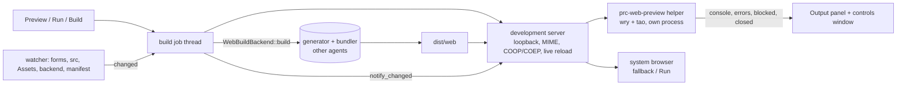

# Plan — The web-view Preview

- **Status:** implemented on `worktree-agent-a97ba65c65571c2df`; §8 lists what is not
- **Spec:** ./spec.md   **Date:** 2026-10-20

## 1. Approach

Preview is *build → serve → show*, each step behind a seam so that the pieces other people are writing (the WebAssembly
generator, the bundler, the player) plug in without a screen changing.



| Requirement | Where it is met |
|---|---|
| R1 | `panels/web_preview.rs` `WebPreview::start` runs `WebBuildBackend::build` on a thread, then `serve`. The backend is a trait object (`cobolt_project_tools::web::{WebBuildBackend, link, backend}`), `NotYetLinked` until the generator is linked once at program start. |
| R2, AC6 | The web view is a **separate process**, `prc-web-preview` (`crates/cobolt-web-preview`). The IDE only holds a pipe; `PreviewSession::poll` notices a dead child and reports `Closed`. Test: `a_session_relays_events_and_notices_a_helper_that_died` (project-tools) and the IDE flow test. |
| R3 | `SourceWatcher` (forms folder, `src/`, `Assets/`, `backend/`, the manifest) → rebuild → `ServerHandle::notify_changed()` → the page's next poll of `/__prc/version` reloads it. **A reload, not an in-place update** — §8. |
| R4, AC3 | `web/presets.rs` (7 presets × 2 orientations, with pixel ratio and safe-area insets that turn with the screen); the controls window drives them; `Controls::changes_from` sends `size`, `scheme` and **one** `emulate` (a new device changes size, ratio and insets, and the page loads once). |
| R5, AC4 | The helper's init script wraps `console.*`, `error` and `unhandledrejection` and posts them over `window.ipc`; the IDE turns them into `Note::Console` / `Note::PageError` in the Output panel (capped at 40 per poll). Developer tools: `Command::Devtools`. |
| R7, AC5 | A failed rebuild reports and **leaves the served folder alone**: the last good bundle stays on screen. The errors are in the Output panel and the controls log (not painted over the page — §8). |
| R8, AC7 | The helper allows navigation only to the Preview's own origin (`may_navigate`, exact-prefix with a boundary check, tested against `@`, port-suffix and `file:` tricks) and denies new windows; both are reported (`blocked`) and the controls window offers the address in the system browser (http/https only). `open_in_system_browser` itself refuses anything that is not a loopback `http` address. |
| R10, AC9 | Every branch is behind `is_web_project()`; the designer's Preview window and Run Form are untouched for Desktop. |
| Q1 | Separate process. |
| Q2 | **wry 0.57 + tao 0.35** (§5). |
| Q3 | The IDE does not start a project's Backend; the Preview says so (`pk_prev_backend_off`) rather than pretending. |
| Q5 | Measured: see §6. |
| Q6 | Two actions, as on desktop: **Preview** = web view with the device controls; **Run** = the same server in the system browser; **Build** = the bundle and its report. |

## 2. Affected crates / files

- `crates/cobolt-project-tools/src/web/{mod,devserver,presets,preview}.rs` — the seam, the server, the presets, the protocol.
- `crates/cobolt-web-preview/{Cargo.toml,src/main.rs}` — the helper (new workspace member).
- `crates/cobolt-ide/src/panels/web_preview.rs` (controller + controls window), `app.rs` (wiring), `i18n.rs` (`pk_build_*`, `pk_prev_*`, `pk_ps_*`).
- Root `Cargo.toml` (+member) and `Cargo.lock`.

## 3. The helper protocol (JSON lines, pinned from both sides)

```text
IDE -> helper  {"cmd":"open","url":"http://127.0.0.1:8123/","title":"..","width":390,"height":844,
                 "dpr":3.0,"dark":true,"locale":"pt-BR","safe_area":[47,0,34,0]}   # last four optional
               {"cmd":"size",..} {"cmd":"reload"} {"cmd":"scheme","dark":true} {"cmd":"devtools"} {"cmd":"close"}
               {"cmd":"emulate","dpr":2.0,"locale":"pt-BR","safe_area":[24,0,20,0]}  # any of three; one reload
helper -> IDE  {"event":"ready"} {"event":"console","level":..,"text":..} {"event":"error","message":..,"source":..,"line":..}
               {"event":"blocked","url":..} {"event":"failed","message":..} {"event":"closed"}
```

The helper depends on `serde_json` and nothing of ours; each side's tests pin the exact lines, so a change to either
fails one of the two. Emulation lives in the page origin's `localStorage` and an initialisation script re-applies it on
every load (`devicePixelRatio`, `navigator.language`/`languages`, the CSS variables `--prc-safe-area-*`).

## 4. Key decisions & alternatives

- **Separate process** (Q1). A web view that hangs or crashes takes only the helper; the window is the OS's, so nothing in the IDE's layout can resize it (GOLDEN RULE). Rejected: embedding a child web view in the egui window (not a native container on every OS).
- **A static, loopback-only server on `std::net`, no new dependency.** Host-header check (DNS-rebinding), path decoded once then canonicalised and contained, symlinks that leave the bundle are not followed, GET/HEAD only. A non-blocking accept truncated large responses in the first version; the accept is blocking and `stop()` wakes it with a connection.
- **The controls are an egui window in the IDE, the page is the helper's window.** Why: the controls obey the egui rules (explicit size, no self-resize) and the page's window is an OS window that changes size only when the developer sends `size` or drags its edge.
- **The controls window's size is the sum of constants.** Its body is one allocation of an exact size, drawn in a child `Ui` clipped to it (a child tells the window nothing of what it draws), every button and checkbox is a fixed box with truncated text. Tested over six languages × a busy and an empty state (`the_controls_window_keeps_its_size`).
- **Notes, not strings.** The controller says `Note::BuildDone { ms, bytes, files, startup_ms }`; the Output panel and the window render it from the current `Tr` table, so the language can change while a Preview runs.

## 5. Probes — the engine library (Q2), checked 2026-10-20

| | wry 0.57.0 | tao 0.35.3 |
|---|---|---|
| Licence | Apache-2.0 OR MIT | Apache-2.0 |
| MSRV | 1.85 (workspace 1.92) | 1.74 |
| macOS | `objc2-web-kit` 0.3.2 (Zlib OR Apache-2.0 OR MIT) → WKWebView | AppKit |
| Windows | `webview2-com` 0.39.1 (MIT) → WebView2 | Win32 |
| Linux | WebKitGTK (system libraries) — **not used**: the helper builds only on macOS and Windows and falls back to the system browser | GTK |

- Features: `wry` with `default-features = false, features = ["os-webview"]`, `tao` with `rwh_06`; target-gated (`cfg(any(target_os = "macos", target_os = "windows"))`), so a Linux build of the workspace compiles nothing of it.
- No TLS or crypto crate comes with them: **`ring` and `aws-lc-rs` do not enter the dependency graph through this crate**; `Cargo.lock` gains the GTK/WebKitGTK stack only because a lock file resolves every target (`ring` was already in the lock at HEAD, pulled by something else).
- Tauri 2 (WASM-012, the mobile shell) uses the same two crates, so the Preview and the mobile shell share an engine library.
- The helper compiles and its tests run on macOS (`cargo test -p cobolt-web-preview`, 5 tests, includes the `run` module). **A window was never opened by an agent** (the operator's rule is not to drive the IDE's windows, and the helper is the same kind of window); Windows is untested.

## 6. Measurements (printed by the tests)

- Dev server, loopback, debug build: 200 requests for a 17-byte file in 114 ms (0.57 ms each, 1744 req/s); a 3 MiB `program.wasm` 10 times in 157 ms (15.7 ms each, 191 MiB/s).
- A changed stylesheet moves the server's change count in 166 ms (watch interval 150 ms).
- Whole flow with a stand-in generator and helper: build → serve → web view in 337–499 ms; a form edit then rebuilt and republished.
- Controls window: 420 x 560 points in all 6 languages and both states over 120 frames; the log keeps at least 136 points.
- Q5 (the update budget): the IDE watcher looks every 400 ms and waits one quiet look, so a change is seen in 0.4–0.8 s, plus the generator's own time, plus the page's poll of the version (the server polls its folder every 150 ms). The AC2 numbers for a real generator cannot be measured until one is linked.

## 7. Risks & mitigations

- *The generator is not linked* → `NotYetLinked`, a localised message, and an existing `dist/web` is still served.
- *A bundle written non-atomically reloads half-written* → the seam's contract (documented on `WebBuildBackend`) is that a backend replaces the bundle atomically.
- *Console floods* → capped per poll, and the log keeps 300 notes.
- *The helper is not beside the IDE* → `PRC_WEB_PREVIEW` names it; otherwise the system browser, with a note that says what is lost.

## 8. Not finished, plainly

1. **R3 in place:** the page reloads (live reload); state-preserving updates need the player's cooperation (WASM-016).
2. **R6 Backend:** the IDE does not start the project's Backend; the Preview says so.
3. **R7 "errors over the page":** errors go to the Output panel and the controls log; nothing is painted over the page.
4. **R9, AC8:** the headless render and the scripted run of a *web* form need the module and browser runners of WASM-015 R1–R2; `render_form` / `run_form` still use the desktop engine.
5. **AC4 "with the form name":** a page error carries its source file and line, not the form's name.
6. **Emulation is script-level:** `devicePixelRatio`, `navigator.language` and the safe-area variables are overridden by an init script; a CSS `@media (resolution)` or `env(safe-area-inset-*)` is not changed. Use `--prc-safe-area-*` in the player's stylesheet.
7. **Linux has no web view**; **Windows is untested**; **no window was driven** by an agent.
