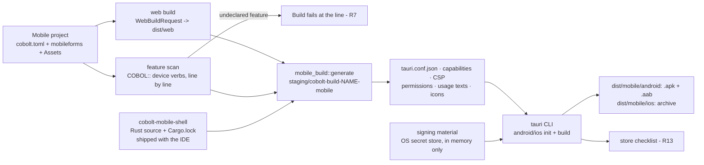

<!--
SPDX-License-Identifier: Apache-2.0
Copyright (c) 2026 Emerson Lopes and PowerRustCOBOL contributors
-->

# Plan — The mobile shell (Tauri 2): Android and iOS builds, devices, signing and permissions

- **Status:** draft → approved
- **Spec:** ./spec.md   **Date:** 2026-10-22
- **Branch / line:** `features-2x` (2.x.x). WASM-PLAN work item **W7**; it starts after W4 (the player) and W5 (the IDE Build wiring), both of which exist on `features-2x`.
- **Author:** Anthropic Claude Codex Agent

### What this plan could and could not verify (read first)

The spec asks that its statements about Tauri be checked at `/plan`. **In this run neither the web nor the machine's mobile tools could be checked**: web search was not permitted and the probe of the toolchain (`cargo tauri --version`, the Android SDK, `xcodebuild -version`, `rustup target list --installed`) was refused. So:

- every statement below about **existing PowerRustCOBOL code** was read in the tree (file and symbol given);
- every statement about **Tauri 2, its plugins, Android or iOS** is marked **[verify]**. Each one has to be confirmed against the official sources (Tauri's v2 documentation and the crates' `Cargo.toml` on crates.io) as the **first task of `/tasks`** (task V0 in §6). Any one that turns out false changes the design at the point it names, and the change goes back into this file before work goes on;
- the only Tauri-related fact the tree records is in `crates/cobolt-web-preview/Cargo.toml`: `wry 0.57` and `tao 0.35` are "the web view and window crates Tauri 2 uses, under the Apache-2.0 / MIT licences, MSRV 1.85", and "no TLS or crypto crate comes with them (`ring` and `aws-lc-rs` stay out of the lock)". That was checked when those crates were added; it says nothing about `tauri` itself or its plugins.

## 1. Approach

A Mobile build is **the Web build followed by a shell build**. The Web half exists: `cobolt_project_tools::web::WebBuildRequest::from_manifest` (`crates/cobolt-project-tools/src/web/mod.rs`) already turns a Mobile project into a bundle request with the engine matrix of its platform (`android_webview` or `ios_webview` only, `Isolation::Off`) and its module variants (`MobileSettings::module_variants`, `crates/cobolt-compiler/src/project_kind.rs`: iOS always carries the single-memory module). This spec adds what comes after the bundle — the Tauri shell project, its configuration and capability list, the platform declarations, signing, and the device run — plus the small set of device features a COBOL program can call.

The shape follows a pattern the compiler already has: `crates/cobolt-compiler/src/backend_build.rs` reads and checks a part of the project, **generates a small Cargo project in the build staging folder** (`build_staging_dir`, under `default_build_root()` — `~/Library/Caches/PowerRustCOBOL/builds` on macOS, `%LOCALAPPDATA%` on Windows, `$XDG_CACHE_HOME` on Linux), builds it and installs the result. The shell is built the same way: generated, never hand-edited, outside the project folder, and rebuilt from the project every time.



**Requirement by requirement:**

| R | How |
|---|---|
| **R1** | `mobile_build::build_mobile` runs the Web build (through the linked `WebBuildBackend`, exactly as the IDE's `start_web` in `crates/cobolt-ide/src/app.rs` does), then generates the shell project with `frontendDist` pointing at a copy of the bundle, and calls the Tauri CLI for the project's platform: **Android** → an installable `.apk` and the store's `.aab` [verify: `tauri android build --apk --aab`]; **iOS** → an archive/IPA [verify: `tauri ios build` and its export option]. Outputs go to `dist/mobile/android/` and `dist/mobile/ios/` beside `dist/web/` (`BUNDLE_SUBDIR`). The identity comes from the project (R6). A project has **one** platform today (`MobileSettings::platform`); see open question PQ1 on "each platform the project selected". |
| **R2** | A new detection module, `cobolt-compiler/src/mobile_toolchain.rs`, below the IDE so the IDE and `rcrun mcp`'s `build` tool give the same answers (the reason `project_kind.rs` lives in the compiler). It returns one `MobileTool` row per tool: present/missing/wrong version, what it is for, and the next step. It **checks** the Android SDK (`ANDROID_HOME`/`ANDROID_SDK_ROOT`, then the platform's default SDK folder), the NDK (`NDK_HOME`, then `ndk/` in the SDK), a JDK (`JAVA_HOME`, then `java -version`), Xcode and its command-line tools (`xcode-select -p`, `xcodebuild -version`, macOS only), the Rust targets (`rustup target list --installed`) and the Tauri CLI at the IDE's pinned version (Q5, D-Pin). It **installs** only the Rust targets, with `rustup target add`, after the developer agrees — the same consent flow as the existing Rust installer (`toolchain::FirstRunPrompt`, `spawn_install` in `crates/cobolt-ide/src/toolchain.rs`) — and **never** Xcode, the Android SDK, the NDK or a JDK (it names where to get them). Whether the Tauri CLI counts as "safe to install" (`cargo install tauri-cli --version =X --locked`) is open question PQ2. On a machine that is not macOS, iOS is offered as **unavailable, with the reason** (Q2 decided: no remote builds). |
| **R3** | `mobile_devices.rs` (same crate) lists targets: Android emulators (`emulator -list-avds`) and connected devices (`adb devices -l`); iOS simulators (`xcrun simctl list devices --json`) and connected devices [verify: `xcrun devicectl list devices`]. The IDE's **Run on device** window starts the chosen one, runs the shell in development mode against the existing development server (`cobolt_project_tools::web::devserver`, which already does live reload), streams the device log into the Output panel (`adb logcat --pid=<pid>`; `xcrun simctl spawn <udid> log stream --predicate` for a simulator) and stops it on request. Development mode is the **only** case where the page is not loaded from the bundle (R12); see D-Dev. |
| **R4** | `[mobile.signing]` in the manifest holds **names only**: the Android keystore's path and key alias; the Apple team id, signing identity name and provisioning-profile name. The **keystore password and key password** live in the operating system's secret store, under accounts `mobile-signing/<project-id>/<name>` (`crates/cobolt-ide/src/secrets/mod.rs`, `SERVICE = "PowerRustCOBOL"`). They reach the build **in memory** and the Gradle process **through its environment**, never through a file (D-Sign). The secret store's **kill switch** (`NATIVE_STORE_DISABLED = true`, which makes every call answer `Unavailable` so `llm.rs` falls back to plaintext) must not apply here: R4 requires *refuse*, not *fall back*. D-Store adds a strict pair of calls that ignore the kill switch and return an error, and the signing window is the "management UI" the switch's comment waits for (list, replace, delete these accounts). The Apple certificate itself stays in the login keychain where Xcode keeps it; the IDE stores no Apple secret. **Debug builds** sign with the platform's debug key automatically [verify: Tauri/Gradle/Xcode defaults]. |
| **R5** | Before calling the CLI for a release build, `build_mobile` checks that the signing names are set and the passwords retrievable, and after it, that the artefact is signed and not with a debug key (Android: `apksigner verify --print-certs` against the debug certificate's `CN=Android Debug`; iOS: `codesign -dvv` naming a distribution identity) [verify the tools' output formats]. Either failure is a refused build with its reason. |
| **R6** | New manifest fields (§3): `app_id` (reverse-DNS, validated: two or more segments, each `[A-Za-z][A-Za-z0-9_]*`), `app_name` with per-language entries for the six languages, `icon` and `splash` (paths in `Assets/`). The version is the project's `version`; the **build number** is derived from it, `major*10000 + minor*100 + patch`, per platform's rules (Android `versionCode`, iOS `CFBundleVersion`) — D-BuildNo. The icons are generated at every required size from the one source image [verify: `tauri icon <png>` produces the Android and iOS sets]; an image that is not square or smaller than 1024 px is refused with the reason. |
| **R7** | A **feature table** (`mobile_features.rs`) maps each device feature to: the `COBOL::` verbs that use it (§3, ABI amendment A10), its Android permissions, its iOS `Info.plist` usage key, the Tauri plugin and the capability permissions it needs, and the store-checklist lines (R13). The **scan** walks the project's parsed programs (the same ASTs the Web build compiles, via `cobolt_parser` as `backend_build` does) for `INVOKE COBOL::…`/inline `COBOL::Verb(…)` calls whose verb belongs to a feature, and for controls whose use implies one (none in the first set). A use of a feature the project has not listed under `[mobile] features` fails the Build with `file:line: uses <feature> (COBOL::<verb>); add it to the project's device features` — the `file:line: construct — alternative` shape of WASM-002 R3 (`WebBuildError::Refused`). Declared features write the platform declarations; **only** declared features do (least privilege, WASM-013 R14). |
| **R8** | Permissions are requested **at the first call** of a verb that needs one, by the shell, with the developer's rationale text from `[mobile.features.<name>] rationale` (translatable). On Android the rationale is shown by the player as a dialog before the system prompt; on iOS the usage text is the prompt's sentence (`NS…UsageDescription`) [verify that this is the only rationale iOS shows]. A refusal answers the verb with the ABI's existing **`-6` "host refused (permission or policy)"** (`WASM-ABI-v1.md` §9), which the generated code already turns into `ON EXCEPTION` — so the program handles it as a normal failure. No new error code. Of the first set only secure storage could need a permission (biometric-protected keys are not in it), so R8 is built and tested in the first set with the dialler/browser features (no prompt) and secure storage (no prompt) **and** proved on the first feature that does prompt (PQ3). |
| **R9** | The **first set** (spec R9, decided as written): **secure storage** (`COBOL::SecureStore`, `SecureLoad`, `SecureDelete`), **opening an address in the system browser or the dialler** (the existing `COBOL::Navigate`/`OpenUrl`, §12.1, routed by the shell — WASM-006 R11 — plus `mailto:`/`tel:`/`sms:` handed to the OS) and **deep links** (the OS address scheme `<app_id>://form?param=…`, delivered to `me::GetParam`/`GetParams`, which ABI §12.1 already says read deep-link parameters). Each is a host-API entry, versioned by the feature table's `FEATURE_SET_VERSION` and recorded in the module's manifest `builtins` (ABI §10), with a KB entry. The other features — camera, location, notifications, biometric unlock, haptics, share sheet, clipboard, barcode scanner — are **not decided**: Q1 says "yes", *to confirm*. Working assumption (PQ3): the feature table is built so that each is one row, one plugin and one KB entry; the five of Q1 are planned as phase M5 below, taken up one at a time **only after** the operator confirms which belong to 2.0. |
| **R10** | The shell sets `viewport-fit=cover` on the host page (a field the bundle writes for Mobile) so WKWebView fills `env(safe-area-inset-*)`. Android's system WebView is not relied on to fill `env()` [verify for the API floor of Q3]: the shell reads the window insets and the keyboard (IME) inset natively and pushes them to the page as CSS custom properties `--pr-safe-top/right/bottom/left` and `--pr-keyboard`, on both platforms, so WASM-007's stylesheet has **one** set of names (`max(env(...), var(--pr-safe-...))` in the base CSS). Orientation (`MobileSettings::orientation`, already in the manifest and offered by the New Project dialog, `crates/cobolt-ide/src/panels/new_project.rs`) writes Android `screenOrientation` and iOS `UISupportedInterfaceOrientations`. The **Back** gesture/button on Android is delivered to the page as an event the player turns into the navigation pop of WASM-011 R13; when the stack is empty the application goes to the background as Android expects [verify the Tauri 2 API for intercepting Back]. iOS has no system Back button; the edge-swipe is the player's (WASM-011). |
| **R11** | The shell forwards the platform's lifecycle — paused/resumed, and terminate where the platform reports it [verify which Tauri `RunEvent`s exist on mobile] — to the page; the page also listens to `visibilitychange` as the portable fallback. The player maps them to the lifecycle events of spec 037 that WASM-016 already raises for a closing page. On resume the player's connection (`crates/cobolt-web-player/src/net.rs`, ABI A8) reconnects with back-off (WASM-003 R8), and an `authentication`/`expired` answer leads to sign-in through the Authentication control (WASM-009 R5) — no new mechanism, a test that proves it. |
| **R12** | The generated `tauri.conf.json` names the bundled folder as `frontendDist` and **no** `devUrl` in a release build; the CSP is the one `cobolt_web_bundle::csp` builds (`Policy`, `CspOptions::strict()`), put into the configuration [verify the key, `app.security.csp`] and adapted to the shell's own origin [verify: `tauri://localhost` on iOS, `http(s)://tauri.localhost` on Android]. The **capability file** is generated from the declared features and lists **exactly** the commands the page may call, for the main window only, with no remote origin (WASM-013 R14). A navigation to any address outside the application's origin is stopped in the shell and handed to the system browser (the `opener` plugin [verify]); `mailto:`/`tel:`/`sms:` go to the OS. |
| **R13** | `build_mobile` prints, after a successful build, a checklist derived from the declared features (feature table): iOS privacy items (the usage keys present; a privacy manifest's required-reason categories [verify Apple's current list]) and Android data-safety items (what each permission implies). It is printed, never submitted (non-goal). |
| **R14** | A Desktop project never reaches this code: `build_project` already refuses a Web/Mobile project (`CompilerError::NotADesktopProject`) and the Web path is untouched except that `WebBuildRequest` gains nothing (the Mobile half reads it, it does not change it). AC10's test re-runs the existing Web and Desktop build tests unchanged. The New Project dialog's Mobile options (`orientation`, `min_os`) are honoured: `orientation` as R10 says; `min_os` per Q3 (decided) — see §3 and D-MinOS. |

## 2. Affected crates / files

**New**

- `crates/cobolt-mobile-shell/` — the shell's **Rust** source, its own Cargo workspace with its own `Cargo.lock` (like `crates/cobolt-web-player`, which the root `Cargo.toml` lists under `exclude`): `src/lib.rs` (the mobile entry point, the navigation guard, the inset/keyboard/Back/lifecycle forwarding, the secure-storage commands) and `Cargo.toml` pinning `tauri` and the plugins (D-Pin). Shipped with the IDE as source and lock, staged into each build like `stage_sdk` stages the platform's crates (`cobolt-compiler/src/lib.rs`). Excluded from the root workspace so `cargo build --workspace` does not need the Android/iOS targets. **No Kotlin, Swift, Java or Gradle file is authored or committed** (PRIME DIRECTIVE, D-Native).
- `crates/cobolt-compiler/src/mobile_build.rs` — `MobileBuildOptions`, `MobileBuildResult`, `build_mobile`, `generate` (shell project, `tauri.conf.json`, capability file, CSP, platform declarations, icons, translated names), the release-signing checks (R5), the checklist (R13). Pattern: `backend_build.rs`.
- `crates/cobolt-compiler/src/mobile_toolchain.rs` — `MobileTool`, `MobileToolStatus`, `detect(platform)`, `install_rust_target` (R2).
- `crates/cobolt-compiler/src/mobile_devices.rs` — `DeviceTarget`, `list(platform)`, `start`, `install_and_launch`, `log_stream`, `stop` (R3). Process spawning only; no UI.
- `crates/cobolt-compiler/src/mobile_features.rs` — the feature table, `FEATURE_SET_VERSION`, `scan(programs) -> Vec<FeatureUse>` (R7, R9, R13).
- `crates/cobolt-compiler/tests/mobile_shell.rs`, `crates/cobolt-mobile-shell/tests/dependency_guard.rs` — §6.
- `crates/cobolt-ide/src/panels/mobile_devices.rs` — the **Run on device** window (target list, start/stop, log to Output).
- `crates/cobolt-ide/src/panels/mobile_signing.rs` — the **Signing** window (names into the manifest, passwords into the store; replace and delete).

**Changed**

- `crates/cobolt-compiler/src/project_kind.rs` — `MobileSettings` gains `app_id`, `app_name`, `icon`, `splash`, `features`, `signing` (§3), each with a serde default so an existing `[mobile]` table loads unchanged (the file's own rule: "every field has a serde default"); `min_os` resolution (D-MinOS); `fn min_os_floor(platform)`.
- `crates/cobolt-compiler/src/lib.rs` — `mod` lines and re-exports; the **System KB** text of "Project kinds: Desktop, Web and Mobile" (the table row that says the package step "needs the mobile shell, which the product does not include yet", and the `[mobile]` block) and the Build/Preview paragraph; the `COBOL::` verb documentation for the new verbs (`control_method_docs`/the application-object table, wherever ABI §12.1's verbs are documented for the KB — located in task V0); `ManifestView` keeps `mobile` as today.
- `crates/cobolt-wasm` — the generator accepts the three secure-storage verbs on the application object (ctrl 2) and records them in the manifest's `builtins`; a Web build that uses them fails with the R3 line "available in a Mobile project only" (D-WebRefuse).
- `crates/cobolt-runtime` — the interpreter's `COBOL::` dispatch answers the three device verbs with a "available in a Mobile application only" run-time error instead of an unknown-verb path, so `rcrun run-form`, embedded child forms and the compiled binary behave alike (interpreter/binary parity). Where that dispatcher lives is located in task V0; it was not read for this plan.
- `crates/cobolt-wasm-abi` and `specs/WASM-ABI-v1.md` — amendment **A10**: the secure-storage verbs, the deep-link delivery, and the shell's events to the page (insets, Back, lifecycle) as the player sees them. The ABI version stays 1 (additive verbs; an unknown verb already answers `-4`, A7).
- `crates/cobolt-web-player` — in its own workspace: the shell bridge (detect the shell, call its commands, receive Back/insets/lifecycle), the Hyperlink/`Navigate` route to the system browser in the shell (WASM-006 R11), the Android rationale dialog (R8). Written in Rust through `wasm-bindgen`/`js-sys`; the prebuilt player in `assets/web-player/` is rebuilt (WASM-016 AC7 freshness).
- `crates/cobolt-web-bundle` — `viewport-fit=cover` and the `--pr-safe-*` fallbacks in the base CSS for a Mobile bundle; the CSP options for the shell's origin.
- `crates/cobolt-project-tools/src/web/mod.rs` and `src/tools/build.rs` — the `build` tool of `rcrun mcp` runs the mobile half for a Mobile project (debug only; D-Sign); the device list as a tool output (WASM-015's agent tooling).
- `crates/cobolt-ide/src/app.rs` — `start_web` continues into the mobile half for a Mobile project; menu entries **Run on device…** and **Signing…** for a Mobile project.
- `crates/cobolt-ide/src/secrets/mod.rs` — `store_required` / `retrieve_required` / `delete_required` (D-Store); `list_accounts(prefix)` if the platform layer can answer it (task V0 checks macOS/Windows/Linux layers), otherwise the signing window lists the names the manifest holds.
- `crates/cobolt-ide/src/i18n.rs` — Tr keys ×6 (§7).
- `assets/knowledge/chunked.data` — regenerated (`cargo run -p cobolt-ide --example build_chunked_kb`).
- `crates/cobolt-ide/src/version.rs`, `CHANGELOG.md` — `z` bump per change.
- `specs/WASM-PROGRESS.md` — the WASM-012 row (P now; T/I/V later); `specs/WASM-ABI-v1.md` (A10).
- **Not touched:** `README.md`, anything under `docs/` (2.x.x rule). The user-facing description of the mobile build lives in the System KB text and in these specs.

## 3. Data / model changes

**`cobolt.toml`, `[mobile]` (additive; old tables load unchanged):**

```toml
[mobile]
platform     = "android"
device       = "phone"
orientation  = "portrait"
min_os       = "auto"            # see D-MinOS
style        = "spa"
multi_memory = true
backend_url  = ""
app_id       = "com.example.orders"      # new — required before the first package build; empty until set
icon         = "Assets/icon.png"         # new — square, at least 1024 px
splash       = "Assets/splash.png"       # new — optional
features     = ["secure-storage", "open-address", "deep-link"]   # new — the declared device features (R7)

[mobile.app_name]                        # new — the application's name, per language; "en" required
en = "Orders"
es = "Pedidos"

[mobile.features.secure-storage]         # new — per-feature rationale (R8), per language
rationale.en = "Keeps you signed in on this phone."

[mobile.signing]                         # new — NAMES only; passwords are in the OS secret store (R4)
android_keystore = "/Users/me/keys/orders.jks"   # outside the project folder; refused when inside it
android_alias    = "orders"
apple_team_id    = "ABCDE12345"
apple_identity   = "Apple Distribution: Example Ltd"
apple_profile    = "Orders App Store"
```

- **Credentials:** none of these fields is a secret; the keystore path is refused when it points inside the project folder (a project folder is shared and committed; the keystore file itself is a secret). The Build's secret scan (WASM-002 R7 / WASM-013 R7) runs over the project as for Web. *Example projects committed to the repository carry no `[mobile.signing]` values.*
- **`min_os`** keeps its string type and `auto` default (no migration). See D-MinOS for what `auto` now resolves to and how a lower value is refused.
- **Generated, never in the project:** the shell project, `tauri.conf.json`, the capability file, `AndroidManifest.xml` additions, `Info.plist` keys, translated name resources, icon sets — all in `<build root>/cobolt-build-<name>-mobile/`, rewritten on every build (generated-code contract; spec 100/101's build folder answers the spec's "the planners decide where it lives"). The artefacts land in `<project>/dist/mobile/<platform>/`.
- **Program module:** the manifest's `builtins` list (ABI §10) carries the device verbs the program uses; the feature scan cross-checks it (D-Scan).
- **ABI A10** (additive, version stays 1): `COBOL::SecureStore(key, value)`, `SecureLoad(key)` → value or empty, `SecureDelete(key)` — none suspends in the first set [verify: the Tauri command call is asynchronous in the page; if so they **suspend** like `Sleep` (§12.1), and A10 says so]; deep-link delivery to `me::GetParam`; refusal `-6`.

## 4. Key decisions & alternatives

- **D-Shape — the shell is generated per build into the build folder from a shipped Rust crate.** Why: the spec's generated-code contract; `backend_build.rs` is the precedent; the project folder stays the developer's. Rejected: a `src-tauri/` folder in each project (hand-editable, drifts, would mix generated Kotlin/Swift into user projects); a prebuilt shell binary (impossible: the spec's own tech note — the shell is compiled and signed per application).
- **D-Native — no native-language code authored by us.** The Android and iOS projects Tauri's `init` generates (Gradle files, a Kotlin activity, an Xcode project) are created **in the build folder** at build time and never committed; native features come from **published** plugins and crates only. Why: the PRIME DIRECTIVE (the repository is Rust; product assets aside). Rejected: a hand-written Kotlin/Swift plugin in the repo. **Consequence, stated:** a feature with no acceptable published plugin cannot be done this way; secure storage is the first candidate (Risk 2, PQ4).
- **D-Pin — Tauri and the plugins track the IDE (Q5, decided).** One version set in `crates/cobolt-mobile-shell/Cargo.toml` and its committed lock, checked by a dependency-guard test (no `ring`, no `aws-lc-rs`, MSRV ≤ 1.92 for what builds on the developer's machine, licences in an allow-list — WASM-013 R9); the Tauri CLI version the IDE expects is a constant beside it, and R2 checks the installed CLI against it. R2's "the version the project pins" is read as "the version the IDE pins", which is what Q5 decided. Rejected: per-project pins (Q5).
- **D-Sign — passwords reach Gradle through the environment of the child process, never a file.** The generated signing configuration reads the keystore path, alias and passwords from environment variables set only on the `tauri android build` process [verify how Tauri 2's Android template takes a signing config]. Release signing is offered **from the IDE only**, which owns the secret store; `rcrun mcp`'s `build` tool makes debug packages and answers a release request with the reason. Rejected: a `keystore.properties` file (Tauri's documented route [verify], but a file holding a password, even in the build folder, breaks R4's "never written"); moving the secret store below the IDE now (a larger change no requirement needs; noted for WASM-013).
- **D-Store — strict secret-store calls for signing.** `store_required`/`retrieve_required`/`delete_required` bypass `NATIVE_STORE_DISABLED` and return `Err` with the store's reason; the signing window is the management UI the kill switch's comment asks for. Why: R4 forbids the plaintext fallback, and the kill switch would otherwise make every signing secret "unavailable" on every machine. Rejected: flipping the kill switch off globally (its comment ties that to the LLM keys' own management UI — another decision). **This touches a standing safety switch; it is called out for the operator's review at `/analyze`.**
- **D-MinOS — Q3 (decided): the floor is the last OS version released in 2024, raised one year per PowerRustCOBOL major.** For 2.x: **Android 15 (API 35)** and **iOS 18** [verify both against the vendors' release dates]. `min_os_floor(platform)` holds the table; `auto` resolves to the floor; a value below it is refused at Check and Build with the floor named; the New Project dialog lists the floor and newer. Whether Tauri 2 and the web views support a floor this high is not in doubt (they support older ones [verify]); the opposite constraint — features of WASM-017's baseline that need newer web views — is checked against the floor in task V0.
- **D-Tablet — Q4 (decided): one shell; phone and tablet differ only by the responsive breakpoints.** `DeviceClass` writes only what each platform needs to *allow* a tablet (iOS device family including iPad when `device = "tablet"` [verify Tauri's key]; nothing on Android).
- **D-Dev — development mode loads from the development server; release never does.** Android reaches the loopback server through `adb reverse tcp:<port> tcp:<port>`, so the server stays on loopback (WASM-008's server is loopback-only); the iOS simulator shares the host's loopback; a **physical iOS device** needs the server on the LAN address, which is opt-in per run with a warning (the only widening of the server's exposure). Rejected: always binding the dev server to the LAN.
- **D-Scan — the feature scan reads the AST, and the module manifest confirms it.** Why: the line number is in the AST; the `builtins` list confirms the generated module uses nothing the scan missed (a test asserts the two sets are equal on the fixtures). Rejected: scanning source text (misses inline calls, finds comments).
- **D-WebRefuse — a Web build that uses a device verb is refused at the line.** Why: R14 (Web unchanged) plus WASM-002 R3's shape; a browser has no secure store the page cannot read (WASM-009 R5). Rejected: a silent no-op in the browser.
- **D-Insets — one set of CSS names on both platforms** (`--pr-safe-*`, `--pr-keyboard`) pushed by the shell, with `env()` as the first choice inside `max()`. Why: WASM-007 R10 promises the platform web views; Android's `env()` support is the uncertain half.
- **D-Errors — permission refusal is the existing `-6`.** Rejected: a new code (the ABI's list already names "permission").

## 5. Risks & mitigations

1. **Every Tauri fact is unverified in this run** (see the top). → Task V0 checks each `[verify]` item against official sources and records the source and date in this file; the design changes before work goes on if one is false.
2. **Secure storage may need native code we may not write** (D-Native). Tauri's official plugin list may not have an OS-keystore plugin [verify]; candidates are a published third-party Tauri plugin, or the `keyring` crate if it has Android and iOS backends [verify]. → V0 evaluates them against the guards (licence, `ring`/`aws-lc-rs`, maintenance). If none qualifies, this is **PQ4** for the operator, because R9's first set and WASM-009 R5 (refresh credential in the OS store on mobile) both depend on it.
3. **Dependency guards.** Tauri's default features or a plugin may pull `reqwest`/`rustls` → `ring` [verify]. → `default-features = false` and a guard test on the shell's lock; a plugin that brings `ring` is replaced or dropped.
4. **MSRV.** The shell is compiled on the developer's machine with whatever Rust they have; the IDE requires 1.92 (`toolchain::minimum()`). A Tauri version needing newer → D-Pin chooses a set that builds on 1.92, the guard test asserts each crate's `rust-version` ≤ 1.92.
5. **Disk and time.** A first Android build downloads Gradle and the NDK toolchain output and builds four Rust targets; the memory notes a test sweep on this machine already uses tens of GB. → Mobile tests that need the SDK are `#[ignore]`d with the exact command to run them, the default test run uses generation-only tests; one target (`aarch64`) by default for debug runs [verify the CLI flag].
6. **This machine may lack the SDKs.** WASM-PLAN §5 already says: what cannot be run here is listed in the ledger with the command, never claimed. → AC1/AC3/AC6–AC8 evidence recorded per platform; iOS only on a Mac with Xcode.
7. **Kill-switch bypass (D-Store) widens a deliberately closed path.** → only `mobile-signing/` accounts, a test that the LLM path still falls back, and the operator's review.
8. **Android Back interception and lifecycle events may differ between Tauri minor versions** [verify]. → one module of the shell owns each, with a test page in the fixture project that logs what arrives.
9. **Player rebuild.** Changing `cobolt-web-player` means rebuilding the shipped `assets/web-player/` (pinned toolchain, WASM-PLAN risk 4). → the freshness test of WASM-016 AC7 catches a stale player.

## 6. Test strategy

**V0 — verification task (first, before code).** For each `[verify]` item: the source URL, the date, the answer, and the change it forces (if any), written back into this file. Includes the local probe the plan could not run: `cargo tauri --version`, `rustup target list --installed`, `xcodebuild -version`, `java -version`, the SDK/NDK folders.

**Automated (default run, no SDK needed):**

- `cobolt-compiler` unit tests (`project_kind.rs`): the new `[mobile]` fields round-trip through TOML; an old `[mobile]` table loads with every new default; `app_id` validation (accepts `com.example.app`, refuses `example`, `1com.x`, `com..x`); `min_os` below the floor refused with the floor named; `auto` resolves to the floor; build number from version (`2.0.29` → `20029`); a keystore path inside the project folder refused.
- `mobile_features.rs`: every feature row has verbs, permissions/usage key, capability permissions and a checklist line; `FEATURE_SET_VERSION` present; the scan finds `INVOKE COBOL::"SecureStore"` and the inline form at the right `file:line`, ignores comments; **reports** `N uses of M features in K programs`.
- `tests/mobile_shell.rs` (generation only): for an Android and an iOS fixture project — `tauri.conf.json` has `frontendDist` and no `devUrl` in release, the CSP equals `cobolt_web_bundle::csp`'s for the shell origin; the capability file lists exactly the commands of the declared features and no remote origin (AC9, static half); the Android permissions and iOS usage keys match the declared features and **only** them (AC5, platform-file half); an undeclared use fails at its line (AC5); orientation written as set (AC7, static half); the generated tree contains **no** password (AC4's scan, run over the project folder **and** the build folder with known test passwords); a release build without signing names or with a missing password is refused before any process starts (AC4, refusal half); a Desktop and a Web fixture build byte-identically to before (AC10). Each test prints what it compared.
- `mobile_toolchain.rs`: detection driven by a fake environment (variables and a fake `PATH` of stub executables written by the test in a temp dir, Rust only): each tool hidden in turn is named with its purpose and next step; Xcode/SDK never installed (the install function refuses anything but a Rust target); iOS unavailable on non-macOS with the reason (AC2). Reports a table of tool × state.
- `crates/cobolt-mobile-shell/tests/dependency_guard.rs`: no `ring`/`aws-lc-rs` in the lock; licences in the allow-list; `rust-version` ≤ 1.92 — counts printed.
- `cobolt-wasm`: the three verbs compile in a Mobile build and appear in `builtins`; a Web build refuses them at the line (D-WebRefuse); scan set = `builtins` set on the fixtures.
- `cobolt-web-player` (its workspace): the shell bridge with a fake shell object — Back pops the navigation stack and on an empty stack asks the shell to background (AC7, logic); a refusal answer becomes `-6` (AC6, logic); an external address goes to the opener, an own-origin one does not (AC9, logic); resume triggers reconnect and an expired answer reaches sign-in (AC8, logic).
- `cobolt-ide`: i18n completeness test covers the new keys in six languages; the signing window writes names to the manifest and never a password (test of the save function); D-Store's strict calls return `Err` when the store is unavailable while `llm.rs`'s path still falls back.
- System KB: `prebuilt_chunked_kb_matches_the_published_documentation` green after regeneration.

**Device runs (`#[ignore]`, recorded in `WASM-PROGRESS.md` with the command and the result, never claimed when not run):**

- AC1: build the Android fixture → `.apk` + `.aab`; install on an emulator; the main form shows. On a Mac with Xcode: the iOS archive; a simulator shows the main form.
- AC3: Run on device lists emulators/simulators/devices; a form edit reloads; the device log reaches the Output panel.
- AC4: a release build with the developer's own signing material (operator's, never the agent's — the spec's credentials rule) succeeds; `apksigner`/`codesign` show a non-debug identity.
- AC6: the first gated feature (after PQ3) prompts with the rationale; refusing reaches `ON EXCEPTION` in the fixture program.
- AC7: insets reach the CSS (the fixture page prints `--pr-safe-*`); rotation is locked as set; Back pops.
- AC8: background and return raise the lifecycle events (fixture log) and the backend reconnects; an expired token leads to sign-in.
- AC9: a page script calling an omitted command is rejected by the shell; an external link opens the system browser.

**Manual / visual (operator judges the look):** the Run on device and Signing windows in the six languages at their explicit sizes (the self-resizing-window rule; no window sized from available space).

## 7. Steering compliance

- [x] **i18n:** new Tr keys ×6 (EN/ES/PT/JA/ZH/FR) in `crates/cobolt-ide/src/i18n.rs` for: every `MobileTool` name/purpose/next step; "unavailable on this machine" + reason; the device window (titles, columns, Start/Stop, empty list); the signing window (fields, Save/Replace/Delete, "secret store unavailable — cannot continue"); the R5 refusals; the R7 undeclared-feature message; the checklist heading. The tools (`rcrun mcp`) answer in English as they do today. The application's name and rationale texts are the developer's, per language, in the manifest.
- [x] **Generated-code contract:** the shell project and every platform file are build artefacts, regenerated on every Build, never in the project, never hand-edited; the COBOL banner/regenerate contract for forms is untouched.
- [x] **Docs:** `README.md` and `docs/` untouched (2.x.x). What the line says about itself: these specs, `WASM-ABI-v1.md` A10, the System KB text in `cobolt-compiler`.
- [x] **System KB:** the `[mobile]` keys, the device verbs, the build/run behaviour in the compiler's doc text/tables, and `assets/knowledge/chunked.data` regenerated in the same change.
- [x] **Fix vs feature:** feature, `features-2x`; every change bumps `z` in `version.rs` with a `CHANGELOG.md` entry (never `x`/`y`).
- [x] **Interpreter/binary parity:** the desktop interpreter has no device verbs; the new verbs are refused outside a Mobile build at Check (generator) and the interpreter's `COBOL::` dispatcher answers them with the "Mobile project only" error rather than silently ignoring them — in `rcrun run-form`, embedded child forms and the compiled binary alike.
- [x] **PRIME DIRECTIVE:** Rust only in the repository; Tauri's generated Gradle/Kotlin/Xcode trees live in the build folder; no native-language source authored (D-Native).
- [x] **Credentials:** no secret in a project file or the build folder; release signing material is the operator's; staged diffs scanned before any commit; examples carry no `[mobile.signing]` values.
- [x] **User code is sacred:** nothing in the project folder is rewritten except `cobolt.toml` fields the developer sets in the Signing window and `dist/mobile/`.
- [x] **No "cobolt" in user-facing text:** the `prc-`/PowerRustCOBOL names are used; crate names are internal.
- [x] **Self-resizing windows:** both new windows open at an explicit default size and change only when the user drags.

## 8. Open questions (carried, not decided here)

- **Q1 (to confirm):** which of camera, location, notifications, biometric unlock and barcode scanning enter 2.0. *Working assumption:* none is implemented until confirmed; the feature table and phase M5 make each one row + one plugin + one KB entry.
- **PQ1 — one platform or both per project.** R1 says "for each platform the project selected"; the manifest (`MobileSettings::platform`, WASM-001, implemented) holds one. *Working assumption:* one platform per project; a project for both is two projects or a later change to WASM-001's model. To confirm.
- **PQ2 — may the IDE install the Tauri CLI** (`cargo install tauri-cli --locked --version =<pin>`)? It is a Rust tool from crates.io, like the Rust targets, but larger and compiled on the machine. *Working assumption:* offered with consent, like `rustup target add`; Xcode/SDK/NDK/JDK never.
- **PQ3 — the first feature that shows a permission prompt.** None of the first set prompts, so AC6 cannot be run on the first set alone. *Working assumption:* AC6 is proved on the first of Q1's features the operator confirms.
- **PQ4 — secure storage without native code** (Risk 2): if no published plugin or crate qualifies, does the operator allow a native-language component (which the PRIME DIRECTIVE forbids in the repository), or does secure storage wait? Raised only if V0 finds no Rust-side route.
- **WASM-017 Q5 (not answered, affects this shell):** isolation headers in the shell's asset protocol and whether the iOS web view isolates. *Working assumption:* `Isolation::Off` for Mobile, as `WebBuildRequest::from_manifest` already sets — the plain player and the main thread.
- **Q6 (decided):** certificate pinning is optional and belongs to WASM-013; nothing here.
