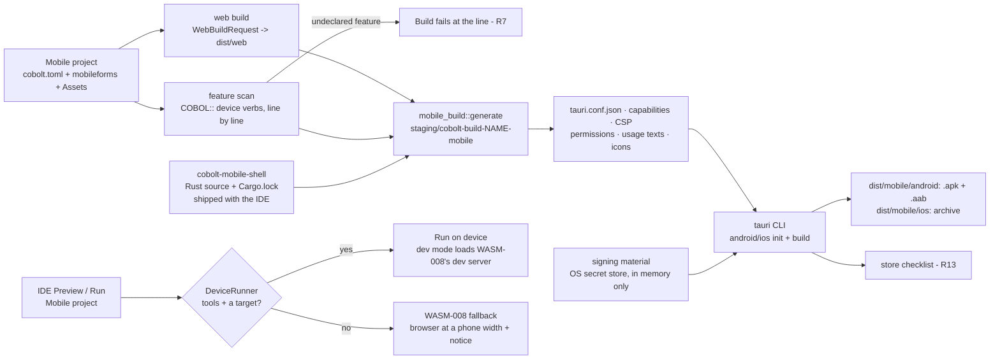

<!--
SPDX-License-Identifier: Apache-2.0
Copyright (c) 2026 Emerson Lopes and PowerRustCOBOL contributors
-->

# Plan — The mobile shell (Tauri 2): Android and iOS builds, devices, signing and permissions

- **Status:** draft → approved. **Revised 2026-10-23** to match the spec as it stands (R3a, the operator's ruling of 2026-10-23) and the tree at **2.0.49**; the first version was written 2026-10-22 (2.0.31). §0 lists what changed.
- **Spec:** ./spec.md   **Date:** 2026-10-23
- **Branch / line:** `features-2x` (2.x.x). WASM-PLAN work item **W7**; it starts after W4 (the player) and W5 (the IDE Build wiring), both of which exist on `features-2x`.
- **Author:** Anthropic Claude Codex Agent

## 0. What this revision changes, and why

| # | Change | Why |
|---|---|---|
| C1 | **R3a is planned** (§1 row R3a, D-Preview): the IDE's **Preview and Run** of a Mobile project *are* the Run on device of R3; with no emulator, simulator or device for the platform they hand over to WASM-008's browser fallback at a phone width. This plan supplies the real implementation of the `DeviceRunner` seam the WASM-008 plan defines. | Spec R3a (operator ruling 2026-10-23); WASM-008 spec §0, R14, R15. |
| C2 | The ABI amendment for the device verbs is renumbered **A10 → A14**. | `specs/WASM-ABI-v1.md` §12 now has A10–A13 (the generator's project module, in-memory files, the remote call, `DISPLAY` lines); A14 is the next free row. |
| C3 | The places the first plan left "to locate in task V0" are now named: the generator's application-object vocabulary (`APP_VERBS`, `suspends` in `crates/cobolt-wasm/src/lower_remote.rs`), the player's verb dispatch (`crates/cobolt-web-player/src/host.rs`, the `"NAVIGATE" \| "OPENURL"`, `"COPYTOCLIPBOARD"` arms), the desktop's `COBOL::` path (a built-in CALL: `cobol_object_call` in `crates/cobolt-parser/src/stmt.rs`, looked up in `BUILTINS`, `crates/cobolt-runtime/src/builtins.rs`), and the three "the mobile shell is not included yet" texts (§2). | The binding rule "ground every claim in a file you read". |
| C4 | `MobileSettings` (`crates/cobolt-compiler/src/project_kind.rs`) has gained `player`, `max_payload_bytes` and `call_timeout_ms` since the first plan (WASM-016, WASM-005); the new fields of §3 come after them. The browser setting the fallback uses (`preview_browser`) is **WASM-008's** field, not added here. | Read in the tree; one owner per field. |
| C5 | **Clipboard** (in R9's later list) is noted as partly present: `COBOL::CopyToClipboard` is already an ABI §12.1 verb the player implements (`Effect::Clipboard`); the mobile row only routes it through the shell. | ABI §12.1, `host.rs`. |
| C6 | Nothing about Tauri could be verified **again** in this run: web access and the local toolchain probe were both refused (2026-10-23). Every `[verify]` stays; task V0 stays first. | Honesty; the spec asks for verification at `/plan`. |

Kept unchanged: the shape (D-Shape), no native code (D-Native), the pinning (D-Pin), signing through the environment (D-Sign), the strict secret-store calls (D-Store), the OS floor (D-MinOS), tablets (D-Tablet), dev mode (D-Dev), the scan (D-Scan), the Web refusal (D-WebRefuse), the insets (D-Insets), the error code (D-Errors).

### What this plan could and could not verify (read first)

- every statement below about **existing PowerRustCOBOL code** was read in the tree (file and symbol given);
- every statement about **Tauri 2, its plugins, Android or iOS** is marked **[verify]**. Each one has to be confirmed against the official sources (Tauri's v2 documentation and the crates' `Cargo.toml` on crates.io) as the **first task of `/tasks`** (V0, §6). Any one that turns out false changes the design at the point it names, and the change goes back into this file before work goes on;
- the only Tauri-related fact the tree records is in `crates/cobolt-web-preview/Cargo.toml`: `wry 0.57` and `tao 0.35` are "the web view and window crates Tauri 2 (the mobile shell, WASM-012) uses", under Apache-2.0 / MIT, with no TLS or crypto crate. It says nothing about `tauri` itself or its plugins;
- the **WASM-008 plan** cited below is its revision of 2026-10-23, present in the working tree and not yet committed; where it changes, the seam of D-Preview follows it.

## 1. Approach

A Mobile build is **the Web build followed by a shell build**. The Web half exists: `cobolt_project_tools::web::WebBuildRequest::from_manifest` (`crates/cobolt-project-tools/src/web/mod.rs`) turns a Mobile project into a bundle request with its platform's engine matrix and module variants (`MobileSettings::module_variants`, `crates/cobolt-compiler/src/project_kind.rs`), written to `dist/web` (`BUNDLE_SUBDIR`). This spec adds what comes after the bundle — the Tauri shell project, its configuration and capability list, the platform declarations, signing, and the device run (which is now also the Mobile Preview and Run, R3a) — plus the small set of device features a COBOL program can call.

The shape follows a pattern the compiler already has: `crates/cobolt-compiler/src/backend_build.rs` (`build_backend`) reads and checks a part of the project, **generates a small Cargo project in the build staging folder** (`build_staging_dir`, under `default_build_root()`, `crates/cobolt-compiler/src/lib.rs`), builds it and installs the result. The shell is built the same way: generated, never hand-edited, outside the project folder, and rebuilt from the project every time.



**Requirement by requirement:**

| R | How |
|---|---|
| **R1** | `mobile_build::build_mobile` runs the Web build (through the linked `WebBuildBackend`, as the IDE's `start_web` in `crates/cobolt-ide/src/app.rs` does today with `WebIntent::Build`), then generates the shell project with `frontendDist` pointing at a copy of the bundle, and calls the Tauri CLI for the project's platform: **Android** → an installable `.apk` and the store's `.aab` [verify: `tauri android build --apk --aab`]; **iOS** → an archive/IPA [verify: `tauri ios build` and its export option]. Outputs go to `dist/mobile/android/` and `dist/mobile/ios/` beside `dist/web/`. The identity comes from the project (R6). A project has **one** platform today (`MobileSettings::platform`); see PQ1 on "each platform the project selected". |
| **R2** | A new detection module, `cobolt-compiler/src/mobile_toolchain.rs`, below the IDE so the IDE and `rcrun mcp`'s `build` tool give the same answers (the reason `project_kind.rs` lives in the compiler). It returns one `MobileTool` row per tool: present/missing/wrong version, what it is for, and the next step. It **checks** the Android SDK (`ANDROID_HOME`/`ANDROID_SDK_ROOT`, then the platform's default SDK folder), the NDK (`NDK_HOME`, then `ndk/` in the SDK), a JDK (`JAVA_HOME`, then `java -version`), Xcode and its command-line tools (`xcode-select -p`, `xcodebuild -version`, macOS only), the Rust targets (`rustup target list --installed`) and the Tauri CLI at the IDE's pinned version (Q5, D-Pin). It **installs** only the Rust targets, with `rustup target add`, after the developer agrees — the same consent flow as the existing Rust installer (`FirstRunPrompt`, `spawn_install` in `crates/cobolt-ide/src/toolchain.rs`) — and **never** Xcode, the Android SDK, the NDK or a JDK (it names where to get them). Whether the Tauri CLI counts as "safe to install" is PQ2. Off macOS, iOS is offered as **unavailable, with the reason** (Q2 decided: no remote builds) — the reason `crates/cobolt-project-tools/src/tools/build.rs` already gives ("an iOS package can only be built on macOS"). The same `detect` answer decides R3a's fallback. |
| **R3** | `mobile_devices.rs` (same crate) lists targets: Android emulators (`emulator -list-avds`) and connected devices (`adb devices -l`); iOS simulators (`xcrun simctl list devices --json`) and connected devices [verify: `xcrun devicectl list devices`]. The IDE's **Run on device** window starts the chosen one, runs the shell in development mode against the existing development server (`cobolt_project_tools::web::devserver`; the page reloads when `ServerHandle::notify_changed` counts a change), streams the device log into the Output panel (`adb logcat --pid=<pid>`; `xcrun simctl spawn <udid> log stream --predicate` for a simulator) and stops it on request. Development mode is the **only** case where the page is not loaded from the bundle (R12); see D-Dev. |
| **R3a** | **New in this revision.** For a Mobile project, Preview (`toggle_web_preview`) and Run (`do_run`, which today calls `start_web(WebIntent::Show(WebTarget::Browser))`, `crates/cobolt-ide/src/app.rs`) both go through the WASM-008 plan's `DeviceRunner` seam (its §2.3: a trait in `crates/cobolt-ide/src/panels/web_preview.rs` whose only implementation, until this spec lands, answers "no device tools"). This plan adds the real implementation, `MobileDeviceRunner`, over `mobile_toolchain::detect(platform)` and `mobile_devices::list(platform)`: **tools present and at least one target** (running, startable emulator/simulator, or connected device) → the dev server's address goes to Run on device (D-Preview says which target); **otherwise** → `DeviceRunner` answers "none" **with the missing `MobileTool` rows' next steps** (or "no emulator, simulator or device: create one" when the tools are there but no target is), and WASM-008's fallback opens its phone-width page with its `Note::NotTheDevice { platform, install }` naming them (WASM-008 R15, AC14). The fallback page, the launcher and the browser setting (`preview_browser` in `[mobile]`) are WASM-008's; this plan owns only the decision's inputs and the device run. Live update and console relay inside the shell use the same page script and the same loopback server as the browser (WASM-008 plan §2.2), so the Output panel receives page events and the device log. |
| **R4** | `[mobile.signing]` in the manifest holds **names only**: the Android keystore's path and key alias; the Apple team id, signing identity name and provisioning-profile name. The **keystore password and key password** live in the operating system's secret store, under accounts `mobile-signing/<project-id>/<name>` (`crates/cobolt-ide/src/secrets/mod.rs`, `SERVICE = "PowerRustCOBOL"`). They reach the build **in memory** and the Gradle process **through its environment**, never through a file (D-Sign). The secret store's kill switch (`NATIVE_STORE_DISABLED = true`, `secrets/mod.rs:46`, which makes `store`/`retrieve`/`delete` answer as unavailable so the LLM keys fall back to plaintext) must not apply here: R4 requires *refuse*, not *fall back*. D-Store adds a strict set of calls that ignore the switch and return an error, and the Signing window is the "management UI" the switch's comment waits for (list, replace, delete these accounts). The Apple certificate stays in the login keychain where Xcode keeps it; the IDE stores no Apple secret. **Debug builds** sign with the platform's debug key automatically [verify: Tauri/Gradle/Xcode defaults]. |
| **R5** | Before calling the CLI for a release build, `build_mobile` checks that the signing names are set and the passwords retrievable, and after it, that the artefact is signed and not with a debug key (Android: `apksigner verify --print-certs` against the debug certificate's `CN=Android Debug`; iOS: `codesign -dvv` naming a distribution identity) [verify the tools' output formats]. Either failure is a refused build with its reason. |
| **R6** | New manifest fields (§3): `app_id` (reverse-DNS, validated: two or more segments, each `[A-Za-z][A-Za-z0-9_]*`), `app_name` with per-language entries for the six languages, `icon` and `splash` (paths in `Assets/`). The version is the project's `version`; the **build number** is derived from it, `major*10000 + minor*100 + patch` (Android `versionCode`, iOS `CFBundleVersion`) — D-BuildNo. The icons are generated at every required size from the one source image [verify: `tauri icon <png>` produces the Android and iOS sets]; an image that is not square or smaller than 1024 px is refused with the reason. |
| **R7** | A **feature table** (`mobile_features.rs`) maps each device feature to: the `COBOL::` verbs that use it (§3, ABI amendment **A14**), its Android permissions, its iOS `Info.plist` usage key, the Tauri plugin and the capability permissions it needs, and the store-checklist lines (R13). The **scan** walks the project's parsed programs (the same ASTs the Web build compiles, via `cobolt_parser` as `backend_build` does) for `COBOL::` calls — the parser turns both `INVOKE COBOL::…` and the inline `COBOL::Verb(…)` into one built-in CALL statement (`cobol_object_call`, `crates/cobolt-parser/src/stmt.rs`) — whose verb belongs to a feature, and for controls whose use implies one (none in the first set). A use of a feature the project has not listed under `[mobile] features` fails the Build with `file:line: uses <feature> (COBOL::<verb>); add it to the project's device features` — the `file:line: construct — alternative` shape of WASM-002 R3 (`WebBuildError::Refused`). Declared features write the platform declarations; **only** declared features do (least privilege, WASM-013 R14). |
| **R8** | Permissions are requested **at the first call** of a verb that needs one, by the shell, with the developer's rationale text from `[mobile.features.<name>] rationale` (translatable). On Android the rationale is shown by the player as a dialog before the system prompt; on iOS the usage text is the prompt's sentence (`NS…UsageDescription`) [verify that this is the only rationale iOS shows]. A refusal answers the verb with the ABI's existing **`-6` "host refused (permission or policy)"** (`WASM-ABI-v1.md` §9), which the generated code already turns into `ON EXCEPTION`. No new error code. None of the first set prompts, so R8 is built and tested in the first set and **proved on the first feature that does prompt** (PQ3). |
| **R9** | The **first set** (spec R9): **secure storage** (`COBOL::SecureStore`, `SecureLoad`, `SecureDelete`), **opening an address in the system browser or the dialler** (the existing `COBOL::Navigate`/`OpenUrl`, ABI §12.1 — in the player `Effect::Navigate`, `host.rs` — routed by the shell, WASM-006 R11, plus `mailto:`/`tel:`/`sms:` handed to the OS) and **deep links** (the OS address scheme `<app_id>://form?param=…`, delivered to `me::GetParam`/`GetParams`, which ABI §12.1 already says read deep-link parameters). Each is a host-API entry, versioned by the feature table's `FEATURE_SET_VERSION` and recorded in the module's manifest `builtins` (ABI §10), with a KB entry. The later features — camera, location, notifications, biometric unlock, haptics, share sheet, clipboard, barcode scanner — are **not decided**: Q1 is "yes", *to confirm*. Working assumption: each is one row, one plugin and one KB entry, planned as phase M5, taken up **only after** the operator confirms which belong to 2.0. *Clipboard* is already a verb (`COBOL::CopyToClipboard`, `Effect::Clipboard`); its row would only route it through the shell. |
| **R10** | The shell sets `viewport-fit=cover` on the host page (a field the bundle writes for Mobile) so WKWebView fills `env(safe-area-inset-*)`. Android's system WebView is not relied on to fill `env()` [verify for the API floor of Q3]: the shell reads the window insets and the keyboard (IME) inset natively and pushes them to the page as CSS custom properties `--pr-safe-top/right/bottom/left` and `--pr-keyboard`, on both platforms, so WASM-007's stylesheet has **one** set of names (`max(env(...), var(--pr-safe-...))` in the base CSS). Orientation (`MobileSettings::orientation`, offered by the New Project dialog, `crates/cobolt-ide/src/panels/new_project.rs`) writes Android `screenOrientation` and iOS `UISupportedInterfaceOrientations`. The **Back** gesture/button on Android is delivered to the page as an event the player turns into the navigation pop of WASM-011 R13; when the stack is empty the application goes to the background as Android expects [verify the Tauri 2 API for intercepting Back]. iOS has no system Back button; the edge-swipe is the player's (WASM-011). |
| **R11** | The shell forwards the platform's lifecycle — paused/resumed, and terminate where the platform reports it [verify which Tauri `RunEvent`s exist on mobile] — to the page; the page also listens to `visibilitychange` as the portable fallback. The player maps them to the lifecycle events of spec 037 that WASM-016 already raises for a closing page. On resume the player's connection (`crates/cobolt-web-player/src/net.rs`, ABI A8) reconnects with back-off (WASM-003 R8), and an `authentication`/`expired` answer leads to sign-in through the Authentication control (WASM-009 R5) — no new mechanism, a test that proves it. |
| **R12** | The generated `tauri.conf.json` names the bundled folder as `frontendDist` and **no** `devUrl` in a release build; the CSP is the one `cobolt_web_bundle::csp` builds (`Policy`, `CspOptions::strict()`, `crates/cobolt-web-bundle/src/csp.rs`), put into the configuration [verify the key, `app.security.csp`] and adapted to the shell's own origin [verify: `tauri://localhost` on iOS, `http(s)://tauri.localhost` on Android]. The **capability file** is generated from the declared features and lists **exactly** the commands the page may call, for the main window only, with no remote origin (WASM-013 R14). A navigation to any address outside the application's origin is stopped in the shell and handed to the system browser (the `opener` plugin [verify]); `mailto:`/`tel:`/`sms:` go to the OS. |
| **R13** | `build_mobile` prints, after a successful build, a checklist derived from the declared features: iOS privacy items (the usage keys present; a privacy manifest's required-reason categories [verify Apple's current list]) and Android data-safety items (what each permission implies). Printed, never submitted (non-goal). |
| **R14** | A Desktop project never reaches this code: `build_project` refuses a Web/Mobile project (`CompilerError::NotADesktopProject`, `crates/cobolt-compiler/src/lib.rs`), and `do_run`/`toggle_web_preview` take the web path only when `is_web_project()`. The Web path is untouched: `WebBuildRequest` gains nothing (the Mobile half reads it), and a **Web** project's Preview/Run never consults `DeviceRunner` (WASM-008's own R12). AC10's test re-runs the existing Web and Desktop build tests unchanged. The New Project dialog's Mobile options (`orientation`, `min_os`, `new_project.rs`) are honoured: `orientation` as R10 says; `min_os` per Q3 (decided) — see §3 and D-MinOS. |

## 2. Affected crates / files

**New**

- `crates/cobolt-mobile-shell/` — the shell's **Rust** source, its own Cargo workspace with its own `Cargo.lock` (like `crates/cobolt-web-player`, which the root `Cargo.toml` lists under `exclude`): `src/lib.rs` (the mobile entry point, the navigation guard, the inset/keyboard/Back/lifecycle forwarding, the secure-storage commands) and `Cargo.toml` pinning `tauri` and the plugins (D-Pin). Shipped with the IDE as source and lock, staged into each build like `stage_sdk` stages the platform's crates (`crates/cobolt-compiler/src/lib.rs`). Excluded from the root workspace so `cargo build --workspace` does not need the Android/iOS targets. **No Kotlin, Swift, Java or Gradle file is authored or committed** (PRIME DIRECTIVE, D-Native).
- `crates/cobolt-compiler/src/mobile_build.rs` — `MobileBuildOptions`, `MobileBuildResult`, `build_mobile`, `generate` (shell project, `tauri.conf.json`, capability file, CSP, platform declarations, icons, translated names), `run_dev` (the dev-mode shell against a given dev-server address, for R3/R3a), the release-signing checks (R5), the checklist (R13). Pattern: `backend_build.rs`.
- `crates/cobolt-compiler/src/mobile_toolchain.rs` — `MobileTool`, `MobileToolStatus`, `detect(platform)`, `install_rust_target` (R2; also R3a's fallback input).
- `crates/cobolt-compiler/src/mobile_devices.rs` — `DeviceTarget`, `list(platform)`, `start`, `install_and_launch`, `log_stream`, `stop` (R3). Process spawning only; no UI.
- `crates/cobolt-compiler/src/mobile_features.rs` — the feature table, `FEATURE_SET_VERSION`, `scan(programs) -> Vec<FeatureUse>` (R7, R9, R13).
- `crates/cobolt-compiler/tests/mobile_shell.rs`, `crates/cobolt-mobile-shell/tests/dependency_guard.rs` — §6.
- `crates/cobolt-ide/src/panels/mobile_devices.rs` — the **Run on device** window (target list, start/stop, log to Output) and `MobileDeviceRunner`, the implementation of WASM-008's `DeviceRunner` (R3a).
- `crates/cobolt-ide/src/panels/mobile_signing.rs` — the **Signing** window (names into the manifest, passwords into the store; replace and delete).

**Changed**

- `crates/cobolt-compiler/src/project_kind.rs` — `MobileSettings` gains `app_id`, `app_name`, `icon`, `splash`, `features`, `signing` (§3) after its current `player`, `max_payload_bytes`, `call_timeout_ms`, each with a serde default and `skip_serializing_if` so an existing `[mobile]` table loads and saves unchanged; `min_os` resolution (D-MinOS); `fn min_os_floor(platform)`.
- `crates/cobolt-compiler/src/lib.rs` — `mod` lines and re-exports; the **System KB** text: the "Project kinds" table row for Mobile (today: "the Android or iOS package step needs the mobile shell, which the product does not include yet", `lib.rs:6208`), the `[mobile]` block, the Build/Preview paragraph (Preview and Run of a Mobile project go to the emulator, with the browser fallback — R3a), and the documentation of the new `COBOL::` verbs beside wherever ABI §12.1's verbs are documented for the KB.
- `crates/cobolt-wasm/src/lower_remote.rs` — `APP_VERBS` gains `SECURESTORE`, `SECURELOAD`, `SECUREDELETE`; `suspends(CTRL_APP, …)` names them if A14 says they suspend [verify, §3]; the manifest's `builtins` records them. A Web build that uses one fails with the R3 line "available in a Mobile project only" (D-WebRefuse).
- `crates/cobolt-runtime` — **interpreter/binary parity**: on the desktop, `COBOL::Name(…)` is a built-in CALL looked up in `BUILTINS` (`crates/cobolt-runtime/src/builtins.rs`), and the application-object verbs of the web line are, by the generator's own comment, "named here and nowhere in `BUILTINS`" (`lower_remote.rs`). The device verbs are **not** added to `BUILTINS`. What the desktop does today with a `COBOL::` name it does not know (a Check diagnostic or a run-time error) was not read for this plan; the requirement is that a device verb is **never silently ignored** in `rcrun run-form`, embedded child forms or the compiled binary — one task at `/tasks` reads that path and, if it is silent, adds the "available in a Mobile application only" error at the one place all three hosts share.
- `crates/cobolt-wasm-abi` and `specs/WASM-ABI-v1.md` — amendment **A14**: the secure-storage verbs, the deep-link delivery, and the shell's events to the page (insets, Back, lifecycle) as the player sees them. The ABI version stays 1 (additive verbs; an unknown verb already answers `-4`, A7).
- `crates/cobolt-web-player` — in its own workspace: the shell bridge (detect the shell, call its commands, receive Back/insets/lifecycle), the `Effect::Navigate`/`Effect::Clipboard` routes through the shell (`host.rs`; WASM-006 R11), the three secure-storage arms beside the existing application verbs in `host.rs`, the Android rationale dialog (R8). Written in Rust through `wasm-bindgen`/`js-sys`; the prebuilt player in `assets/web-player/` is rebuilt (WASM-016 AC7 freshness).
- `crates/cobolt-web-bundle` — `viewport-fit=cover` and the `--pr-safe-*` fallbacks in the base CSS for a Mobile bundle; the CSP options for the shell's origin.
- `crates/cobolt-project-tools/src/tools/build.rs` — the `build` tool of `rcrun mcp` runs the mobile half for a Mobile project (debug only; D-Sign); its `package.reason` "needs the Tauri 2 mobile shell, which this program does not include yet" (`:134`) is replaced by the real result or the missing-tool reason; the device list as a tool output (WASM-015's agent tooling).
- `crates/cobolt-ide/src/panels/web_preview.rs` — `Note::PackageNote` ("A Mobile build ends at the bundle until the mobile shell is linked", `:77`) gives way to the mobile build's notes; the `DeviceRunner` seam (WASM-008's) receives `MobileDeviceRunner` (R3a).
- `crates/cobolt-ide/src/app.rs` — `start_web(WebIntent::Build)` continues into the mobile half for a Mobile project; `do_run` and `toggle_web_preview` route a Mobile project through `DeviceRunner` (R3a); menu entries **Run on device…** and **Signing…** for a Mobile project.
- `crates/cobolt-ide/src/secrets/mod.rs` — `store_required` / `retrieve_required` / `delete_required` (D-Store); `list_accounts(prefix)` if the platform layers (`macos`, `windows.rs`, `linux.rs` in the same folder) can answer it, otherwise the Signing window lists the names the manifest holds.
- `crates/cobolt-ide/src/i18n.rs` — Tr keys ×6 (§7); `pk_build_package_note` (`:2998`, "…needs the mobile shell, which this program does not include yet") is rewritten in all six languages.
- `assets/knowledge/chunked.data` — regenerated (`cargo run -p cobolt-ide --example build_chunked_kb`).
- `crates/cobolt-ide/src/version.rs`, `CHANGELOG.md` — `z` bump per change.
- `specs/WASM-PROGRESS.md` — the WASM-012 row (P now; T/I/V later); `specs/WASM-ABI-v1.md` (A14).
- **Not touched:** `README.md`, anything under `docs/` (2.x.x rule). The user-facing description of the mobile build lives in the System KB text and in these specs.

## 3. Data / model changes

**`cobolt.toml`, `[mobile]` (additive; old tables load and save unchanged):**

```toml
[mobile]
platform     = "android"
device       = "phone"
orientation  = "portrait"
min_os       = "auto"            # see D-MinOS
style        = "spa"
multi_memory = true
backend_url  = ""
app_id       = "com.example.orders"      # new — required before the first package build; empty until set
icon         = "Assets/icon.png"         # new — square, at least 1024 px
splash       = "Assets/splash.png"       # new — optional
features     = ["secure-storage", "open-address", "deep-link"]   # new — the declared device features (R7)

[mobile.app_name]                        # new — the application's name, per language; "en" required
en = "Orders"
es = "Pedidos"

[mobile.features.secure-storage]         # new — per-feature rationale (R8), per language
rationale.en = "Keeps you signed in on this phone."

[mobile.signing]                         # new — NAMES only; passwords are in the OS secret store (R4)
android_keystore = "/Users/me/keys/orders.jks"   # outside the project folder; refused when inside it
android_alias    = "orders"
apple_team_id    = "ABCDE12345"
apple_identity   = "Apple Distribution: Example Ltd"
apple_profile    = "Orders App Store"
```

- **Not added here:** `preview_browser` (the browser of R3a's fallback) is WASM-008's field on `MobileSettings` (its plan, D11); this plan reads it only through WASM-008's launcher.
- **Credentials:** none of these fields is a secret; the keystore path is refused when it points inside the project folder (a project folder is shared and committed; the keystore file itself is a secret). The Build's secret scan (WASM-002 R7 / WASM-013 R7) runs over the project as for Web. *Example projects committed to the repository carry no `[mobile.signing]` values.*
- **`min_os`** keeps its string type and `auto` default (no migration). The field's doc comment ("`auto` (the newest the toolchain supports), an Android API level (`26`) or an iOS version (`16.0`)") is rewritten to D-MinOS's meaning.
- **Generated, never in the project:** the shell project, `tauri.conf.json`, the capability file, `AndroidManifest.xml` additions, `Info.plist` keys, translated name resources, icon sets — all in `<build root>/cobolt-build-<name>-mobile/`, rewritten on every build (generated-code contract; the spec's "the planners decide where it lives" answered by the build folder of specs 100/101). The artefacts land in `<project>/dist/mobile/<platform>/`. A dev-mode run (R3, R3a) uses the same staging folder, so a Preview after a Build does not regenerate from scratch.
- **Program module:** the manifest's `builtins` list (ABI §10) carries the device verbs the program uses; the feature scan cross-checks it (D-Scan).
- **ABI A14** (additive, version stays 1): `COBOL::SecureStore(key, value)`, `SecureLoad(key)` → value or empty, `SecureDelete(key)`; deep-link delivery to `me::GetParam`; refusal `-6`. **Suspension** [verify]: a Tauri command call is asynchronous in the page; if so the three verbs **suspend** like `Sleep` (ABI §12.1, A12's list of waiting verbs) and `suspends()` names them; A14 states which.

## 4. Key decisions & alternatives

- **D-Shape — the shell is generated per build into the build folder from a shipped Rust crate.** Why: the spec's generated-code contract; `backend_build.rs` is the precedent; the project folder stays the developer's. Rejected: a `src-tauri/` folder in each project (hand-editable, drifts, would mix generated Kotlin/Swift into user projects); a prebuilt shell binary (impossible: the shell is compiled and signed per application, spec §6).
- **D-Native — no native-language code authored by us.** The Android and iOS projects Tauri's `init` generates (Gradle files, a Kotlin activity, an Xcode project) are created **in the build folder** at build time and never committed; native features come from **published** plugins and crates only. Why: the PRIME DIRECTIVE. Rejected: a hand-written Kotlin/Swift plugin in the repo. **Consequence:** a feature with no acceptable published plugin cannot be done this way; secure storage is the first candidate (Risk 2, PQ4).
- **D-Pin — Tauri and the plugins track the IDE (Q5, decided).** One version set in `crates/cobolt-mobile-shell/Cargo.toml` and its committed lock, checked by a dependency-guard test (no `ring`, no `aws-lc-rs`, MSRV ≤ 1.92, licences in an allow-list — WASM-013 R9); the Tauri CLI version the IDE expects is a constant beside it, and R2 checks the installed CLI against it. R2's "the version the project pins" is read as "the version the IDE pins", which is what Q5 decided. Rejected: per-project pins (Q5).
- **D-Preview — new (R3a).** Mobile Preview and Run are one path: `DeviceRunner` → Run on device, or WASM-008's browser fallback. **Which target:** the one chosen last in this IDE session for this project, if it is still listed; else, when exactly one target is running, that one; else the Run on device window opens with the list and the developer chooses (R3's "start the chosen one"). The choice is IDE session state, **not** written to `cobolt.toml` (user files change only when the developer sets something). **When to fall back:** `detect` reports the platform unavailable or a required tool missing, **or** `list` returns no target at all; a target that fails to start is reported in the Output panel and does **not** silently fall back (the developer asked for the device and should see why it failed). Rejected: Preview always opening the browser first (contradicts R3a); a second preview surface inside the IDE (R3a: "the IDE has no other preview surface for mobile"); falling back on a failed start (hides a broken emulator behind a page that is not the device).
- **D-Sign — passwords reach Gradle through the environment of the child process, never a file.** The generated signing configuration reads the keystore path, alias and passwords from environment variables set only on the `tauri android build` process [verify how Tauri 2's Android template takes a signing config]. Release signing is offered **from the IDE only**, which owns the secret store; `rcrun mcp`'s `build` tool makes debug packages and answers a release request with the reason. Rejected: a `keystore.properties` file (Tauri's documented route [verify], but a file holding a password, even in the build folder, breaks R4's "never written"); moving the secret store below the IDE now (no requirement needs it; noted for WASM-013).
- **D-Store — strict secret-store calls for signing.** `store_required`/`retrieve_required`/`delete_required` bypass `NATIVE_STORE_DISABLED` and return `Err` with the store's reason; the Signing window is the management UI the switch's comment asks for. Why: R4 forbids the plaintext fallback, and the switch would otherwise make every signing secret "unavailable" on every machine. Rejected: flipping the switch off globally (its comment ties that to the LLM keys' own management UI — another decision). **This touches a standing safety switch; it is called out for the operator's review at `/analyze`.**
- **D-MinOS — Q3 (decided): the floor is the last OS version released in 2024, raised one year per PowerRustCOBOL major.** For 2.x: **Android 15 (API 35)** and **iOS 18** [verify both against the vendors' release dates]. `min_os_floor(platform)` holds the table; `auto` resolves to the floor; a value below it is refused at Check and Build with the floor named; the New Project dialog lists the floor and newer. That Tauri 2 and the web views support a floor this high is not in doubt (they support older ones [verify]); features of WASM-017's baseline that need newer web views are checked against the floor in V0.
- **D-Tablet — Q4 (decided): one shell; phone and tablet differ only by the responsive breakpoints.** `DeviceClass` writes only what each platform needs to *allow* a tablet (iOS device family including iPad when `device = "tablet"` [verify Tauri's key]; nothing on Android).
- **D-Dev — development mode loads from the development server; release never does.** Android reaches the loopback server through `adb reverse tcp:<port> tcp:<port>`, so the server stays on `127.0.0.1` (`devserver.rs`: loopback only, with a Host check that accepts `127.0.0.1:<port>`); the iOS simulator shares the host's loopback; a **physical iOS device** needs the server on the LAN address, which is opt-in per run with a warning (the only widening of the server's exposure). With R3a this is now the **default** Preview path, so the opt-in is asked once per IDE session and project, never stored in the project. The WASM-008 plan's `POST /__prc/log` origin check holds in dev mode, because the shell's page is served from that same origin. Rejected: always binding the dev server to the LAN.
- **D-Scan — the feature scan reads the AST, and the module manifest confirms it.** The line number is in the AST; the `builtins` list confirms the generated module uses nothing the scan missed (a test asserts the two sets are equal on the fixtures). Rejected: scanning source text (misses inline calls, finds comments).
- **D-WebRefuse — a Web build that uses a device verb is refused at the line.** Why: R14 (Web unchanged) plus WASM-002 R3's shape; a browser has no secure store the page cannot read (WASM-009 R5). Rejected: a silent no-op in the browser.
- **D-Insets — one set of CSS names on both platforms** (`--pr-safe-*`, `--pr-keyboard`) pushed by the shell, with `env()` as the first choice inside `max()`. Why: WASM-007 R10 promises the platform web views; Android's `env()` support is the uncertain half.
- **D-Errors — permission refusal is the existing `-6`.** Rejected: a new code (the ABI's list already names "permission").

## 5. Risks & mitigations

1. **Every Tauri fact is unverified** (§0 C6). → V0 checks each `[verify]` item against official sources and records the source and date in this file; the design changes before work goes on if one is false.
2. **Secure storage may need native code we may not write** (D-Native). Tauri's official plugin list may not have an OS-keystore plugin [verify]; candidates are a published third-party Tauri plugin, or the `keyring` crate if it has Android and iOS backends [verify]. → V0 evaluates them against the guards (licence, `ring`/`aws-lc-rs`, maintenance). If none qualifies, this is **PQ4** for the operator, because R9's first set and WASM-009 R5 both depend on it.
3. **Dependency guards.** Tauri's default features or a plugin may pull `reqwest`/`rustls` → `ring` [verify]. → `default-features = false` and a guard test on the shell's lock; a plugin that brings `ring` is replaced or dropped.
4. **MSRV.** The shell is compiled on the developer's machine with whatever Rust they have; the IDE requires 1.92 (`toolchain::minimum()`). → D-Pin chooses a set that builds on 1.92; the guard test asserts each crate's `rust-version` ≤ 1.92.
5. **Preview latency (new with R3a).** The first dev-mode shell build per project compiles Rust for a mobile target and runs Gradle or Xcode — minutes, not seconds — and now sits behind the Preview button. → the staging folder is reused between runs (§3), a frontend change only reloads through the dev server (no shell rebuild), the Output panel shows the build's progress lines, and a running shell is reused by the next Preview (the same way the WASM-008 plan reuses a serving Preview). The first-run time is measured and recorded in V0's notes, not promised.
6. **Disk and time.** A first Android build downloads Gradle and the NDK toolchain output and builds Rust targets; a test sweep on this machine already uses tens of GB. → tests that need the SDK are `#[ignore]`d with the exact command, the default run uses generation-only tests; one target (`aarch64`) by default for debug runs [verify the CLI flag].
7. **This machine may lack the SDKs.** WASM-PLAN §5: what cannot be run here is listed in the ledger with the command, never claimed. → AC1/AC3/AC6–AC8 and WASM-008 AC13 evidence recorded per platform; iOS only on a Mac with Xcode.
8. **Kill-switch bypass (D-Store) widens a deliberately closed path.** → only `mobile-signing/` accounts, a test that the LLM path still falls back, and the operator's review.
9. **Android Back interception and lifecycle events may differ between Tauri minor versions** [verify]. → one module of the shell owns each, with a test page in the fixture project that logs what arrives.
10. **Player rebuild.** Changing `cobolt-web-player` means rebuilding the shipped `assets/web-player/`. → the freshness test of WASM-016 AC7 catches a stale player.
11. **The WASM-008 seam may move (new).** `DeviceRunner` is defined by a WASM-008 plan not yet committed or implemented. → `MobileDeviceRunner` implements whatever trait WASM-008 lands; if WASM-012 is implemented first, it introduces the trait in the shape the WASM-008 plan gives (§2.3) and WASM-008 adopts it — one definition either way.

## 6. Test strategy

**V0 — verification task (first, before code).** For each `[verify]` item: the source URL, the date, the answer, and the change it forces (if any), written back into this file. Includes the local probe the plan could not run: `cargo tauri --version`, `rustup target list --installed`, `xcodebuild -version`, `java -version`, the SDK/NDK folders; and the read of the desktop's path for an unknown `COBOL::` name (§2, `cobolt-runtime`).

**Automated (default run, no SDK needed):**

- `cobolt-compiler` unit tests (`project_kind.rs`): the new `[mobile]` fields round-trip through TOML; an old `[mobile]` table loads with every new default **and saves byte-for-byte**; `app_id` validation (accepts `com.example.app`, refuses `example`, `1com.x`, `com..x`); `min_os` below the floor refused with the floor named; `auto` resolves to the floor; build number from version (`2.0.29` → `20029`); a keystore path inside the project folder refused.
- `mobile_features.rs`: every feature row has verbs, permissions/usage key, capability permissions and a checklist line; `FEATURE_SET_VERSION` present; the scan finds `INVOKE COBOL::"SecureStore"` and the inline form at the right `file:line`, ignores comments; **reports** `N uses of M features in K programs`.
- `tests/mobile_shell.rs` (generation only): for an Android and an iOS fixture project — `tauri.conf.json` has `frontendDist` and no `devUrl` in release, a dev-mode configuration has the given dev address and nothing else changes; the CSP equals `cobolt_web_bundle::csp`'s for the shell origin; the capability file lists exactly the commands of the declared features and no remote origin (AC9, static half); the Android permissions and iOS usage keys match the declared features and **only** them (AC5, platform-file half); an undeclared use fails at its line (AC5); orientation written as set (AC7, static half); the generated tree contains **no** password (AC4's scan, run over the project folder **and** the build folder with known test passwords); a release build without signing names or with a missing password is refused before any process starts (AC4, refusal half); a Desktop and a Web fixture build byte-identically to before (AC10). Each test prints what it compared.
- `mobile_toolchain.rs`: detection driven by a fake environment (variables and a fake `PATH` of stub executables written by the test in a temp dir, Rust only): each tool hidden in turn is named with its purpose and next step; Xcode/SDK never installed (the install function refuses anything but a Rust target); iOS unavailable on non-macOS with the reason (AC2). Reports a table of tool × state.
- `mobile_devices.rs`: the parsers for `emulator -list-avds`, `adb devices -l` and `simctl list devices --json` on recorded outputs [verify the formats in V0]; no target → empty list, never an error.
- **R3a (`MobileDeviceRunner`, `cobolt-ide`)** — driven by fake `detect`/`list` answers: (a) tools present + one running target → Run on device is called with the dev server's address and that target; (b) several targets, none chosen → the Run on device window is asked to open, no fallback; (c) a tool missing → "none" with that tool's next step, which reaches WASM-008's `NotTheDevice` note (AC14 of WASM-008, the WASM-012 half); (d) tools present, no target → "none" with "create an emulator/simulator"; (e) a target that fails to start → an Output error, **no** fallback (D-Preview); (f) a **Web** project never calls the runner (R14). Each case prints the decision and its inputs.
- `crates/cobolt-mobile-shell/tests/dependency_guard.rs`: no `ring`/`aws-lc-rs` in the lock; licences in the allow-list; `rust-version` ≤ 1.92 — counts printed.
- `cobolt-wasm`: the three verbs compile in a Mobile build and appear in `builtins`; `suspends` agrees with A14; a Web build refuses them at the line (D-WebRefuse); scan set = `builtins` set on the fixtures.
- `cobolt-runtime` (parity): a desktop program calling `COBOL::SecureStore` is not silently ignored — the same diagnostic or error in `rcrun run-form` and in the compiled binary.
- `cobolt-web-player` (its workspace): the shell bridge with a fake shell object — Back pops the navigation stack and on an empty stack asks the shell to background (AC7, logic); a refusal answer becomes `-6` (AC6, logic); an external address goes to the opener, an own-origin one does not (AC9, logic); resume triggers reconnect and an expired answer reaches sign-in (AC8, logic).
- `cobolt-ide`: i18n completeness test covers the new keys and the rewritten `pk_build_package_note` in six languages; the Signing window writes names to the manifest and never a password (test of the save function); D-Store's strict calls return `Err` when the store is unavailable while `llm.rs`'s path still falls back.
- System KB: `prebuilt_chunked_kb_matches_the_published_documentation` green after regeneration.

**Device runs (`#[ignore]`, recorded in `WASM-PROGRESS.md` with the command and the result, never claimed when not run):**

- AC1: build the Android fixture → `.apk` + `.aab`; install on an emulator; the main form shows. On a Mac with Xcode: the iOS archive; a simulator shows the main form.
- AC3 and **R3a / WASM-008 AC13**: Preview of the Mobile fixture with an emulator present starts it, installs, shows the form; Run does the same; a form edit reloads; the device log and the page's console reach the Output panel.
- **R3a / WASM-008 AC14** (no SDK on the machine, or `ANDROID_HOME` pointed at an empty folder): Preview opens the browser at a phone width and the Output panel names the missing tool.
- AC4: a release build with the developer's own signing material (operator's, never the agent's) succeeds; `apksigner`/`codesign` show a non-debug identity.
- AC6: the first gated feature (after PQ3) prompts with the rationale; refusing reaches `ON EXCEPTION` in the fixture program.
- AC7: insets reach the CSS (the fixture page prints `--pr-safe-*`); rotation is locked as set; Back pops.
- AC8: background and return raise the lifecycle events (fixture log) and the backend reconnects; an expired token leads to sign-in.
- AC9: a page script calling an omitted command is rejected by the shell; an external link opens the system browser.

**Manual / visual (operator judges the look):** the Run on device and Signing windows in the six languages at their explicit sizes (the self-resizing-window rule; no window sized from available space); Preview of a Mobile project with and without an emulator.

## 7. Steering compliance

- [x] **i18n:** new Tr keys ×6 (EN/ES/PT/JA/ZH/FR) in `crates/cobolt-ide/src/i18n.rs` for: every `MobileTool` name/purpose/next step; "unavailable on this machine" + reason; "no emulator, simulator or device" + next step (R3a); a target that failed to start; the device window (titles, columns, Start/Stop, empty list); the LAN opt-in warning (D-Dev); the signing window (fields, Save/Replace/Delete, "secret store unavailable — cannot continue"); the R5 refusals; the R7 undeclared-feature message; the checklist heading; `pk_build_package_note` rewritten. The tools (`rcrun mcp`) answer in English as they do today. The application's name and rationale texts are the developer's, per language, in the manifest.
- [x] **Generated-code contract:** the shell project and every platform file are build artefacts, regenerated on every Build and dev run, never in the project, never hand-edited; the COBOL banner/regenerate contract for forms is untouched.
- [x] **Docs:** `README.md` and `docs/` untouched (2.x.x). What the line says about itself: these specs, `WASM-ABI-v1.md` A14, the System KB text in `cobolt-compiler`.
- [x] **System KB:** the `[mobile]` keys, the device verbs, the build/run/Preview behaviour (R3a) in the compiler's doc text/tables, and `assets/knowledge/chunked.data` regenerated in the same change.
- [x] **Fix vs feature:** feature, `features-2x`; every change bumps `z` in `version.rs` with a `CHANGELOG.md` entry (never `x`/`y`).
- [x] **Interpreter/binary parity:** the device verbs are not desktop built-ins; a Mobile-only verb is refused at Check in a Web build (generator) and is never silently ignored on the desktop — `rcrun run-form`, embedded child forms and the compiled binary give the same answer (§2, `cobolt-runtime`).
- [x] **PRIME DIRECTIVE:** Rust only in the repository; Tauri's generated Gradle/Kotlin/Xcode trees live in the build folder; no native-language source authored (D-Native).
- [x] **Credentials:** no secret in a project file or the build folder; release signing material is the operator's; staged diffs scanned before any commit; examples carry no `[mobile.signing]` values.
- [x] **User code is sacred:** nothing in the project folder is rewritten except `cobolt.toml` fields the developer sets in the Signing window and `dist/mobile/`; the Preview's target choice and the LAN opt-in are IDE session state, not project data.
- [x] **No "cobolt" in user-facing text:** the `prc-`/PowerRustCOBOL names are used; crate names are internal.
- [x] **Self-resizing windows:** both new windows open at an explicit default size and change only when the user drags.

## 8. Open questions (carried, not decided here)

- **Q1 (answered "yes", to confirm):** which of camera, location, notifications, biometric unlock and barcode scanning enter 2.0. *Working assumption:* none is implemented until confirmed; the feature table and phase M5 make each one row + one plugin + one KB entry.
- **PQ1 — one platform or both per project.** R1 says "for each platform the project selected"; the manifest (`MobileSettings::platform`, WASM-001, implemented) holds one. *Working assumption:* one platform per project; a project for both is two projects or a later change to WASM-001's model. To confirm.
- **PQ2 — may the IDE install the Tauri CLI** (`cargo install tauri-cli --locked --version =<pin>`)? A Rust tool from crates.io like the Rust targets, but larger and compiled on the machine. *Working assumption:* offered with consent, like `rustup target add`; Xcode/SDK/NDK/JDK never.
- **PQ3 — the first feature that shows a permission prompt.** None of the first set prompts, so AC6 cannot be run on the first set alone. *Working assumption:* AC6 is proved on the first of Q1's features the operator confirms.
- **PQ4 — secure storage without native code** (Risk 2): if no published plugin or crate qualifies, does the operator allow a native-language component (which the PRIME DIRECTIVE forbids in the repository), or does secure storage wait? Raised only if V0 finds no Rust-side route.
- **PQ5 — new: R3a's target choice and fallback trigger** (D-Preview): last-chosen, else the single running target, else the list; fall back only when no tool or no target exists, never on a failed start. A planner's reading of R3a, not an operator ruling — the operator may overrule.
- **WASM-008 Q7 (decided in the WASM-008 plan, not by the operator):** `preview_browser` in `[mobile]` and the Mobile fallback uses it. This plan follows it; if the operator overrules, only WASM-008's launcher changes.
- **WASM-017 Q5 (not answered, affects this shell):** isolation headers in the shell's asset protocol and whether the iOS web view isolates. *Working assumption:* `Isolation::Off` for Mobile, as `WebBuildRequest::from_manifest` already sets — the plain player and the main thread.
- **Q2, Q3, Q4, Q5, Q6 (decided by the operator, 2026-10-22):** no remote builds; the 2024 OS floor raised one year per major; tablets by breakpoints; Tauri tracks the IDE; certificate pinning optional in WASM-013 (nothing here).
