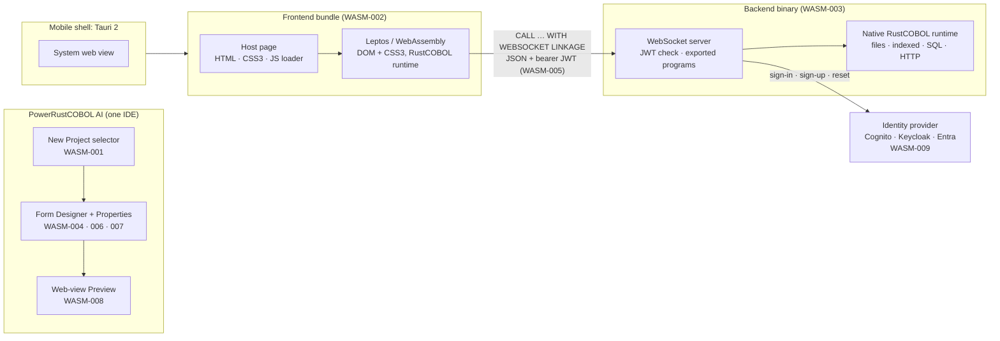
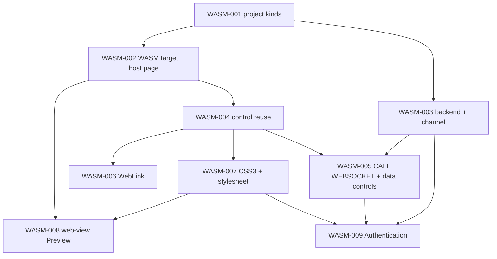

<!--
SPDX-License-Identifier: Apache-2.0
Copyright (c) 2026 Emerson Lopes and PowerRustCOBOL contributors
-->

# The WASM series — specs for the 2.x.x line (WebAssembly applications)

- **Status:** drafts, 2026-10-19. Written on `features-2x`, cut from `2.x.x`.
- **Why a separate numbering.** At the operator's request these specs are numbered **WASM-001, WASM-002, …** and live in `specs/WASM-NNN-<slug>/` instead of the
  `NNN-<slug>` series of `specs/README.md` (which is at 107). The phases are the same (`/specify → /clarify → /plan → /tasks → /analyze → /implement → /docsync`).
  The `/specify` skill and `specs/README.md` still say `NNN`; teach them about `WASM-NNN` before the first `/plan`.
- **The 1.x.x line is official.** Nothing here changes `README.md` or `docs/`; what 2.x.x will say about itself is written in these specs until the operator releases the line (CLAUDE.md, 2026-10-19).

## 1. Where each of the operator's items went

Items that overlap were merged (as asked). Item 12 is §5.

| Operator item | Subject | Spec |
|---|---|---|
| 1 (selector) + 10 | Project kinds, the New Project selector, the WebForms / MobileForms / Backend entries | [WASM-001](WASM-001-project-types-and-ide-entries/spec.md) |
| 1 (stack) + 2 | The WebAssembly build target (Leptos + Tauri 2) and the HTML/CSS3/JS host page | [WASM-002](WASM-002-wasm-build-target-and-host-page/spec.md) |
| 3 | The Backend project and the secure frontend–backend channel (JWT) | [WASM-003](WASM-003-backend-project-and-secure-channel/spec.md) |
| 4 | Reuse of the control catalogue | [WASM-004](WASM-004-control-reuse-on-the-web/spec.md) |
| 5 | `CALL … WITH WEBSOCKET LINKAGE`, the group ⇄ JSON mapping, and the data controls through the backend | [WASM-005](WASM-005-websocket-call-and-remote-data/spec.md) |
| 6 | The WebLink control | [WASM-006](WASM-006-weblink-control/spec.md) |
| 7 + 8 | CSS3 for appearance and the form's default stylesheet | [WASM-007](WASM-007-css3-styling-and-form-stylesheet/spec.md) |
| 9 | The Preview is a web view | [WASM-008](WASM-008-webview-preview/spec.md) |
| 11 (and the obtaining side of 3) | The Authentication control and the identity-provider backend | [WASM-009](WASM-009-authentication-control-and-identity-providers/spec.md) |
| 12 | What is missing | §5 below |

## 2. The shape of the whole (proposed baseline, to be confirmed at `/clarify`)

## 3. Decisions to take first

These open questions change what the other specs say; settle them in this order before any `/plan`.

| # | Decision | Where | Recommendation |
|---|---|---|---|
| D1 | **Execution model:** the interpreter compiled to WebAssembly, or a COBOL → Rust transpiler | WASM-002 Q1 | Interpreter for 2.0; transpiler later. Reverses spec 006's "no interpreter shipped" |
| D2 | **Password typed into our form** vs the provider's hosted sign-in, given Entra and Keycloak guidance | WASM-009 Q1 | Per provider (in-app for Cognito; hosted flow where the provider requires it) — verify the three products first |
| D3 | **CSS precedence:** do properties or the stylesheet win | WASM-007 Q1 | Explicit properties above the stylesheet; `!important` as the escape hatch |
| D4 | **Stateless or stateful backend calls** | WASM-003 Q2 | Fresh `WORKING-STORAGE` per call |
| D5 | **WebSocket only, or also a small HTTPS surface** (refresh cookie, provider redirects, health) | WASM-003 Q3, WASM-009 Q3 | Also HTTPS, kept minimal |
| D6 | **`RETURNING` on local `CALL`** is parsed and ignored today; fix on 1.x.x first | WASM-005 Q2 | Yes — a fix, forward-ported to 2.x.x |
| D7 | **Preview in a separate process** or embedded in the IDE window | WASM-008 Q1 | Separate process and window |
| D8 | **Layout on the web:** CSS layout or the existing solver | WASM-004 Q1 | CSS for Flex/Grid/Flow, absolute for Absolute, parity-checked |

## 4. What carries over from the removed spec 006, and what does not

Spec 006 (*Web projects*, removed 2026-10-14; `git show ccfa3449^:specs/006-web-wasm-projects/spec.md`) asked for the same family of things before the stack changed.

| Spec 006 | In the WASM series |
|---|---|
| A project-type picker, Desktop \| Web, type fixed at creation | Kept and extended (WASM-001); fixed at creation stays the recommendation |
| UI drawn on an egui `<canvas>` | **Replaced** by DOM + CSS3 through Leptos (WASM-002 R5) |
| COBOL transpiled to Rust, no interpreter | **Reopened** as D1 |
| A portable-subset validator at Check/Build | Kept (WASM-002 R3) |
| Indexed files memory-only; data by hand through the REST client | **Replaced** by the backend and `CALL … WITH WEBSOCKET LINKAGE` (WASM-003, WASM-005) |
| Toolchain auto-install (`wasm32` target, `trunk`) | Kept, widened to Tauri and the platform SDKs, with consent (WASM-002 R6) |
| Preview = `trunk serve` + the default browser | **Replaced** by a web view (WASM-008) |
| No in-IDE web debugger | Kept for v1; a debugging spec is proposed (§5) |
| The backend "a separate, future project type" | **Now in scope** (WASM-003) |

## 5. What is missing from the strategy (operator item 12)

Proposed specs, not yet written. Numbers are placeholders. **P1** = the series cannot ship 2.0 without a decision here; **P2** = needed soon after or alongside; **P3** = later.

| Proposed | Spec | Why it is missing today | P |
|---|---|---|---|
| WASM-010 | **The runtime in the browser** — portability, async and responsiveness | The interpreter blocks on channels, uses threads, `std::fs`, `redb` and clocks; a long `PERFORM` freezes a tab. Needs feature gating, an async event loop, a Web Worker decision, a clock/random policy, the `EXEC RUST` policy and a conformance subset run in the browser. D1 depends on it | P1 |
| WASM-011 | **Navigation and multi-form applications** | Spec 049's shell, `OpenFormSync/Async` (modal/modeless), `super::` and child windows have no browser meaning yet; URLs, history, deep links, reload state and multiple instances are unspecified | P1 |
| WASM-012 | **The mobile shell (Tauri 2)** | Android SDK/NDK and Xcode toolchains, emulators/simulators/devices, signing and store packaging, permissions and device features (camera, location, notifications, biometrics, secure storage), lifecycle, back button, safe areas, deep links, updater | P1 |
| WASM-013 | **Security architecture and threat model** | The control specs each carry their own rules; nothing owns CSP, CORS/Origin, XSS (captions, Viewer HTML), CSRF, WebSocket hardening, token storage, supply chain (crates and any JavaScript), the `aws-lc-rs`/`ring` ban, and a review checklist | P1 |
| WASM-014 | **The backend contract and its evolution** | Versioning of exported programs and layouts, a frontend↔backend compatibility handshake, the error model, idempotency and retries, large payloads and streaming, server push (subscriptions), the file-transfer protocol | P1 |
| WASM-015 | **Testing, agent tooling and the knowledge base for 2.0** | Headless-browser conformance, visual regression, end-to-end with a test backend, the MCP tools (`check`, `build`, `render_form`, `run_form`) for web kinds, the System KB, Grace's specialists and the plugin's golden rules | P1 |
| WASM-016 | **Backend deployment and operations** | Containers, cloud targets (PowerCloud already knows AWS), reverse proxy and TLS, scaling and session affinity, secrets, metrics and traces (extending the observability document), health, rolling upgrades, migrations and backups | P2 |
| WASM-017 | **Accessibility and internationalisation of the generated applications** | ARIA, focus order, contrast, RTL, locale formats against numeric-edited `PICTURE` and `DECIMAL-POINT IS COMMA`, IME, UTF-8 against `PIC X`/`PIC N` in fields and JSON, run-time language switching for the *developer's* application | P2 |
| WASM-018 | **The touch and mobile interaction model** | Gestures, long-press as context menu, no hover, minimum touch-target lint, virtual keyboard behaviour, input modes from the `PICTURE` (numeric keyboard), orientation, pull-to-refresh | P2 |
| WASM-019 | **Offline, PWA and caching** | Service worker, offline call queue, IndexedDB policy, bundle update flow and cache busting, installability | P2 |
| WASM-020 | **Data controls beyond v1** | Server-side paging, sorting and filtering for DataGrid, optimistic concurrency on Save, transactions across calls (`COMMIT`/`ROLLBACK` over the channel), record locking with remote clients (needs the cross-process locking fix) | P2 |
| WASM-021 | **Debugging and diagnostics** | COBOL breakpoints in browser runs (the DAP crate over a WebSocket to the IDE), source maps, console and error telemetry, crash reports, correlation ids between frontend and backend logs | P2 |
| WASM-022 | **Distribution and updates** | Hosting and CDN, caching headers, versioned URLs, the Tauri updater, store-submission checklists, what the IDE's `update_check` does when 2.0.0 exists (it would offer it to every 1.x.x IDE), rollback | P2 |
| WASM-023 | **Project conversion and code sharing** | A desktop → web conversion assistant that reports unsupported controls and verbs, `project_upgrade` steps, Common Code and copybooks shared between desktop and web | P2 |
| WASM-024 | **Templates and examples** | *Agentic AI Chatbot (Web)* (the model key stays on the backend), *UserControl (Web)*, web versions of PowerChat, PowerAnalytics, PowerDemo3 and PowerSpatial, *Create from Template…* | P2 |
| WASM-025 | **Documentation, localisation and release plan** | The Developer's Guide 2.0 chapters (held back by the 2026-10-19 ruling), README, regenerating the five translations at the minor, forum announcements batched into the RC, release-candidate steps from 2.0.0 | P2 |
| WASM-026 | **Performance budgets** | Module size and start-up, interpreter throughput in WebAssembly against native (`cobolt-bench`), DataGrid virtualisation, memory, payload sizes | P2 |
| WASM-027 | **Licensing and compliance** | Licences of Leptos, Tauri, the web-view crate and the bundler; map-tile usage policies when a browser fetches tiles; reCAPTCHA terms and consent; store data-safety forms; an SBOM | P2 |
| WASM-028 | **Identity extras** | Social login and federation, passkeys/WebAuthn, an authorisation model (roles, permissions), session and device management, an audit log | P3 |
| WASM-029 | **Plugins, custom controls and external crates on `wasm32`** | `Custom { plugin_id }` has no painter or runtime today; `EXEC RUST` and `add_crate` need a `wasm32` story | P3 |
| WASM-030 | **More web-native controls** | Embedded video and audio, image from a URL, IFrame, a rich-text editor, a camera/QR scanner (mobile) | P3 |
| WASM-031 | **Other form factors** | Android Smartwatch, Apple Watch, TV | P3 |
| WASM-032 | **Designer evolution** | A web-view-based designer, a CSS-aware designer, device frames, component-state preview | P3 |

**Strategic gaps worth saying out loud** (they are not specs of their own, but they bear on every one):

1. **Spec 017's principle — one renderer everywhere — ends for the web kinds.** The Form Designer paints with egui; the web renders with the DOM. Pixel parity between them is a *measured goal* (WASM-004 R11), not a given, and
   the operator should decide how much difference is acceptable (WASM-004 Q6, WASM-007 Q5).
2. **The runtime is the long pole.** Until `cobolt-runtime` builds for `wasm32` and yields instead of blocking, WASM-002's "the same program behaves the same" (R4) cannot be tested at all (WASM-010).
3. **The example forms carry live credentials** in properties. The web build's secret gate (WASM-002 R7, WASM-005 R14) will stop them; the examples need cleaning before they become web templates.

## 6. Housekeeping the series asks for

- **System KB:** every new control, property, method, event, `CALL` phrase and `COBOL::"…"` built-in updates the compiler's documentation tables, `builtins.rs` `BUILTINS` and the regenerated `assets/knowledge/chunked.data` in the same change.
- **Parity of hosts:** a runtime change reaches `rcrun run-form`, embedded child forms, the compiled binary and, now, the browser module.
- **No documentation changes on 2.x.x:** `README.md` and `docs/` stay as published for 1.x.x.
- **Forward-ports:** fixes made on 1.x.x reach 2.x.x by `git cherry-pick -x` (CLAUDE.md); D6 is one such fix.
