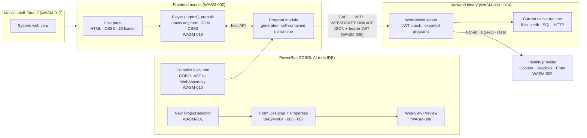
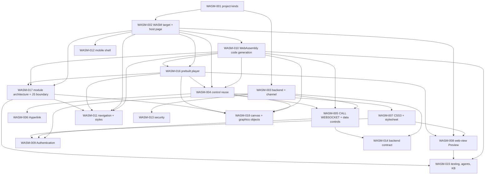

<!--
SPDX-License-Identifier: Apache-2.0
Copyright (c) 2026 Emerson Lopes and PowerRustCOBOL contributors
-->

# The WASM series — specs for the 2.x.x line (WebAssembly applications)

- **Status:** drafts, 2026-10-19. Written on `features-2x`, cut from `2.x.x`. Eighteen specs: WASM-001 to WASM-009 answer the operator's eleven items; WASM-010 to WASM-015 are the first six of the
  "missing specs" (the operator accepted them the same day); WASM-016 specifies the player, which the operator's decision on the module layout created; WASM-017 takes in the operator's guidance of 2026-10-20 on modular loading, the memory model, the JavaScript boundary and the build, adapted to what browsers run today. Further proposals are in §5.
- **Why a separate numbering.** At the operator's request these specs are numbered **WASM-001, WASM-002, …** and live in `specs/WASM-NNN-<slug>/` instead of the
  `NNN-<slug>` series of `specs/README.md` (which is at 107). The phases are the same (`/specify → /clarify → /plan → /tasks → /analyze → /implement → /docsync`).
  The `/specify` skill and `specs/README.md` still say `NNN`; teach them about `WASM-NNN` before the first `/plan`.
- **The 1.x.x line is official.** Nothing here changes `README.md` or `docs/`; what 2.x.x will say about itself is written in these specs until the operator releases the line (CLAUDE.md, 2026-10-19).
- **Rulings that the specs now carry (2026-10-19 and 2026-10-20):** the compiler **generates WebAssembly directly** — no interpreter, no runtime in the browser, the final code self-contained; an application is a **prebuilt Leptos player** that draws any form plus **one generated program module for the whole project**, so a Web build is *emit the module, copy the player* with no Rust toolchain; no `redb`
  or disk in the browser; **threads and Rayon are in** (2026-10-20, reversing the ruling of 2026-10-19), used when the page is cross-origin isolated and never required; **multi-memory is the default** for the program module, with a single-memory variant for iOS; the Component Model and ES-module integration are **not kept** because Chrome support is not established;
  the **backend keeps the current runtime** (with `redb`, `std::fs`, threads and what the new functions need); a **single-page application is the default, standalone forms are the alternative**; **Canvas 2D, Canvas 3D and graphics objects** join every platform (WASM-018); and `CALL … RETURNING` being ignored was **a fix on 1.x.x, forward-ported to 2.x.x** (done).

## 1. Where each of the operator's items went

Items that overlap were merged (as asked). Item 12 is §5.

| Operator item | Subject | Spec |
|---|---|---|
| 1 (selector) + 10 | Project kinds, the New Project selector, the WebForms / MobileForms / Backend entries | [WASM-001](WASM-001-project-types-and-ide-entries/spec.md) |
| 1 (stack) + 2 | The WebAssembly build target (Leptos + Tauri 2) and the HTML/CSS3/JS host page | [WASM-002](WASM-002-wasm-build-target-and-host-page/spec.md) |
| 3 | The Backend project and the secure frontend–backend channel (JWT) | [WASM-003](WASM-003-backend-project-and-secure-channel/spec.md) |
| 4 | Reuse of the control catalogue | [WASM-004](WASM-004-control-reuse-on-the-web/spec.md) |
| 5 | `CALL … WITH WEBSOCKET LINKAGE`, the group ⇄ JSON mapping, and the data controls through the backend | [WASM-005](WASM-005-websocket-call-and-remote-data/spec.md) |
| 6 | The Hyperlink control | [WASM-006](WASM-006-weblink-control/spec.md) |
| 7 + 8 | CSS3 for appearance and the form's default stylesheet | [WASM-007](WASM-007-css3-styling-and-form-stylesheet/spec.md) |
| 9 | The Preview is a web view | [WASM-008](WASM-008-webview-preview/spec.md) |
| 11 (and the obtaining side of 3) | The Authentication control and the identity-provider backend | [WASM-009](WASM-009-authentication-control-and-identity-providers/spec.md) |
| 12 → accepted | WebAssembly code generation: the compiler emits a self-contained module | [WASM-010](WASM-010-webassembly-code-generation/spec.md) |
| 12 → accepted | Navigation and application styles: SPA by default, standalone forms | [WASM-011](WASM-011-navigation-and-application-styles/spec.md) |
| 12 → accepted | The mobile shell (Tauri 2) | [WASM-012](WASM-012-mobile-shell-tauri-2/spec.md) |
| 12 → accepted | Security architecture and threat model | [WASM-013](WASM-013-security-architecture/spec.md) |
| 12 → accepted | The backend contract and its evolution | [WASM-014](WASM-014-backend-contract-and-evolution/spec.md) |
| 12 → accepted | Testing, agent tooling and the knowledge base for the web kinds | [WASM-015](WASM-015-testing-agent-tooling-and-knowledge/spec.md) |
| Decision on the module layout | The player: a prebuilt Leptos form engine, the second `.wasm` | [WASM-016](WASM-016-prebuilt-player/spec.md) |
| Decision of 2026-10-20 | Canvas 2D, Canvas 3D and graphics objects (games, charts, image manipulation) on every platform | [WASM-018](WASM-018-canvas-and-graphics-objects/spec.md) |
| Guidance of 2026-10-20 | Module architecture, memory model, threads and the JavaScript boundary: modules per form loaded and discarded on demand, fixed memory, coarse-grained host API, feature baseline, build profile | [WASM-017](WASM-017-module-architecture-and-js-boundary/spec.md) |
| Form layers and the Non-Visuals tab (spec 091), adapted to HTML | Stacking, visibility, hit testing, clipping, tab order and run-time properties of layers on the web | [WASM-004](WASM-004-control-reuse-on-the-web/spec.md) R13–R24, with WASM-007, 010, 011, 015 and 016 and ABI amendment A9 |
| 12 | The rest of what is missing | §5 below |

## 2. The shape of the whole (proposed baseline, to be confirmed at `/clarify`)

## 3. Decisions

| # | Decision | Where | Status |
|---|---|---|---|
| D1 | **Execution model.** The compiler generates WebAssembly; no interpreter, no runtime in the browser; the final code carries what it needs; no `redb` or disk in the browser; the backend keeps the current runtime | WASM-002, WASM-003, WASM-010 | **Decided** (operator, 2026-10-19; threads were taken out of the "no" list on 2026-10-20, D16). Reverses spec 006's *via Rust*, keeps its *no interpreter* |
| D1b | **Directly or through Rust.** The operator asked whether WebAssembly can be generated directly; the answer is yes (WASM-010 §1) | WASM-010 Q1 | **Decided and confirmed** (operator, 2026-10-20: *keep direct generation*, when offered the alternatives of a COBOL → Rust transpiler and an interpreter compiled to `wasm32`) |
| D6 | **`RETURNING` on local `CALL`** is parsed and ignored today | WASM-005 Q2 | **Decided and done:** fix `8a15f00d` (1.91.219) on branch `claude/fixes-call-returning-18dea7`, forwarded as `afe22c51` (2.0.1) on 2.x.x. Merging the fix into `main` waits for the operator |
| D9 | **Application style:** SPA by default, standalone forms as the alternative | WASM-011 | **Decided** (operator, 2026-10-19); details are WASM-011's questions |
| D10 | **The player:** **two `.wasm` files** — a prebuilt Leptos player that draws any form, plus the generated COBOL module; a Web build is *emit the module, copy the player*, with no Rust toolchain. Cost accepted: no per-project Leptos code, no `Custom` plug-in controls on the web in v1 | WASM-002 Q7, WASM-010 Q10, WASM-016 | **Decided** (operator, 2026-10-19) |
| D11 | **Data-model parity:** the generator lays data out in real bytes while the interpreter keeps values; where they differ the standard and NIST decide, and the interpreter's bug is a 1.x.x fix | WASM-010 Q5, R16 | Recommended as stated. **Open** |
| D2 | **Password typed into our form** vs the provider's hosted sign-in, given Entra and Keycloak guidance | WASM-009 Q1, R8b | **Decided: the flow is chosen per provider** (operator, 2026-10-19). Still to do: verify each product's capabilities and fix each adapter's default |
| D3 | **CSS precedence:** do properties or the stylesheet win | WASM-007 Q1, R8 | **Decided: CSS wins** (operator, 2026-10-19) |
| D12 | **Templates creatable in 2.0:** Web + Android + iOS, no watch; the list as written in WASM-001 | WASM-001 Q3, R5 | **Decided** (operator, 2026-10-19) |
| D13 | **The Backend is part of every Web or Mobile project** (a `backend/` folder and a tree entry), **not a project kind**; no backend-only template | WASM-001 R1, WASM-003 Q1 | **Decided** (operator, 2026-10-20) |
| D15 | **Architecture of the artefacts** (the guidance of 2026-10-20): **one program module for the whole project**, with each form instance's data in a region that is released with the form; a data memory fixed at compile time with a transport arena; a coarse-grained host API; `.free()`, the size-first profile and `wasm-opt` for the **player only**; `wasm-pack` not used | WASM-017 | **Decided** (operator, 2026-10-20: *use the alternative* of Q1, one module per project) |
| D16 | **Threads and Rayon are in.** Rayon in the player and the graphics objects; the program module in a Worker when the page is cross-origin isolated; the **plain** player and the main thread as a full fallback. Costs stated: cross-origin isolation (`COOP`/`COEP`) and a **pinned nightly** with `build-std` for the threaded player — threads were never missing from browsers or from Wasm 3.0's scope; the operator's premise that 3.0 brought them is not what the sources say | WASM-017 R19, WASM-002 R20, WASM-013 R15b, WASM-016 R13c | **Decided** (operator, 2026-10-20); supersedes the ruling of 2026-10-19 |
| D17 | **Multi-memory is the default** for the program module (the transport arena is memory 1) with a **single-memory variant** always for iOS and for any matrix that includes Safari (the Web bundle then carries both and the loader probes); the player, built by `rustc`, never uses a second memory | WASM-017 R8–R9 | **Decided** (operator, 2026-10-20) |
| D18 | **Component Model and ES-module integration:** kept only if Chrome supports them — **not established** (source-phase imports are Stage 3, `jco` calls itself experimental, Chrome's status page was unreachable) — so **not kept**: ES-module integration is optional and feature-detected, the Component Model is not used; revisit on native support | WASM-017 R3, R6, Q7 | **Decided** by the operator's own condition (2026-10-20) |
| D19 | **Canvas 2D, Canvas 3D and five client objects** (ImageBuffer, Plot, Scene3D, Physics2D, Physics3D) on every platform, from 100 %-Rust crates: `tiny-skia`, `rustybuzz`+`skrifa`, `image`+`imageproc`, `plotters`, `wgpu`+`glam`+`gltf`, `rapier`, `rayon`; one pure-Rust crate, `cobolt-graphics`, behind a display list | WASM-018 | **Decided** (operator, 2026-10-20); the crate versions are fixed at `/plan` |
| D20 | **Form layers on the web (spec 091):** the desktop rules carry over to web forms unchanged; on the web a layer is a stacking context, hit testing is the browser's, a hidden layer is `inert`, every layer starts hidden, and the non-visual set is one predicate | WASM-004 R13–R24, WASM-016 R18–R19, WASM-ABI-v1 A9 | **Proposed.** The desktop rules are decided by spec 091 (approved 2026-10-09); the HTML realisation is to confirm at `/clarify` |
| D14 | **Markup is never inserted as an HTML string:** the Viewer builds DOM nodes from an allow-listed, parsed tree; and Hyperlink does not offer `ping` in v1 | WASM-013 R5, WASM-016 R15, WASM-006 R3 | **Decided** (operator, 2026-10-20) |
| D4 | **Stateless or stateful backend calls** | WASM-003 Q2 | Fresh `WORKING-STORAGE` per call. **Open** |
| D5 | **WebSocket only, or also a small HTTPS surface** (refresh cookie, provider redirects, health, downloads) | WASM-003 Q3, WASM-009 Q3, WASM-014 Q4 | Also HTTPS, kept minimal. **Open** |
| D7 | **Preview in a separate process** or embedded in the IDE window | WASM-008 Q1 | Separate process and window. **Open** |
| D8 | **Layout on the web:** CSS layout or the existing solver | WASM-004 Q1, R8 | **Decided: CSS layout** (operator, 2026-10-19), parity-checked against the desktop |
| D21 | **The frontend↔backend channel is asymmetrically encrypted, and a broken connection is retried behind a blocking modal** (operator, 2026-10-24: "a side note that must permeate all WASM specs"). The key pair is **generated when the application starts**. When the connection breaks, the frontend **retries** with a timeout of **10 s, raised by 10 s on each retry, for at most 3 cycles** (10 s, 20 s, 30 s); after the third it **gives up and raises an exception**. While it retries it **blocks all mouse and keyboard input** and shows a **modal** with an **animation** — the screen (the desktop, or the device on a phone) trying to reach the server, a **cloud between them** — on a left-to-right multi-stop gradient **red → dark red → crimson → black**, foreground **white**; the modal **appears when the connection breaks and disappears when it is re-established**. Where each spec carries it: WASM-003 R24–R26 (the channel and the retry policy), WASM-016 R20–R21 and WASM-012 R15 (the modal on the web and on a device), WASM-005 R18 (a call in flight), WASM-014 R18 (the key exchange in the handshake), WASM-013 R17 (the threat model); every other spec names it in its §6 | WASM-003, 005, 012, 013, 014, 016; every §6 | **Decided** (operator, 2026-10-24) |

## 4. What carries over from the removed spec 006, and what does not

Spec 006 (*Web projects*, removed 2026-10-14; `git show ccfa3449^:specs/006-web-wasm-projects/spec.md`) asked for the same family of things before the stack changed.

| Spec 006 | In the WASM series |
|---|---|
| A project-type picker, Desktop \| Web, type fixed at creation | Kept and extended (WASM-001); fixed at creation stays the recommendation |
| UI drawn on an egui `<canvas>` | **Replaced** by DOM + CSS3 through Leptos (WASM-002 R5) |
| COBOL transpiled to Rust, no interpreter shipped | **Half kept:** no interpreter and no runtime in the browser; **no Rust step either** — the compiler emits WebAssembly directly (WASM-010, D1) |
| A portable-subset validator at Check/Build | Kept (WASM-002 R3, WASM-010 R8) |
| Indexed files memory-only; data by hand through the REST client | **Replaced** by the backend and `CALL … WITH WEBSOCKET LINKAGE` (WASM-003, WASM-005); in-memory indexed files in the browser are out of v1 (WASM-010 Q8) |
| Toolchain auto-install (`wasm32` target, `trunk`) | **Dropped for Web:** a Web build needs no Rust toolchain (prebuilt player, directly emitted module; WASM-002 R6, WASM-016); Mobile needs Tauri and the platform SDKs (WASM-012) |
| Preview = `trunk serve` + the default browser | **Replaced** by a web view (WASM-008) |
| No in-IDE web debugger | Kept for v1; a debugging spec is proposed (§5); the module carries a line table (WASM-010 R14) |
| The backend "a separate, future project type" | **Now in scope** (WASM-003, WASM-014) |

## 5. What else is missing from the strategy (operator item 12)

The six **P1** specs of the first list — the generator, navigation, the mobile shell, security, the backend contract, testing/agents/KB — are written (WASM-010 to WASM-015), and the player took WASM-016, so the numbers
below start at 019 (WASM-017 is the architecture spec, WASM-018 the graphics spec). Still **proposed, not written**, with placeholder numbers:
**P2** = needed soon after or alongside; **P3** = later.

| Proposed | Spec | Why it is missing today | P |
|---|---|---|---|
| WASM-019 | **Backend deployment and operations** | Containers, cloud targets (PowerCloud already knows AWS), reverse proxy and TLS, scaling and session affinity, secrets, metrics and traces (extending the observability document), health, rolling upgrades, migrations and backups | P2 |
| WASM-020 | **Accessibility and internationalisation of the generated applications** | ARIA, focus order, contrast, RTL, locale formats against numeric-edited `PICTURE` and `DECIMAL-POINT IS COMMA`, IME, UTF-8 against `PIC X`/`PIC N` in fields and JSON, run-time language switching for the *developer's* application | P2 |
| WASM-021 | **The touch and mobile interaction model** | Gestures, long-press as context menu, no hover, minimum touch-target lint, virtual keyboard behaviour, input modes from the `PICTURE` (numeric keyboard), orientation, pull-to-refresh | P2 |
| WASM-022 | **Offline, PWA and caching** | Service worker, offline call queue, IndexedDB policy, bundle update flow and cache busting, installability | P2 |
| WASM-023 | **Data controls beyond v1** | Server-side paging, sorting and filtering for DataGrid, optimistic concurrency on Save, transactions across calls (`COMMIT`/`ROLLBACK` over the channel), record locking with remote clients (needs the cross-process locking fix) | P2 |
| WASM-024 | **Debugging and diagnostics** | COBOL breakpoints in browser runs (the DAP crate over a WebSocket to the IDE), source maps beyond the line table, console and error telemetry, crash reports, correlation ids between frontend and backend logs | P2 |
| WASM-025 | **Distribution and updates** | Hosting and CDN, caching headers, versioned URLs, the Tauri updater, store-submission checklists, what the IDE's `update_check` does when 2.0.0 exists (it would offer it to every 1.x.x IDE), rollback | P2 |
| WASM-026 | **Project conversion and code sharing** | A desktop → web conversion assistant that reports unsupported controls and verbs, `project_upgrade` steps, Common Code and copybooks shared between desktop and web | P2 |
| WASM-027 | **Templates and examples** | *Agentic AI Chatbot (Web)* (the model key stays on the backend), *UserControl (Web)*, web versions of PowerChat, PowerAnalytics, PowerDemo3 and PowerSpatial, *Create from Template…* | P2 |
| WASM-028 | **Documentation, localisation and release plan** | The Developer's Guide 2.0 chapters (held back by the 2026-10-19 ruling), README, regenerating the five translations at the minor, forum announcements batched into the RC, release-candidate steps from 2.0.0 | P2 |
| WASM-029 | **Performance budgets** | The numbers that WASM-017 makes measurable: module size and start-up, generated-module throughput against the interpreter (`cobolt-bench`), DataGrid virtualisation, memory, payload sizes | P2 |
| WASM-030 | **Licensing and compliance** | Licences of Leptos, Tauri, the web-view crate, the emitter and the bundler; map-tile usage policies when a browser fetches tiles; reCAPTCHA terms and consent; store data-safety forms; data-protection law | P2 |
| WASM-031 | **Identity extras** | Social login and federation, passkeys/WebAuthn, an authorisation model (roles, permissions), session and device management, an audit log | P3 |
| WASM-032 | **Plugins, custom controls and external crates on `wasm32`** | `Custom { plugin_id }` has no painter or runtime today; `EXEC RUST` is refused in the browser (WASM-002 Q4) and needs a story through the backend | P3 |
| WASM-033 | **More web-native controls** | Embedded video and audio, image from a URL, IFrame, a rich-text editor, a camera/QR scanner (mobile) | P3 |
| WASM-034 | **Other form factors** | Android Smartwatch, Apple Watch, TV | P3 |
| WASM-035 | **Designer evolution** | A web-view-based designer, a CSS-aware designer, device frames, component-state preview | P3 |

**Strategic gaps worth saying out loud** (they are not specs of their own, but they bear on every one):

1. **Spec 017's principle — one renderer everywhere — ends for the web kinds.** The Form Designer paints with egui; the web renders with the DOM. Pixel parity between them is a *measured goal* (WASM-004 R11), not a given, and
   the operator should decide how much difference is acceptable (WASM-004 Q6, WASM-007 Q5).
2. **One language, two engines.** The browser runs generated WebAssembly; the backend and the desktop run the interpreter. Keeping them equal is a measured gate (WASM-010 R16, WASM-015 R6), and every divergence is a bug in one of
   them — a 1.x.x fix when it is the interpreter's.
3. **The compiler back end is the long pole.** WASM-010's phase A (layout, arithmetic, control flow, the host API) has to exist before most acceptance criteria of the other specs can run.
4. **Keys in forms.** A form has properties where a key or connection string can be typed (`AgentAPIKey`, `ConnectionString`); the committed examples checked on 2026-10-19 keep the key properties empty, but the web Build's secret
   scan (WASM-002 R7, WASM-013 R7) is what keeps it that way.

## 6. Housekeeping the series asks for

- **System KB:** every new control, property, method, event, `CALL` phrase and `COBOL::"…"` built-in updates the compiler's documentation tables, `builtins.rs` `BUILTINS` and the regenerated `assets/knowledge/chunked.data` in the same change.
- **Parity of hosts:** a runtime fix reaches `rcrun run-form`, embedded child forms, the compiled binary and the **backend**, which all run the interpreter; the browser module has no interpreter and is held equal by conformance
  (WASM-010 R16, R17).
- **No documentation changes on 2.x.x:** `README.md` and `docs/` stay as published for 1.x.x.
- **Forward-ports:** fixes made on 1.x.x reach 2.x.x by `git cherry-pick -x` (CLAUDE.md); D6 is one such fix, and any interpreter bug the conformance runs find (WASM-010 R16c) will be others.
