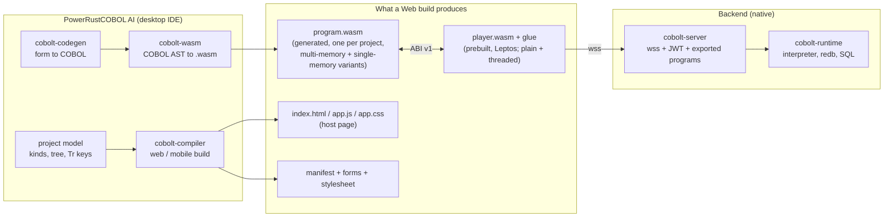
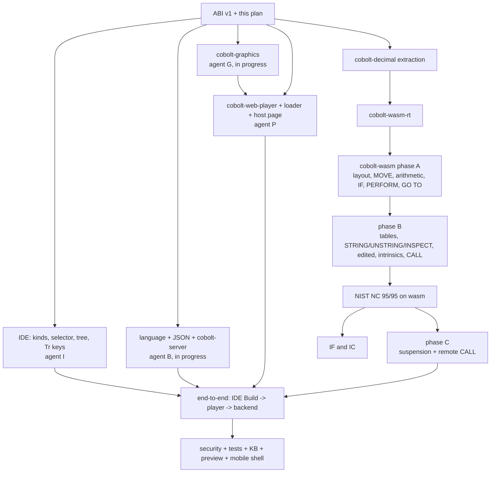

<!--
SPDX-License-Identifier: Apache-2.0
Copyright (c) 2026 Emerson Lopes and PowerRustCOBOL contributors
-->

# WASM series — master plan (the `/plan` of WASM-001 … WASM-018)

- **Status:** plan, drafted 2026-10-20 from the specs and from a read of the code (cited below); every claim about existing code was checked in the tree on that date.
- **Author:** Anthropic Claude Codex Agent
- **Companions:** `specs/WASM-INDEX.md` (decisions D1–D19), `specs/WASM-PROGRESS.md` (the ledger — the only place that says what is *done*), `specs/WASM-ABI-v1.md` (the contract between the three artefacts).
- **Operator's instruction (2026-10-20):** plan, task and implement; when a question arises *do what is right in the long term, not what is less risky or easier*; *do not let anything be implemented on a later occasion*.

This file decides **structure, order and risk**. Per-spec detail lives in each spec's own `plan.md` and `tasks.md`, which are written as the spec is taken up (not before: a plan written ahead of the code it describes is a guess, and CLAUDE.md says do not guess).

## 1. The four artefacts and who owns them

| Artefact | Crate(s) | Built | Specs |
|---|---|---|---|
| **Program module** | `cobolt-wasm` (generator, mini-linker), `cobolt-wasm-rt` (support routines in Rust, compiled to `wasm32` and shipped as a blob), `cobolt-decimal` (the exact-decimal kernel shared with the interpreter) | by the IDE's Build, in seconds, **no Rust toolchain at the developer's machine** | 010, 017, 005 |
| **Player** | `cobolt-web-player` (Leptos) + `cobolt-graphics` | **once, by the product's build**, shipped in the IDE; plain and threaded variants | 016, 004, 006, 007, 011, 018 |
| **Host page + loader** | `cobolt-compiler` templates (HTML/JS/CSS) | per build | 002, 011, 013 |
| **Backend** | `cobolt-server` | native, `cargo build` of the backend part of the project | 003, 005, 014, 009 |
| **IDE integration** | `cobolt-ide`, `cobolt-codegen`, `cobolt-project-tools` | with the IDE | 001, 008, 015, 012 |

## 2. Decisions this plan takes (each is revisitable; each is recorded with its reason)

### P1 — The routines are written once, in Rust, and linked statically (WASM-010 Q3 → (a))

`cobolt-wasm-rt` is a `#![no_std]` crate compiled to `wasm32-unknown-unknown` by `cargo run -p cobolt-wasm --example build_rt`; the result is committed as `crates/cobolt-wasm/assets/rt.wasm` with a sidecar hash of the rt sources and a test that fails when the sources changed and the blob did not (the pattern of `assets/knowledge/chunked.data` and its freshness test). At Build time the **mini-linker** copies into the generated module only the rt functions reachable from the generated code (tree-shaking), renumbering functions, types and globals, and merges the rt's static data into the module's data segments. **Reason:** the alternative — emitting each routine instruction by instruction from the compiler — is a second implementation of 128-bit decimal arithmetic written in a bytecode assembler; "right in the long term" is one source.

### P2 — The decimal kernel is extracted to a `no_std` crate, `cobolt-decimal`, which the interpreter re-exports

`cobolt-runtime/src/value.rs` holds `CobolNumeric` (add/sub/mul/div/round/truncate/compare, `umul128`, `div256_by10`) — pure integer code, but written against `std::fmt`/`String`. On **2.x.x only**, the arithmetic moves to `cobolt-decimal` (no `std`, no `alloc`), and `value.rs` re-exports it and keeps `CobolValue` and the `Display` glue. The interpreter's behaviour is unchanged (proved by its existing tests and the NIST baselines); the generated module's behaviour is the **same code**. **Cost stated:** a 1.x.x fix to `value.rs` forward-ports by hand rather than by `cherry-pick`; `value.rs` last changed for the `div` fix and is rarely touched. The forward-port note in CLAUDE.md names the file.

### P3 — Code shape: a trampoline of block functions over an explicit stack

Suspension (a remote `CALL`, a dialog, a wait, a yield) must return to the host and resume later, in every browser. Therefore **no COBOL control transfer uses the WebAssembly call stack**:

- The program is lowered to a **control-flow graph of blocks**. Each block is one WebAssembly function `(func (result i32))` returning the **next block id** or a reserved code (`SUSPEND`, `END`, `ERROR`).
- A dispatcher `step(task)` runs `loop { id = table[id]() ; budget -= 1 ; if id is reserved or budget < 0 { break } }` using `call_indirect`. A **task** (one event handler run, one `CALL` chain) keeps its `pc`, its `PERFORM` stack and its `CALL` stack **in linear memory**; resuming is calling `step` again.
- A construct with no call-out inside (no out-of-line `PERFORM`, no `CALL`, no waiting statement, and no loop) stays **structured inside one block**; a loop is a back-edge through the dispatcher so that a long loop reaches the budget check and can yield (WASM-010 R9). Loops whose body is call-out-free run one iteration per dispatch.
- Inline `PERFORM … UNTIL` etc. are lowered to header/body/step blocks; `GO TO … DEPENDING` is a `br_table`; `ALTER` is a patchable slot in a table in memory (the interpreter's `alter_map` is the semantics); `NEXT SENTENCE` is a jump to the sentence's end block.

**Reason:** a single giant `loop`/`br_table` function is the cheaper generator but tiers up badly in V8 and cannot be debugged; Asyncify post-processing adds a Binaryen dependency and slows everything; JSPI is not in every browser (WASM-010 Q4 already chose explicit state).

### P4 — Expressions and data access go through register-machine calls into the rt

Each data item has a **descriptor** (offset, usage, digits, scale, sign mode, length) in a constant table. Arithmetic, comparisons and numeric moves are sequences of calls `rt_ld(desc)`, `rt_ldc(const)`, `rt_add`, …, `rt_st(desc, flags)` over a small **register stack** that lives in a reserved scratch area (never across a suspension). `CobolValue::{Numeric,Float}` semantics, `ROUNDED` modes, `SIZE ERROR` and the 31-digit cap come from `cobolt-decimal`; the byte codecs (DISPLAY with each sign mode, COMP/COMP-5 big-endian binary, COMP-3 packed, COMP-1/2 floats, national) are new rt code with their own golden vectors, because the interpreter keeps values, not bytes (WASM-010 §1 "What exists today"). Alphanumeric `MOVE`, comparison, `INITIALIZE` use `memory.copy`/`memory.fill` and small rt loops.

### P5 — The oracle is the interpreter, then the standard

Where the two engines differ, **the NIST suite and the standard decide** (WASM-010 Q5). A difference is classified in `specs/WASM-PARITY.md` (created with the first one): *generator bug* (fix here), *interpreter bug* (fix on `main` as a 1.x.x fix, forward-port with 2.x.x numbering), or *accepted divergence* (never: R16(c) forbids documenting a difference away — the entry then records the standard's text and the open bug). The differential harness (`cobolt-wasm/tests/parity.rs`) runs each program on both engines and diffs the output; it is the daily instrument, the NIST run is the gate.

### P6 — Conformance mode (how NIST can run at all without files in the product)

The NIST programs write their report to a sequential **print file**. The product's browser build refuses file verbs (WASM-010 non-goal). For the gate only, the generator has a **`--conformance`** flag that accepts **sequential and line-sequential file verbs** and lowers them to four extra host imports (`file_open/read/write/close`) implemented by the test host over an in-memory file system. The flag is recorded in the manifest; the player and the loader **refuse** a conformance module; the Build of a Web/Mobile project never sets it. Everything that is not file I/O is the same code in both modes, which is why the gate is meaningful. *(This is a deliberate, narrow widening of the subset, stated in the spec's ledger entry; it is not a hidden second product.)*

### P7 — Engines for testing

`wasmi` (pure Rust, interpreter engine) for the unit and conformance runs — fast to start, deterministic, no JIT; `node` (present on the machine) with the real V8 for the browser-faithful runs of the multi-memory variant; Chrome/Safari through the existing browser tools for the player runs (WASM-015). `wasmi` passes the dependency guards as a dev-dependency of `cobolt-wasm` only.

### P8 — Order

GOLDEN RULE #9 applies to the generator: **NC (Nucleus) is finished on both axes before IF and IC**. Everything else proceeds in parallel where the files are disjoint.

## 3. Work breakdown (what is built where, in what order)

| # | Work | Specs | Crates / files | Depends on | Owner |
|---|---|---|---|---|---|
| W0 | ABI v1 document; this plan | 002, 010, 016, 017 | `specs/WASM-ABI-v1.md`, `specs/WASM-PLAN.md` | specs | me |
| W1 | `cobolt-graphics` (display list, text, ImageBuffer, Plot, Scene3D, Physics, handles, limits, dependency guard) | 018 | `crates/cobolt-graphics` | none | agent G (running) |
| W2 | `CALL … WITH WEBSOCKET LINKAGE`; group⇄JSON + golden vectors; `cobolt-server`; contract; identity backend | 005, 003, 014, 009 | parser, ast, semantic, runtime, `crates/cobolt-server` | none | agent B (running) |
| W3 | `cobolt-decimal` extraction; `cobolt-wasm-rt`; `cobolt-wasm` (layout, lowering, linker, host-API glue); parity harness; NC → IF → IC | 010, 017 | three new crates | W0 | me |
| W4 | Player: `cobolt-web-player` (Leptos), loader JS, host page, variants, Viewer builds nodes, controls of classes A–E, CSS, navigation, Hyperlink, Authentication control (front half), Canvas controls bound to W1; form layers (WASM-004 R13–R24) | 016, 002, 004, 006, 007, 011, 009, 018 | `crates/cobolt-web-player`, templates | W0, W1 (for canvas) | agent P |
| W5 | IDE: project kinds and selector, tree entries (WebForms/MobileForms/Backend), Tr keys ×6, Build/Run/Preview wiring, web-view preview | 001, 008, 015 | `cobolt-ide`, `cobolt-project-tools`, `cobolt-compiler` | W3 (call), W4 (artefact) | agent I, then me |
| W6 | Security gates and tests matrix, agent tooling, System KB tables and `chunked.data` | 013, 015 | tests, compiler doc tables | W3–W5 | me |
| W7 | Mobile shell (Tauri 2) | 012 | `crates/…/mobile`, templates | W4 | me |
| W8 | Parity ledger, fixes forward-ported to 1.x.x where the interpreter is wrong | 010 R16 | `specs/WASM-PARITY.md`, `main` | W3 | me |

## 4. Risks, stated

1. **The generator is the long pole.** NC is 95 programs, 4614 assertions; each construct the interpreter handles by a rule the standard states differently is a decision. Mitigation: differential harness first (P5), phase A small, ledger per phase.
2. **Byte-accurate layout vs the value-based interpreter** (R3): `REDEFINES`, group moves over `COMP-3`, overlapping `MOVE`. The generator follows the standard; the NIST pass is the referee.
3. **A mini-linker for a Rust-compiled module** is new infrastructure (stack-pointer global, data segments, indirect-call table, name section). Mitigation: build the rt with `-C panic=abort`, no `alloc`, no function pointers, no `static mut` aliasing; test the linker with a tree-shaking census (size per phase) and with `wasm-tools validate` on every output.
4. **Toolchain.** `trunk 0.22` needs rustc 1.96.1 (installed 1.95): the plan uses `trunk 0.21.14` or `wasm-bindgen` directly; the threaded player needs a pinned nightly with `rust-src` (not installed yet; installed when W4 reaches the threaded variant).
5. **`lopdf` blocks `cobolt-forms` on `wasm32`** (used by the Viewer's PDF code): the player needs the form model; the PDF code is gated off for `wasm32` (a cargo feature, default on natively) — a change to `cobolt-forms` that W4 makes and tests on both targets.
6. **Disk.** ~76 GB free; each worktree builds its own `target/`. Agents clone a target with `cp -cRp` where one exists; no `cargo clean` of the shared one.
7. **Parallel agents merging.** Each agent owns disjoint crates (table above); integration is by merge into `features-2x` **by me**, resolving `Cargo.toml`/`Cargo.lock` and the version/CHANGELOG by hand (the lesson of the earlier rebase).

## 5. Definition of done for the series

The series is done when the ledger (`WASM-PROGRESS.md`) shows every spec at **V** with named evidence, and these end-to-end facts hold, each with a recorded run: (1) a Web project built in the IDE's Build path opens in a browser and in the IDE's web-view preview, its event handlers run in the generated module, its controls are drawn by the player; (2) a remote `CALL` reaches an authenticated backend over `wss`, suspends the module, resumes it with the answer; (3) NC, IF and IC run on the generated module with 0 failures; (4) the threaded and plain players and both module variants pass the matrix of WASM-017 R20; (5) the Mobile shells run the same bundle (Android and iOS toolchains permitting on this machine — what cannot be run here is listed in the ledger with the exact command to run it, never claimed).
